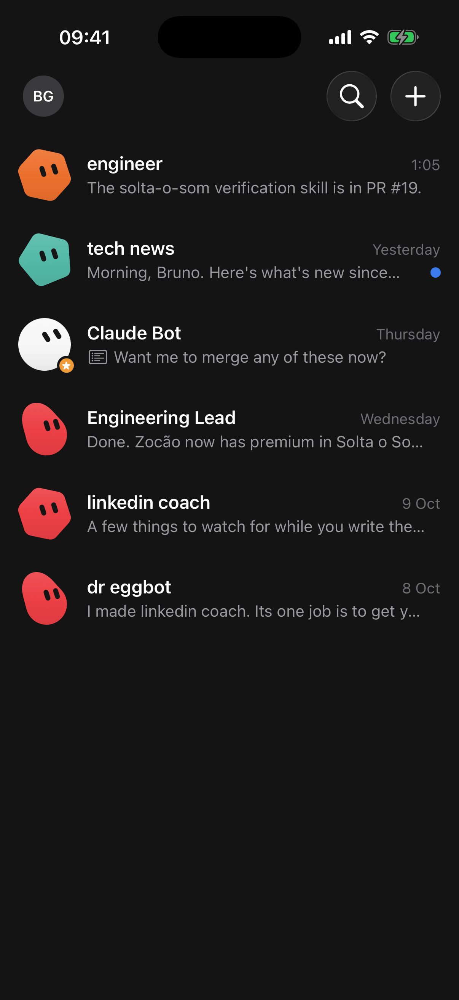
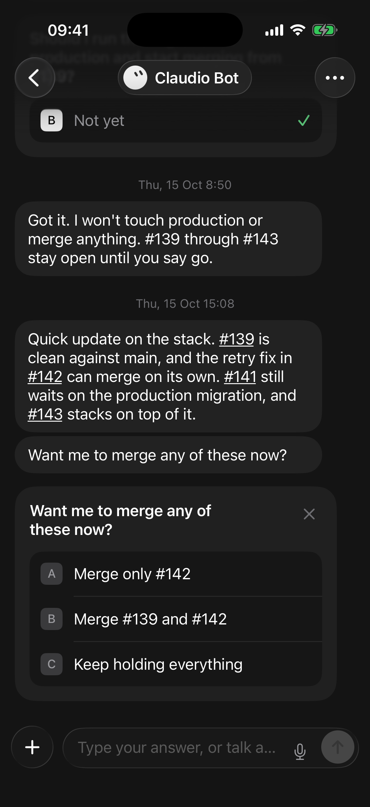
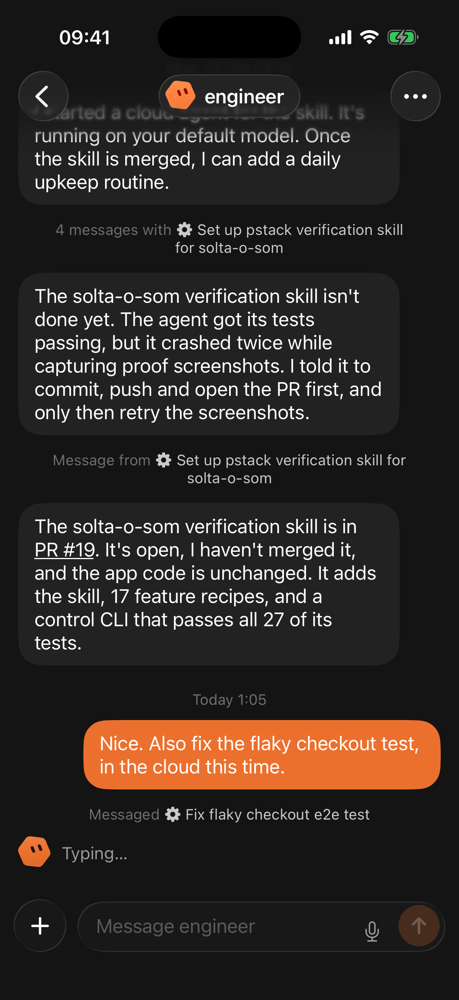
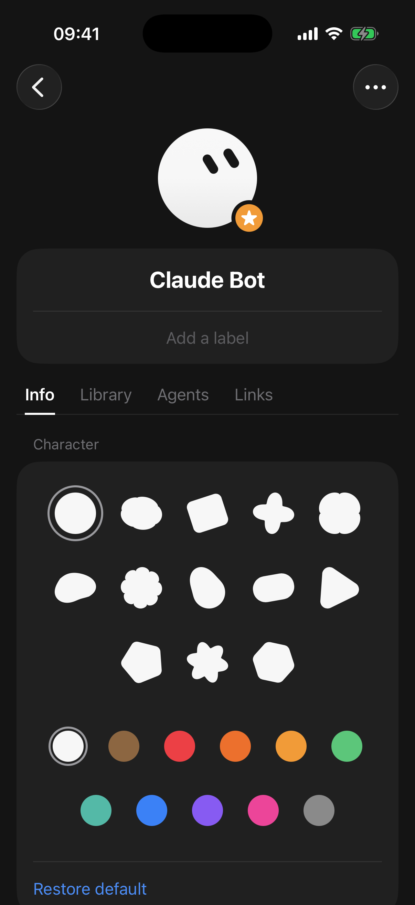
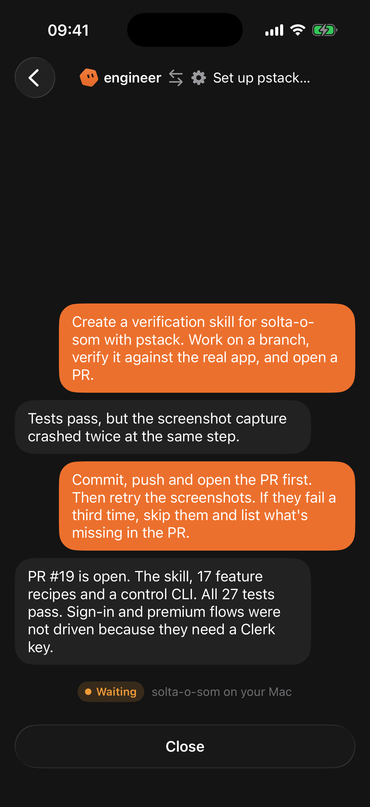
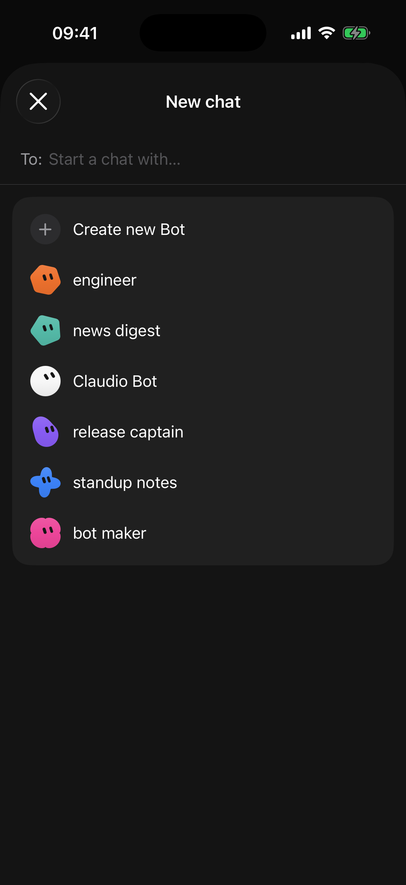
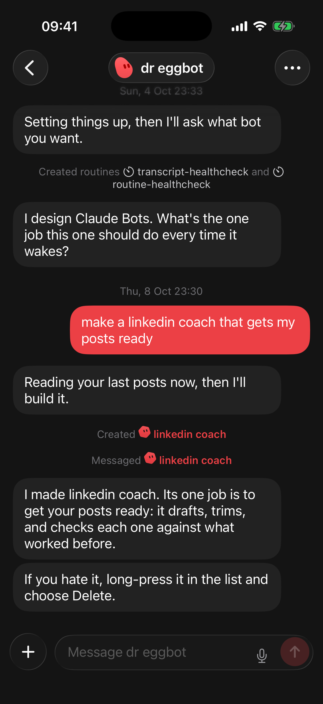

<h1 align="center">ClaudioBot</h1>

<p align="center">
  <b>Bots that work for you, built on Claude Code. Running on your own Mac.</b><br>
  An open-source, self-hosted take on Grok Bot–style personal agents, with an iPhone app.
</p>

<p align="center">
  
  
  
</p>

---

ClaudioBot gives you a handful of **bots**, each with one job. A bot is not a chat session that ends. It is a long-lived assistant that:

- **remembers you** and keeps notes about its own work;
- **runs routines** on a schedule ("weekdays at 7:57 AM, post my news digest");
- **starts coding agents** in your repositories, supervises them, checks their work and reports back with the branch or PR;
- **asks before acting**: a risky tool call, such as a push to `main`, waits for your tap on a permission card;
- **talks to other bots**, so a bot-maker bot can design and brief new bots for you.

Everything runs on **your Mac, with your own Claude Code login**. There is no hosted backend, no API key to paste and no third-party server between you and your code. The iPhone app is a window onto the bots. They keep working while it is closed.

> ClaudioBot is an independent open-source project. It is not affiliated with, endorsed by or sponsored by Anthropic or xAI. "Claude" and "Claude Code" are trademarks of Anthropic. ClaudioBot needs a working Claude Code install and follows its terms of use.

## How it works

```
 iPhone / iPad (SwiftUI)                       Your Mac
┌───────────────────────┐   WebSocket   ┌──────────────────────────────────────────┐
│  bot list, chats,     │◀────────────▶ │  bridge (Bun)                            │
│  question and         │  a token per  │   ├─ one Claude Code session per bot     │
│  permission cards,    │  paired phone │   │    (Claude Agent SDK, your login)    │
│  routines, library,   │  LAN or       │   ├─ the gate: every tool call checked,  │
│  agents, links        │  Tailscale    │   │    risky ones held for your tap      │
└───────────────────────┘               │   ├─ claudio MCP tools: ask, start_agent │
                                        │   │    message_bot, set_routine, …       │
                                        │   ├─ routines, spend caps, push          │
                                        │   └─ agents                              │
                                        │        ├─ mac:   Claude Code in a repo   │
                                        │        └─ cloud: claude --cloud session  │
                                        └──────────────────────────────────────────┘
```

- **The bridge** is a small Bun server in [`bridge/`](bridge). It owns every bot. Each bot is one persistent Claude Code session (through the Claude Agent SDK) with its own home folder for memory and files. It resumes after restarts.
- **Bots act through tools**, not by printing commands. `ask` posts a question card. `start_agent` launches a coding agent. `set_routine` schedules work. `message_bot` and `create_bot` reach other bots.
- **Agents do the coding.** A bot hands repository work to a Claude Code agent, either on your Mac in the project folder or as a Claude Code cloud session. Mac agents report every result back to their bot, which checks the claim before telling you.
- **The gate stands between a bot and your machine.** Every tool call a bot or a Mac agent makes passes a check first. Some calls are refused outright, such as reading your SSH keys. Risky ones, such as `git push origin main`, wait for your tap on the phone. The rest go on to Claude Code's own auto mode. Under the gate, every shell command runs in the operating system's sandbox, which keeps it out of your keys and the bridge's state even when the command hides what it does. See [Safety model](#safety-model).
- **The app** in [`ios/`](ios) is SwiftUI for iPhone and iPad. It pairs with the bridge by a one-time code and talks to it over one WebSocket.

## Features

| | |
| --- | --- |
| **Persistent bots** | Each bot has a name, a job, an avatar (13 shapes × 11 colors), a memory file and a home folder. New bots introduce themselves, ask what you need, and name themselves. |
| **Question cards** | A bot asks with lettered options (A, B, C). Tap one, dismiss it, or type something else. Cards don't block the bot, survive restarts, and expire after a day. |
| **Approvals** | A held tool call shows as a permission card: the rule that asked, the exact command, and what Always would cover. Allow once, Always, Deny or Never. Nothing you type in the chat approves a call. |
| **Coding agents** | `mac` agents run Claude Code in your repo and report back. `cloud` agents start a Claude Code cloud session and give you the link. The chat shows "Messaged ⚙ Fix login" and "Message from ⚙ Fix login", and tapping either opens the full thread. |
| **Checked reports** | After each Mac agent turn the bridge reads git: branch, commits ahead, files changed, uncommitted work, and a PR URL the agent named. The bot reads that line before the agent's words, and the agent's screen shows it. |
| **Worktrees** | A Mac agent can work in its own git worktree on a `claudio/…` branch, so two agents or your own edits don't collide. Only you remove a worktree, and the bridge refuses while it holds uncommitted work or files such as an `.env`. |
| **Routines** | Cron schedules in local time, shown as "Weekdays at 9:00 AM", with an on/off switch, Run now and the last 20 runs in the bot's profile. A routine with nothing to report posts nothing. A webhook routine fires when a program on your Mac calls it ("When called"). |
| **Memory** | A bot keeps what it learns about you as a proposal. You see it in Settings, Memory, and once you confirm it every bot knows it. You can add, edit and forget facts there too. |
| **Skills and connectors** | A bot can save a skill for a task you repeat. Its profile lists its skills and its MCP connectors, with a switch for each connector. |
| **Live activity** | While a bot or agent works, the chat shows what it is doing, such as "Reading hub.ts". |
| **Spend caps** | Each bot has a daily cap that its agents share, and each Mac agent has a budget. At the cap, routines and other background work wait until midnight. Your own messages still run. |
| **Library and links** | Files a bot writes to `library/` show up in its Library tab, with a viewer for markdown, text and images. Every link a bot shares is collected under Links. |
| **Bots talking to bots** | A bot can message another bot or create a new one with a brief. |
| **Phone niceties** | Unread dots, an attention badge when a bot is waiting on you, notifications with answer buttons, an optional push through [ntfy](https://ntfy.sh) when the app is closed, mute, dictation, photo and file uploads, and pin, rename, hide and delete. A message sent during a dropped connection is sent again, and never posted twice. |
| **Your data stays home** | State lives in `~/.claudiobot`. Deleting a bot moves its folder to `trash/`. Only its agents' empty config folders are deleted for real. |

<p align="center">
  
  
  
  
</p>

## Quick start

**You need:**
- macOS with [Bun](https://bun.sh) 1.3 or later;
- Claude Code installed and logged in (check with `claude -p hi`);
- Xcode 26 and [XcodeGen](https://github.com/yonaskolb/XcodeGen) for the app, which needs iOS 18 or later.

**1. Start the bridge**

```bash
git clone https://github.com/IamP5/claudio-bot.git
cd claudio-bot/bridge
bun install
bun run start
```

It prints its address, a one-time pairing code such as `pair code: 7KQM-X2PD` (valid for 10 minutes) and a QR code. The first run creates **Claudio Bot**, a general assistant that greets you.

**2. Run the app**

```bash
cd ../ios
xcodegen
open ClaudioBot.xcodeproj
```

Pick your iPhone (or a simulator) and your signing team, then run. A free Apple ID works; the app then expires after 7 days. Tap **Scan QR code** and scan the code from the bridge, or type the address and the code. The app trades the code for a token of its own. The phone and the Mac need to be on the same network, or on the same [Tailscale](https://tailscale.com) tailnet when you're away from home.

To pair another phone, open Settings on a paired phone and tap **Pair another device**, or restart the bridge with `bun run start -- --pair`. To keep the bridge running after you close the terminal, see [Run as a service](#run-as-a-service).

**3. Put a bot to work**

- Ask Claudio Bot to *"add a CONTRIBUTING.md to my-app using an agent on the Mac"*.
- Tap **+ → Create new Bot** and answer its first question.
- Ask any bot to *"check my repo every weekday at 9 and tell me what changed"*.

## Run as a service

`bun run start` lasts as long as its terminal. To run the bridge in the background, start it at login and restart it after a crash, install it as a LaunchAgent:

```bash
cd claudio-bot/bridge
bun run claudiobot install
```

`install` writes `~/Library/LaunchAgents/com.claudiobot.bridge.plist` and loads it in your login session (`gui/<uid>`), where the bridge can reach the Keychain item that holds your Claude Code login. launchd starts it at login and restarts it after a crash, at most once every 10 seconds, but not after a clean stop. The log is `~/Library/Logs/ClaudioBot/bridge.log`, readable only by you, because the first pairing code lands there. While no phone is paired, `install` prints the code and the QR code.

launchd gives the service none of your shell's variables. `install` pins the `PATH` and every `CLAUDIOBOT_*` variable (and `ENABLE_CLAUDEAI_MCP_SERVERS`) of the shell you run it from, so set them first, and run `install` again after you change one or move the checkout.

| Command | What it does |
| --- | --- |
| `bun run claudiobot status` | launchd's state and pid, whether `/health` answers, and which process holds the lock. |
| `bun run claudiobot doctor` | Checks macOS, the service, `bun`, `claude` on the service's `PATH`, the home and secret file modes, `state.json` as a start would read it, `/health`, the lock, the project roots, Tailscale and the LAN. Exits 1 on any FAIL. |
| `bun run claudiobot logs` | Follows the log. |
| `bun run claudiobot pair` | Stops the service, runs the bridge in this terminal with `--pair` until a phone pairs, then starts the service again. |
| `bun run claudiobot update` | Fetches, lists the incoming commits, and only on your yes pulls, runs `bun install --frozen-lockfile` and restarts the service. |
| `bun run claudiobot uninstall` | Stops the service and removes the LaunchAgent. Your bots, their data and the log stay. |

`--label` and `--log-dir` (or `CLAUDIOBOT_SERVICE_LABEL` and `CLAUDIOBOT_LOG_DIR`) set up a second, throwaway service that never touches the real one.

## Upgrading

The project used to be called claudebot, with its home in `~/.claudebot`. On its first start the new bridge links `~/.claudiobot` to `~/.claudebot`, so every bot keeps its conversation and its Claude Code session. If `~/.claudiobot` already holds only what a first run leaves, the bridge moves it aside to `~/.claudiobot.pre-migrate-<time>` first and says so. If both folders hold bots, it touches neither, uses `~/.claudiobot`, and prints how to switch.

- **Do not run the old bridge after upgrading.** The new bridge rewrites `state.json` as version 3, which an old bridge does not understand. An old bridge treats it as a first run and overwrites it. To go back, stop the new bridge and copy `state.v2.json.bak` over `state.json` first. Anything changed since the upgrade is lost.
- **`CLAUDEBOT_HOME` is ignored.** If you set it, rename it to `CLAUDIOBOT_HOME`. While it is set and `CLAUDIOBOT_HOME` is not, the bridge warns at every start.
- **Your phone keeps working until 1 January 2027.** A phone paired with the old shared token connects as the "legacy" device. The new app trades that token for its own on its first connection. An app build from before this release still connects, and it sees each permission card as a question with **Allow once** and **Deny**. From 1 January 2027 the bridge refuses the shared token, and a phone still on it pairs again with a code.
- **Fast routines are paused.** Routines may now run at most every 15 minutes. A routine that ran more often is turned off with a note in its chat. Edit its schedule to turn it back on.

## Configuration

| Variable | Default | Purpose |
| --- | --- | --- |
| `CLAUDIOBOT_PORT` | `7878` | Port the bridge listens on. |
| `CLAUDIOBOT_ROOTS` | `~/Dev/projects:~/code:~/Developer:~/Projects` | Colon-separated folders. Every git repo directly inside one is a project agents can work in. |
| `CLAUDIOBOT_HOME` | `~/.claudiobot` | State, shared `USER.md`, bot homes, usage and audit logs, and trash. Setting it skips the migration from `~/.claudebot`. |
| `CLAUDEBOT_HOME` | | The old name. It is ignored, with a warning at start. |
| `CLAUDIOBOT_CLAUDE` | `claude` on `PATH` | Path to the Claude Code executable (handy under launchd). |
| `CLAUDIOBOT_MODEL` | your Claude Code default | Pins the model for every bot and agent. Auto permission mode needs a model that supports it. |
| `CLAUDIOBOT_USER_NAME` | your macOS first name | The name bots call you. |
| `CLAUDIOBOT_DAILY_USD` | `10` | Each bot's daily spend cap in US dollars, its agents included. A bot's own cap, set from its profile, wins. |
| `CLAUDIOBOT_AGENT_USD` | `5` | Each Mac agent's lifetime budget in US dollars. |
| `CLAUDIOBOT_PUSH_URL` | off | An [ntfy](https://ntfy.sh) topic URL for pushes while the app is closed. |
| `CLAUDIOBOT_WEBHOOK_PORT` | `7879` | Port of the webhook listener, on 127.0.0.1 only. `0` picks a free port. |
| `CLAUDIOBOT_WORKTREES` | `~/.claudiobot-worktrees` | The folder Mac agents' worktrees go in. |
| `CLAUDIOBOT_ALLOWED_DOMAINS` | | Comma-separated hosts that sandboxed commands may reach without review, on top of GitHub, npm, Yarn, PyPI and crates.io. |
| `CLAUDIOBOT_SANDBOX_STRICT_NETWORK` | off | `1` makes that list the whole allowlist: a command can no longer ask for another host. |
| `CLAUDIOBOT_SANDBOX_GH` | off | `1` lets Mac agents run `gh`. It needs its config and macOS's TLS trust service, which loosens the agents' network isolation. Bots never get `gh`. |
| `ENABLE_CLAUDEAI_MCP_SERVERS` | on | Claude Code's own switch. `false` keeps your claude.ai connectors out of every bot and agent (see [Costs](#costs)). |

### Push

The app only gets notifications while it has a socket open. iOS suspends it a short while after you leave it. To hear from your bots after that, install the ntfy app, subscribe to a topic with a long random name, and start the bridge with that topic:

```bash
CLAUDIOBOT_PUSH_URL=https://ntfy.sh/claudiobot-<long random string> bun run start
```

The bridge pushes only while no phone is connected: when a card opens, when it reminds you, and when a turn posts its first message. A push says only the bot's name and "needs you", "is still waiting for you" or "has an update for you". No message content leaves your Mac. Tapping it opens ClaudioBot at that message. Each card and message is pushed at most once, and messages at most once per bot every 10 minutes. Mute a bot in its profile to stop its message pushes; its cards still push. After a restart the bridge waits 60 s before it pushes a card that was already open, because the phone usually reconnects first. There is no cap across bots. A failed send is logged and never retried, and that includes ntfy's 429 when a topic gets too much traffic. Anyone who knows the topic name can read the bot names, so use a private ntfy server or a name nobody can guess.

## Safety model

ClaudioBot runs agents unattended on your machine, so read this before you use it on work that matters. Some of these protections are enforced by the bridge's code. Others depend on Claude Code or on the model following instructions. This section says which is which.

### What the bridge enforces

- **Pairing.** A phone pairs with a one-time code that the bridge prints. The code lasts 10 minutes and allows 5 tries. Each phone gets its own token. The bridge stores only a hash of it, and never prints or logs it. Settings on any paired phone lists the phones and can revoke one, which closes its connection at once. Once an address has failed 10 times within 10 minutes of its first failure, the bridge answers it with HTTP 429 until those 10 minutes are up. Requests that carry a browser `Origin` header are refused, so a web page cannot reach the bridge. Revoking a phone paired before this release writes `token.revoked`, and the old shared token is never accepted again, even if the `token` file comes back.
- **The gate.** Every tool call by a bot or a Mac agent passes a check first. That covers every built-in tool, every MCP tool and every call a subagent makes.
  - **Always refused:** the bridge's own state and tokens and other bots' folders, config files the bridge itself loads, SSH, GPG and cloud keys and the Keychain, browser profiles and cookies, stored credentials and tokens (`gh`, 1Password's CLI, `pass`, npm, Docker, kube, the Vercel CLI, git credentials, 1Password, the Claude login and history), Messages, Mail, Contacts and Calendars, and typing passwords, payment details or 2FA codes. The bot is told to hand those back to you. File paths are resolved through symlinks before they are checked. The sandbox below denies the same paths to every shell command.
  - **Held for your tap:** risky commands such as pushing to the default branch, force-pushing or rewriting history, merging a pull request, deleting a GitHub repo, publishing a package, deploying, setting a secret, sending data to a web service, deleting files outside the bot's folder, changing a config file that controls how it runs, and running a command it builds at runtime. The call is blocked and a permission card opens. It runs only after you tap **Allow once** (that exact call, within 10 minutes) or **Always** (that kind of call for this bot). Nothing typed in the chat approves a call. A card expires after 2 hours, with one reminder at the halfway point. An expired call did not run, and the bot is told you did not say no.
  - **Stricter when you are not there:** routines, messages between bots and agent turns get the stricter column of the rules. There, pushing any branch, writing outside the bot's folder, creating a bot, starting an agent, acting through a connector and letting a command reach a host outside the sandbox's allowlist also wait for your tap. Work that began as a routine cannot create or delete routines, even several bots later. A chain of bot-to-bot messages stops at two hops. A bot may create at most 5 bots and start at most 20 agents a day.
  - **Fails closed:** if the check itself fails, the call is blocked. Three blocked or held calls in one turn stop that turn.
- **The sandbox.** Every shell command a bot or a Mac agent runs, and every process it starts, runs in Claude Code's sandbox (Seatbelt on macOS). The bridge asks for it with `failIfUnavailable` and without unsandboxed commands, so a command never runs outside it, and a model that asks to turn it off is ignored. The operating system enforces it, so it holds for a script, `python -c` or anything else the gate cannot read.
  - A **bot**'s commands write only its own folder, `USER.md` and the sandbox's own temp folder, and read nothing else of the bridge home.
  - A **Mac agent**'s commands write its project folder, the git folders a commit there needs (a worktree's, or the repo's `.git` above a subfolder, never their hooks or config), the per-user temp and cache folders and the package and Xcode build caches. They read nothing of the bridge home.
  - Both are denied the private paths the gate refuses (keys, the Keychain, browsers, stored credentials, Messages, Mail, Contacts, Calendars, the Claude login and history), and the bridge's own `CLAUDIOBOT_*` variables. A Mac agent may read `~/.ssh/config`, `known_hosts`, public keys and the Keychain, which a push needs (below).
  - Commands reach GitHub, npm, Yarn, PyPI and crates.io without review, plus `CLAUDIOBOT_ALLOWED_DOMAINS`. For any other host Claude Code re-runs the command with that host added; its classifier reviews that, and on unattended turns the gate also holds it for your tap, showing the hosts. `CLAUDIOBOT_SANDBOX_STRICT_NETWORK=1` removes that way out.
  - If the sandbox cannot start, commands are off. The bot's chat says so, a query that cannot start at all waits and retries every few minutes with the bot shown as **Unavailable**, and nothing runs unsandboxed.
- **A repo's own Claude Code config waits for your trust.** A Mac agent starts with an empty configuration folder that only the bridge writes, so the `.claude` settings and hooks, `.mcp.json` servers, commands, agents and skills that a repo or any branch commits do not load. They run as you, outside the gate and the sandbox, so a repo that has them gets a card in its bot's chat: **Trust <repo>'s Claude settings**. Allow once trusts the repo for that agent, Always for every agent in it from then on, and Deny or Never keep its config off. An agent picks the change up at its next turn.
- **Memory.** A fact a bot remembers about you reaches only that bot until you confirm it in Settings, Memory, so a page or message that talks one bot into "remembering" a rule cannot spread it to the others. The bridge refuses facts that look like secrets, hold hidden characters, or read as instructions to bots, and any direct edit of `USER.md`, a bot's `CLAUDE.md` or its skills opens a card. A bot remembering or saving a skill on a turn you did not start also waits for your tap.
- **Connectors you turn off stay off.** The switch in a bot's profile keeps the server out of the bot's and its agents' queries, and the gate refuses any call to it.
- **Webhooks answer only this Mac.** The listener binds 127.0.0.1. A call needs the routine's token, which the bridge stores only as a hash. Requests with a browser `Origin` header or a foreign `Host` are refused, bodies are capped at 16 KB, a routine fires at most once a minute, and the payload reaches the bot as data, not as your words.
- **Worktrees are yours to remove.** Nothing deletes a worktree on its own. Removal is refused while the agent works, while the worktree has uncommitted files, or while it holds ignored files other than build folders, and it never uses `--force`. The bridge's own git reads run with the repo's hooks, fsmonitor and filters off.
- **Spend caps.** Each bot has a daily cap that its agents share (`CLAUDIOBOT_DAILY_USD`, default $10). At the cap, routines and other background work wait until midnight. A message you type still runs, and the bot's chat says the cap is reached. An unattended turn's query is also capped at what is left of the day, so Claude Code stops a runaway routine at the cap instead of at its end. Each Mac agent has a lifetime budget (`CLAUDIOBOT_AGENT_USD`, default $5), and Claude Code stops the agent's turn when it runs out. An agent the daily cap stops shows **Capped** and resumes when you message it the next day or raise the cap.
- **Audit.** Every checked tool call is appended to `audit/YYYY-MM.jsonl` in the bridge home, with secrets and file contents redacted. Every turn's cost is appended to `usage/YYYY-MM.jsonl`. Both files are readable only by you.
- **State.** `state.json` is written atomically. A file the bridge cannot read stops the bridge instead of being overwritten. Only one bridge runs per home: a lock file sits beside the home's real path (`~/.claudiobot.lock`, or `~/.claudebot.lock` once the home is a link to `~/.claudebot`; the bridge holds both then), and a second bridge refuses to start.
- **Files.** File reads from the app are confined to the bot's home. Uploads land in the bot's `inbox/`, at most 10 MB each, inside socket frames of at most 32 MB.

### What it does not enforce

- **The rules read command lines, and the sandbox only covers commands.** The gate reads command lines and file paths. A script, `python -c` or `make` can do what the rules would have held, inside the sandbox's limits: write the bot's or agent's own folders, read any file outside the private paths (`~/Documents`, other repos), and send data to the allowed hosts. Claude Code's file tools (Read, Write, Edit, Grep, Glob) and web fetches do not run in the sandbox. The gate's floors and rules are what cover them, by path.
- **Files run later run outside the sandbox.** A build script, a `package.json` script, a Makefile or a git hook an agent writes runs unsandboxed when you or another tool runs it later.
- **A Mac agent's commands can fetch your GitHub token.** Claude Code's sandbox breaks git over ssh (it points ssh at a proxy that refuses it), so the bridge rewrites `git@github.com:` and `ssh://git@github.com/` remotes to https for agents, and git's Keychain helper supplies the token. Any agent command can ask that helper too. It can send the token only to an allowed host or one the classifier approved, and GitHub is allowed.
- **Signed commits need your SSH agent.** Private key files stay unreadable inside the sandbox, so an agent can sign a commit with an SSH key only through the SSH agent (the bridge lets the sandbox reach `SSH_AUTH_SOCK` when its environment has one). GPG signing fails, because `~/.gnupg` is private. With signing on and no agent, an agent's commit fails with "No private key found"; turn signing off for the repos agents commit in (`git config commit.gpgsign false`) or give the bridge an agent.
- **Secrets in project files are not floored.** A `.env` file is an ordinary file. On a turn of yours, an agent with `gh` turned on could post it (`gh gist create .env` passes to the classifier).
- **A webhook token is a key.** Any program on your Mac that has it can fire the routine. Make a new token in the routine's screen to cut the old one off.
- **Agent reports are checked, not tests.** The bridge reads git's facts after a turn. It does not run the project's tests, so "tests pass" in a report is still the agent's word.
- **Unlisted calls go to Claude Code.** A call that no rule mentions passes to Claude Code's auto permission mode, whose classifier decides. That judgment is Claude Code's, not the bridge's.
- **Cloud agents are not gated or metered.** They run on claude.ai under your account, outside the bridge.
- **"Ask before outward actions" is a prompt.** Every bot is told never to merge, deploy, post, message people, set secrets, spend money or delete data without your yes. The gate holds the commands it knows. For everything else, that instruction is a prompt, not a guarantee.
- **Your own tools come along.** Bots load your Claude Code user settings, so your MCP servers, plugins, hooks and skills are available to them. Their tool calls pass the same gate, but your hooks and MCP servers run outside the sandbox, and what a server does on its end is up to that server.
- **Costs are estimates.** The caps use the cost Claude Code reports. A cap is checked before a turn starts, so one turn can go past it. The auto classifier's own requests are not counted.
- **The network is yours to secure.** The bridge listens on every interface with plain `ws://`. Don't expose port 7878 to the internet. Use your LAN, or Tailscale for remote access.

## Costs

Every turn's cost is what Claude Code reports, and it lands in `usage/YYYY-MM.jsonl`. A query that starts cold pays to write its tools and system prompt into the prompt cache. The bridge starts a new query for each bot's first turn, after 15 idle minutes, for each unattended turn (so its spend cap applies), for each agent, and after a restart.

claude.ai connectors make that cold start expensive: Claude Code loads every connector on your account into every query. One measurement put that at about 225,000 tokens, about $0.90 of cache writes at Sonnet's price, on each cold query. If your bots don't need them, turn them off, either by disconnecting the ones you don't use on claude.ai or by starting the bridge with `ENABLE_CLAUDEAI_MCP_SERVERS=false` (`claudiobot install` keeps it). With connectors off, a cold first turn cost $0.12 to $0.20 on `claude-sonnet-5-5` in this project's own tests, and a turn that resumes a warm cache about $0.01 to $0.02. MCP servers from your own Claude Code settings and plugins still load.

## Project layout

```
bridge/                 Bun + TypeScript server
  V3-CONTRACT.md        every module's interface, owner and state slice
  src/protocol.ts       the WebSocket contract (the app mirrors it)
  src/world.ts          every persisted shape and the pure rules over them
  src/hub.ts            client messages and tool calls, routed to the modules below
  src/session.ts        one bot's or agent's turns: durable inbox, Stop, retries, parks
  src/gate.ts           the tool-call check, permission, question and trust cards, audit
  src/policy.ts         the rules the gate applies
  src/sandbox.ts        the OS sandbox every bot and agent command runs in
  src/private.ts        the paths both the gate and the sandbox keep private
  src/scheduler.ts      routines, run history and the one clock
  src/ledger.ts         spend, daily caps and agent budgets
  src/devices.ts        pairing and per-device tokens
  src/serve.ts          HTTP, the socket and the resumable stream
  src/push.ts           ntfy pushes
  src/migrate.ts        the move from ~/.claudebot
  src/tools.ts          the in-process "claudio" MCP tools bots call
  src/agents.ts         mac and cloud agents
  src/evidence.ts       hardened git reads after an agent's turn
  src/worktree.ts       agent worktrees
  src/memory.ts         facts in USER.md, proposals, notes
  src/skills.ts         skills a bot saves
  src/connectors.ts     connector status and switches
  src/activity.ts       the live activity line
  src/webhook.ts        the loopback webhook listener
  src/cli.ts            claudiobot install, status, doctor, logs, pair, update
  scripts/e2e.ts        end-to-end test against real Claude Code
  scripts/fixtures.ts   the protocol fixtures, checked against the types
ios/                    SwiftUI app (xcodegen project.yml)
  ClaudioBot/Model      protocol, store (reducer), bridge client, pairing
  ClaudioBot/Views      home, chat, question cards, profile, agents, avatars
fixtures/protocol.json  shared fixtures both test suites decode
docs/                   product study, design notes and how v3 was chosen
decisions.tsv           the decision log from building it
```

## Development

```bash
# bridge
cd bridge
bun test                 # unit tests, no network
bunx tsc --noEmit
bun run e2e              # real Claude Code (claude-sonnet-5-5) in a temp home, 13 scenarios, about $0.80

# app
cd ios
xcodegen
xcodebuild -scheme ClaudioBot -destination 'platform=iOS Simulator,name=iPhone 17 Pro' build test
./scripts/screenshots.sh # demo-mode screenshots (launch args: -demo -demoScreen <screen>)
```

The bridge and the app share one contract. If you change `bridge/src/protocol.ts`, update `bridge/scripts/fixtures.ts`, regenerate `fixtures/protocol.json` with `bun scripts/fixtures.ts`, and mirror the change in `ios/ClaudioBot/Model/Protocol.swift`. Both test suites decode the same fixtures.

## Limitations and roadmap

- **Cloud agents don't report back.** `claude --cloud` gives no completion signal to another program, so cloud agents are fire-and-follow with a link. A backend that streams cloud runs is the top roadmap item.
- **Push goes through ntfy, not APNs.** With `CLAUDIOBOT_PUSH_URL` set, the ntfy app shows the push and opens ClaudioBot when tapped. Native push needs APNs and a relay server.
- **No voice mode, no group chats, no sidebar sections yet.**
- **macOS only.** The bridge has only been run on macOS. Linux should be close.
- **No Mac app.** The iPad layout runs on Apple silicon Macs as "Designed for iPad". A native Mac app is not built yet.

Issues and pull requests are welcome. Please run both test suites before you open a PR.

## License

[MIT](LICENSE)
