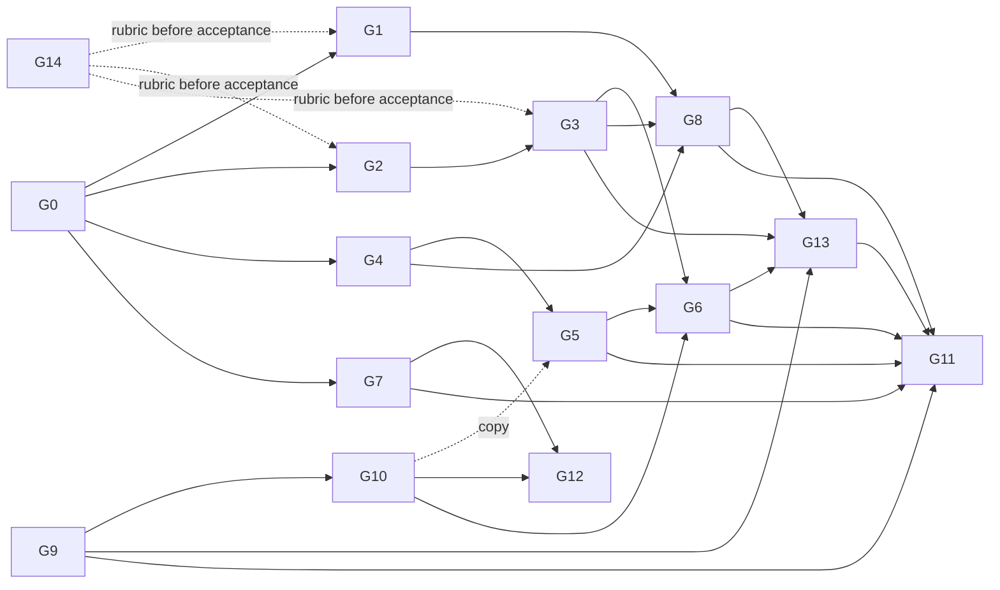

# Fix plan: Sessions (Step 3)

This plan covers all 81 P0/P1 Sessions findings from audit run `20261021T0327Z` (`docs/ux-program/findings.tsv`, survivors in `run-20261021T0327Z.json`). It folds in the 46 P2s that fall inside a group's files and theme. The 9 other P2s wait in the backlog. The plan was written from the code at `ce9b3d0`, and line numbers point there.

Each group is one PR, or one PR plus a short follow-up where noted. A group names its data shape before its UI. The bridge and the app share one schema PR (G0), so bridge groups and app groups can run in parallel afterwards.

## 1. Root causes

Most of the 81 findings come from eight root causes:

| # | Root cause | Findings it explains | Groups |
| --- | --- | --- | --- |
| R1 | A step's state and output are read from the first `tool_result`. Claude Code's launch acks for background work, its hand-back wrapper and the later `<task-notification>` are not modeled. Steps carry no times, no command and no cause. | 027 028 029 033 054 056 058 060 061 062 068 075 | G1, G4 |
| R2 | Session status only looks at the foreground turn. `Live.background`, `Live.cli` (wake turns) and the SDK's `task_*` events are ignored by `isWorking()`, `own.status()`, `own.controls()` and the catalog. | 001 030 037 041 045 050 052 055 059 074 | G2, G4, G12 |
| R3 | The end of a run (stop, failure, process death, bridge restart) is not a recorded outcome. Notices and the `failed` mark live in memory. Stop has one scope and no acknowledgement. | 009 010 031 049 051 072 004 040 | G3, G6 |
| R4 | The thread has no single status slot. Run state is only a `Working…` row at the bottom of the list, so nothing is announced and offline state never takes priority. | 005 006 007 065 071 081 | G5 |
| R5 | Overlay items (cards, notices, queued echoes) are appended after transcript items. Rows and threads wait on serial transcript reads. | 032 044 064 066 067 | G8 |
| R6 | The app trusts a socket until a ping fails. There is no path monitor, no probe on return and no pong deadline. The bridge sends no application heartbeat. | 012 015 063 | G2, G9 |
| R7 | Offline screens keep live-looking state and give no cause or action. Requests sent while offline never end. | 011 013 014 036 047 048 070 073 | G10, G11 |
| R8 | Push only covers bot chats and session cards. The phone counts as watching while suspended, and no session alert exists on the device. | 016 017 018 019 020 021 057 | G13 |

The rest are list presentation (G12), card layout (G7) and runner defects (G14).

## 2. Foundation data model (G0)

All new fields are additive under protocol 3. An absent field reads as `null`, `false` or `[]`. Old apps ignore unknown keys, and unknown enum values decode to `.unknown`. New capabilities are gated by new `FEATURES` names, so a new app never offers a control an older bridge would ignore. TypeScript marks the new fields optional (`?:`), so G0 touches only `protocol.ts` on the bridge, and later groups fill the fields without touching it again.

```ts
// bridge/src/protocol.ts

export const FEATURES = [ ...existing, "session_tasks", "session_unqueue", "push_state" ] as const;

/** waiting: an approval card for this call is open, so it has not started. stopped: cut off by the user or by a restart. */
export type StepState = "running" | "waiting" | "ok" | "error" | "denied" | "stopped";

export type ToolStep = {
  id: string; tool: string; label: string; state: StepState;
  diff: { path: string; added: number; removed: number } | null;
  output: string | null;          // real output only: never a launch ack, a hand-back wrapper or a reject boilerplate
  detail?: string | null;         // what actually runs: the Bash command (first 3 lines, masked), or the agent type
  startedAt?: string | null;      // execution start: the tool_use time, or the approval time when it waited on a card
  endedAt?: string | null;        // tool_result time, or the <task-notification> time for background work
  background?: boolean;           // run_in_background Bash or an async Agent: it outlives the turn
  owner?: string | null;          // step id of the Agent step whose subagent started this one (P-BG-5)
  cause?: string | null;          // one line on error, denied or stopped: "Exit code 1: ls: late.txt: No such file", "Stopped by you"
  usage?: { tools: number; ms: number } | null; // a finished Agent's tool count and run time
};

/** Live work Claude Code tracks for the session: subagents (foreground and background) and background commands. */
export type SessionTask = {
  id: string;                     // Claude Code's task_id
  stepId: string | null;          // tool_use id of the step that started it; joins to ToolStep.id
  kind: "agent" | "command" | "other";
  label: string;                  // the task description, masked
  background: boolean;
  startedAt: string;
  owner: string | null;           // step id of the owning subagent (parent_task_id resolved), null for the main thread
  progress: { tools: number; last: string | null; at: string } | null; // tool count, last tool, last activity
  waiting: MessageId | null;      // an open card this task is blocked on
};

export type SessionControls = {
  ...existing;                    // `working` now means: a turn runs, a wake turn is due or running, or tasks is non-empty
  turn?: { startedAt: string; wake: boolean } | null;   // the foreground turn; wake: Claude Code started it on its own
  tasks?: SessionTask[];
  heardAt?: string | null;        // last sign of life from Claude Code for this session; refreshed at least every 25 s while working
};

export type SessionRow = {
  ...existing;
  since?: string | null;          // when the current run started (the turn, or the oldest live task); null at rest
  running?: { agents: number; commands: number } | null;
  activity?: string | null;       // one line while busy: "Run perl -e 'sleep 60'", "Waiting for approval: Bash", "Background: sleep 75"
  outcome?: { kind: "finished" | "failed" | "stopped" | "lost"; text: string; at: string } | null; // until the next send
};

// SessionItem changes
//   permission: + stepId?: string | null; subagent?: string | null   (the asking subagent's label)
//   notice:     + reason?: "stop" | "task" | "restart" | "failure" | "approval" | null
// PermissionMessage.answer: + "stopped" (protocol2.ts closes it for v2 apps)

// Client frames
//   session_stop    + target?: "all" | "turn" | { task: string }   (absent = "all", today's behaviour)
//                   + turnStartedAt?: string | null                 (a stale stop for an older run is refused)
//   session_unqueue { sessionId, clientId }                         (feature session_unqueue)
// Server frames
//   session_tool_output: output: string | null; + error?: string | null
//   error:               + sessionId?: SessionId; about?: "stop" | "send" | "tool" | "create" | null; ref?: string
//   hello:               + push?: PushState
//   push_state           { type: "push_state"; push: PushState }    (feature push_state)
export type PushState = { state: "on" | "off" | "failing"; error: string | null; at: string | null };
```

Two rules hold this together:

- **Steps come from the transcript, and tasks come from the live stream.** A ToolStep is rebuilt from disk, so it survives a reopen or a restart. A SessionTask exists only while a bridge-driven query is live. The app joins them by `stepId`: a running step with a matching task shows its progress and gets a Stop.
- **`working` means that something runs, and `turn` says whether a turn runs.** Stop, the busy row and the S*.stop rubric items follow `working`. Queue-versus-send follows `turn`.

## 3. Groups

Format: findings are the ones the group closes. "(+Gx)" means another group must also land before the finding can be closed in the ledger.

---

### G0. Run-state schema on both sides

- **Findings:** none closed. It is the base for every group below.
- **Root cause:** the wire cannot express background work, step times, outcomes, stop targets or push state (`protocol.ts:371-456`).
- **Fix design:**
  - Data: exactly section 2.
  - Bridge: types only, plus `fixtures/protocol.json` examples for every new field and frame. `protocol2.ts` is not touched here; G3 closes `stopped` for v2.
  - iOS: `Protocol.swift` mirrors the types with `decodeIfPresent` defaults. `ToolStepState` gets `.waiting` and `.stopped`. `SessionTask`, `PushState`, `Feature.sessionTasks/.sessionUnqueue/.pushState` and the new client frames are added. In `ThreadItems.swift`, `StepState` draws the two new states with a word and a non-colour glyph: "Waiting for approval" (hand) and "Stopped" (stop.circle). Nothing else in the UI changes.
  - Docs: the protocol section of `docs/sessions-design.md`.
- **Patterns:** P-STATE-1, P-STATE-6, P-STATE-7, P-BG-1, P-BG-5, P-TIME-1, P-STOP-2, P-ALIVE-2.
- **Files:** `bridge/src/protocol.ts`, `fixtures/protocol.json`, `bridge/test/protocol.test.ts`, `ios/ClaudioBot/Model/Protocol.swift`, `ios/ClaudioBotTests/ProtocolTests.swift`, `ios/ClaudioBot/Views/ThreadItems.swift` (StepState only), `docs/sessions-design.md`.
- **Verify:** `bun test` and the iOS unit tests (the fixture pins both sides). Protocol lane: rerun S1 once and check that the frames still decode and nothing regresses. No simulator.
- **Acceptance:** fixture round-trips on both sides. A frame without the new keys decodes as before. An unknown step state still renders.
- **Risk:** keep every new field optional, or an older bridge breaks a new app. `Feature` gating is the only thing that hides new controls.
- **Depends on:** nothing. **Wave 1.**

---

### G1. Step truth from the transcript (bridge)

- **Findings:** F-SES-027 sessions-async-agent-launch-ack-shown-as-step-output, F-SES-028 sessions-async-agent-step-reads-done-at-launch, F-SES-029 sessions-background-step-marked-ok-while-running, F-SES-033 sessions-finished-subagent-shows-raw-handback, F-SES-054 sessions-subagent-completion-never-reaches-phone, F-SES-058 sessions-wake-turn-prose-wrong-on-arrival-two-of-three, F-SES-061 thread-bg-step-output-shows-launch-boilerplate, F-SES-075 thread-wake-turn-replies-have-no-trigger-and-repeat.
  P2: F-SES-082 a11y-background-control-steps-raw-tool-names, F-SES-098 sessions-denied-step-shows-claude-code-reject-boilerplate, F-SES-113 sessions-subagent-label-masks-ordinary-words-as-secret, F-SES-114 sessions-subagent-labels-cut-at-60-chars-look-identical, F-SES-121 thread-bash-step-label-doubles-run-verb, F-SES-122 thread-bg-command-approval-and-step-never-say-background.
  Enables G4 for 056, 060, 062, 068, 080 and 100.
- **Root cause (R1):**
  - `settle()` (`transcript.ts:748-766`) turns any non-error `tool_result` into `ok` and keeps its last 2 KB as output.
  - `MACHINE` (`:601`) drops `<task-notification>` entries, and `settle()` deletes the tool id from `tail.tools`, so nothing can settle the step later.
  - `stepLabel` (`:536`, `:541`) prefers the model's description and drops the command.
- **Fix design:**
  - Data: fills `ToolStep.detail/startedAt/endedAt/background/cause/usage` and the `stopped` state. Adds `notice` items with `reason: "task"`.
  - Bridge (`transcript.ts`):
    1. **Launch acks.** Detect `Async agent launched successfully` (Agent/Task) and `Command running in background with ID: <id>` (Bash). The step stays `running` with `background: true` and `output: null`. Keep the tool id open in the tail, plus a map from `task-id` to step.
    2. **`<task-notification>` entries.** Parse `<task-id>`, `<tool-use-id>`, `<status>`, `<summary>`, `<result>` and `<usage>`. Settle the step to ok (`completed`), error (`failed`) or stopped (`stopped`/`killed`). Set `endedAt` to the entry time, `usage` from `<usage>`, and `cause` from the summary when it did not succeed. Settling must be idempotent: the note says one task id may notify more than once, so the last one wins. Also emit a `notice` item (id = the entry uuid, `reason: "task"`, text = Claude Code's summary, for example `Background command "sleep 75" completed (exit code 0)` or `Agent "sleeper two" finished`). It lands in time order just before the wake turn's reply, so the reply has a visible trigger (P-BG-4).
    3. **Agent hand-back.** Strip the `[Subagent hand-back]` framing, the `agentId:` lines and the `<usage>` block. `output` keeps the agent's own report, and `usage` gets the numbers.
    4. **Times.** `startedAt` is the tool_use entry time. G2 overrides it with the approval time. `endedAt` is the result time.
    5. **Bash.** `detail` is the command (first 3 lines, masked). The label stays the description but never doubles "Run". A background call reads "Run in background: …" (122). Calls to `BashOutput`/`KillShell`/`TaskOutput` get labels such as "Checked background command" and "Stopped background command" (082).
    6. **Failures.** For an error result, `cause` is the first `Exit code N` line plus the first non-empty error line. `output` keeps the head (512 B) plus the tail (1.5 KB) with a gap marker, so the exit status is never cut (062).
    7. **Stopped versus denied.** A result of `The user doesn't want to proceed with this tool use` that is followed by `[Request interrupted by user…]`, or one that carries the bridge's stop text (`<user> stopped the session. It did not run.`, defined in G3), maps to `stopped` with `cause: "Stopped by you"`. The Claude Code reject boilerplate is dropped from `output` (098).
    8. **Agent labels.** Use up to 120 characters with middle truncation, so the distinguishing words survive (114). `detail` is the subagent type.
  - Bridge (`text.ts`): `maskSecrets` stops masking ordinary words in labels. It masks only assignments and known key shapes (113).
  - iOS: nothing. G0 already renders the states. Times, detail and cause appear in G4.
- **Patterns:** P-STATE-6, P-STATE-2, P-BG-4, P-BG-6 (no stub as output), P-TIME-1, P-TIME-4, A-1, A-7.
- **Files:** `bridge/src/transcript.ts`, `bridge/src/text.ts`, `bridge/test/transcript.test.ts`, `bridge/test/text.test.ts`, `bridge/test/transcripts/jsonl/` (new fixtures copied from the S1b, S2, S4 and S8 run transcripts, with titles scrubbed).
- **Verify:** protocol lane S1, S1b, S2, S4, S5 and S8 (after G14's runner fixes). No simulator.
- **Acceptance:**
  - S1b.4 and S1.4: each Agent step reads ok only within 2 s of its subagent's end.
  - S1b.5, S1.5, S2.3, S5.3 and S6.5 pass on `startedAt`.
  - S2.4 and S3.4: the step flips and a task notice lands within 60 s of bg-done.
  - S4.1 and S4.2: error state plus `cause`.
  - New check (G14): no step `output` matches `/Async agent launched|Command running in background|Subagent hand-back|doesn't want to proceed/`.
  - S2.1 and S5.1 pass on `detail`.
- **Risk:**
  - The ack and notification texts belong to Claude Code (CLI 2.1.305) and can change. Match loosely, pin them with fixtures, and fall back to today's behaviour when nothing matches.
  - The `<task-notification>` for an agent is written only when the agent stops with no live children, so S8's shell gets no notification at all. G2 covers that case from the stream.
- **Depends on:** G0. **Wave 2.**

---

### G2. Live work model: background tasks, wake turns, waiting cards, heartbeat (bridge)

- **Findings:** F-SES-001 (P0) sessions-working-false-while-background-subagents-run, F-SES-015 protocol-silent-gap-no-app-heartbeat-during-long-call (+G9), F-SES-030 sessions-background-task-invisible-row-idle, F-SES-037 sessions-no-stop-affordance-for-background-work (+G6 for the label), F-SES-041 sessions-registry-waiting-shown-idle, F-SES-050 sessions-stopped-subagent-step-reads-ok-and-extra-turn-runs-idle (+G1), F-SES-052 sessions-subagent-background-command-killed-silently, F-SES-059 sessions-wake-turn-shows-idle-and-no-completion-item (+G1), F-SES-074 thread-tool-step-reads-running-while-awaiting-approval.
  P2: F-SES-132 thread-work-item-at-is-tool-request-time-not-run-start.
  Enables G4 (038, 045, 055), G7 (053), G12 (042), G13 (017).
- **Root cause (R2):**
  - `isWorking()` (`session.ts:890-893`) ignores `Live.background` and `Live.cli`, although `busy()` (`:769`) already knows both.
  - `own.status()` and `own.controls()` (`own.ts:424-453`), `sessions.ts:205-235` and `catalog.ts:123` all build on it.
  - `receive()` (`:1209-1234`) ignores `task_started`, `task_updated`, `task_progress`, `tool_progress` and the `parent_task_id` on `background_tasks_changed`.
  - The registry's `waiting` status is dropped (`claudeApps.ts:93`).
  - A card for a tool call never touches its step (`transcript.ts:740`).
- **Fix design:**
  - Data: fills `controls.turn/tasks/heardAt`, the new `working` meaning, `row.since/running/activity`, `task.waiting`, step `waiting`, and the post-approval `startedAt`.
  - Bridge, `session.ts`:
    - Add a task ledger on `Live`, keyed by `task_id`, fed by `task_started` (tool_use_id, task_type, is_backgrounded, parent_task_id, description), `task_updated` (status, end_time), `task_progress` (usage.tool_uses, last_tool_name), `tool_progress` (heartbeat, elapsed) and `task_notification`. `background_tasks_changed` stays the replace-semantics source of truth for which tasks are live.
    - Expose a read-only `activity()` with `{ turn, wake, tasks, heardAt }`.
    - **Do not change `isWorking()`.** The hub and bots depend on it.
    - A task that disappears with status `killed`, or that leaves `background_tasks_changed` without a notification (S8: a subagent's shell killed at hand-back), produces a notice. It names the command and its owner: "`sleep 60` (started by starter) was stopped when starter returned." (052, P-BG-5, A-10).
  - Bridge, `own.ts`:
    - `controls()` sets `working = turn running || wake due or running || tasks.length > 0` and fills `turn`, `tasks` and `heardAt`.
    - `status()` returns `working` on the same rule, below the attention states.
    - A permission card records `toolUseId` and `o.agentID` (`own.ts:227` passes `subagent: null` today). Tasks then get `waiting: cardId`, and the item gets `stepId` and `subagent`.
  - Bridge, `sessions.ts`: `driven()` and `controls()` for agent sessions use the same `activity()`.
  - Bridge, `threads.ts`:
    - The overlay patches transcript steps. A step with an open card reads `waiting`. A step answered "once" gets `startedAt` = the answer time (132). A `background` step whose task is still live stays `running`.
    - A controls-only `session_items` frame (with `heardAt`) goes out at least every 25 s while `working` and the thread is watched, and at most every 10 s on progress (P-ALIVE-2).
  - Bridge, `catalog.ts`: `row.since` = the turn start or the oldest task start. `row.running` = counts by kind. `row.activity` = the open card ("Waiting for approval: Bash"), else the last running step label, else "Background: <label>". For registry-held sessions, `waiting` + `waitingFor: "permission prompt"` maps to `awaiting_approval` (041).
  - Bridge, `claudeApps.ts`: keep `status` and `waitingFor`.
  - iOS: nothing required. The composer already shows Stop when `working`, so the P0 is closed by the bridge alone.
- **Patterns:** P-STATE-1, P-STATE-3, P-STATE-4, P-BG-1, P-BG-2, P-BG-5, P-ALIVE-2, P-STOP-1, A-3, A-6, A-10.
- **Files:** `bridge/src/session.ts`, `bridge/src/own.ts`, `bridge/src/sessions.ts`, `bridge/src/threads.ts`, `bridge/src/catalog.ts`, `bridge/src/claudeApps.ts`, `bridge/test/{session,own,sessions,threads,claudeApps}.test.ts`, `bridge/test/transcripts/*.ndjson` (new raw-SDK fixtures), `bridge/src/hub.ts` (one line: serve `session_tasks`).
- **Verify:** protocol lane S1, S1b, S2, S5, S7 and S8. Also a probe that leaves a card unanswered (the S5 edge, `pend.ts`) and a registry-waiting probe (S7). No simulator.
- **Acceptance:**
  - S1b.3 and S1b.7: the row is working and `controls.working` is true for the whole subagent window, including the wake turns.
  - S2.2a, S2.2b and S2.6.
  - S8.1a, S8.1b, S8.2 (a task or notice names `sleep 60` or `starter`), S8.3 (a killed notice) and S8.5.
  - S5.2, S5.4 (longest gap ≤ 30 s), S5.5, S1.3, S1.7, S7.2 and S7.4.
  - New S5 edge item (G14): a step with an open card reads `waiting`.
  - S1.6 and S1b.6 pass on `controls.tasks[].progress`.
- **Risk:**
  - **Spike first.** Log raw SDK frames in one S1b and one S8 run. Then confirm four things: `local_agent` tasks appear in `task_started` and `background_tasks_changed`; `agentID` equals the agent's `task_id`; a subagent's shell carries `parent_task_id`; and a killed shell reports `killed`. The audit lists all four as unverified.
  - This is the biggest PR. It can land as two commits: the ledger and status in `session.ts`/`own.ts`/`sessions.ts`, then rows and threads in `catalog.ts`/`threads.ts`.
  - `working` now covers background work, so an old app shows "Queue a message" while only a background task runs. G6 fixes that.
- **Depends on:** G0. **Wave 2.**

---

### G3. Run endings: stop targets, recorded outcomes, restart notices (bridge)

- **Findings:** F-SES-009 composer-stop-and-send-kills-background-process-silently, F-SES-010 offline-bridge-restart-leaves-background-promise-unmarked, F-SES-031 sessions-failed-mark-and-error-notice-lost-on-bridge-restart, F-SES-049 sessions-stop-leaves-no-stopped-entry, F-SES-051 sessions-stopped-subagents-labelled-denied (+G1, +G5 for per-task Stop), F-SES-072 thread-step-running-after-process-death.
  P2: F-SES-108 sessions-row-carries-no-outcome-after-failure-or-stop, F-SES-111 sessions-stop-retires-subagent-approval-as-expired, F-SES-117 sessions-unread-dot-says-nothing-about-what-finished (outcome text; the row UI is in G12), F-SES-130 thread-stop-notice-bare-interrupted-and-header-says-ran.
- **Root cause (R3):**
  - `interrupt()` (`session.ts:1315-1325`) stops every background task on any interrupt, including "Stop and send".
  - `onTurnEnd` (`own.ts:331-340`) has no `stopped` branch.
  - `notices` and `failed` (`own.ts:120-121`) are not persisted.
  - The restart note for background work fires only when a driver is created (`session.ts:1289`). An idle session never gets one.
  - No step is settled when the process dies (`transcript.ts:641-649`).
- **Fix design:**
  - Data: fills `row.outcome`, `notice.reason: "stop" | "restart" | "failure"`, `PermissionMessage.answer: "stopped"` and step `stopped`/`error` with `cause`. Serves `session_stop.target/turnStartedAt`.
  - Bridge, `session.ts`: `interrupt(target)`. `"turn"` stops only the turn. `"all"` stops the turn and every task. `{task}` calls `stopTask(id)` for one task, and that works for foreground subagents too. It returns what it stopped.
  - Bridge, `own.ts`:
    - `stop(rec, target)` records `outcome = { kind: "stopped", text: "Stopped by you: the turn, 2 agents, 1 command" }`. It adds a `notice` (`reason: "stop"`) at the moment of the stop, listing what was stopped (P-STATE-7). It settles open cards with a new reply kind, `stopped`, whose deny message is `<user> stopped the session. It did not run.` and whose answer is `"stopped"` (111).
    - `send(…, interrupt)` passes `"turn"` (009).
    - `onTurnEnd` failed → `outcome failed`. Done → `outcome finished`, with the task summary text when a background task ended (117).
    - Outcome and notices move onto the persisted `rec.own` (`world.ts`) and are cleared on the next send.
    - `restart()` scans records whose `state.background` is not empty. It writes the restart notice and `outcome lost` without starting a driver (010, P-BG-7).
    - Unknown `turnStartedAt` (an older run) is refused with `error{about:"stop"}`.
    - `session_unqueue` drops a pending envelope by `clientId` (the bridge half of 040).
  - Bridge, `threads.ts`: when a session is at rest (no turn, no tasks), the overlay settles every transcript step still `running`. After a failure it becomes `error` with the outcome text as `cause`. After a stop it becomes `stopped` ("Stopped by you"). After a restart it becomes `stopped` ("The bridge restarted"). This covers 072 and the "declined" text in 076.
  - Bridge, `sessions.ts`: routes `target`, `turnStartedAt` and `session_unqueue`. A failed stop returns `error{sessionId, about:"stop"}`.
  - Bridge, `catalog.ts`: `row.outcome` comes from the record. Status is `failed` for failed or lost, and `idle` for stopped or finished.
  - Bridge, `protocol2.ts`: `stopped` closes as `expired` for v2 apps.
  - iOS: none. G6 and G5 consume it.
- **Patterns:** P-STATE-7, P-STATE-2, P-STOP-2, P-STOP-3, P-STOP-4, P-BG-7, P-CONN-5, A-5, A-9.
- **Files:** `bridge/src/session.ts`, `bridge/src/own.ts`, `bridge/src/sessions.ts`, `bridge/src/threads.ts`, `bridge/src/catalog.ts`, `bridge/src/world.ts`, `bridge/src/protocol2.ts`, `bridge/src/hub.ts` (one line: serve `session_unqueue`), `bridge/test/{session,own,sessions,threads,protocol2}.test.ts`.
- **Verify:** protocol lane S4 and S2 (with G14's new "Stop and send keeps background" item). Restart and SIGKILL probes come from G14's `bridge restart` and `kill-claude` actions. No simulator.
- **Acceptance:**
  - S4.3, S4.4, S4.5 (a notice with `reason:"stop"`; assistant prose no longer counts after G14) and S4.6 (with process evidence).
  - New S2.9: after "Stop and send" the background command still finishes.
  - New S6.7: after SIGKILL no step reads running, and the row reads failed with a cause.
  - New S6.8: after a bridge restart the row keeps failed or lost, and the thread has the restart notice.
- **Risk:**
  - Persisting notices grows `world.json`. Keep `NOTICES_KEPT = 10` per session.
  - `stopped` as a card answer touches bot chats' `PermissionMessage`. Check `gate.ts` consumers before shipping.
  - The wake turn that Claude Code starts after a stopped subagent cannot be prevented. G2 makes it read working, and the stop notice above it explains it.
- **Depends on:** G2 (same files, and it reads `activity()` to know nothing is left running). **Wave 3.**

---

### G4. Thread work run: per-step state, timers, command, cause, counts (iOS)

- **Findings:** F-SES-008 a11y-working-group-header-speaks-no-state, F-SES-038 sessions-no-stuck-signal-for-working-subagents (+G2), F-SES-045 sessions-running-count-missing (+G2, +G12 for the row), F-SES-055 sessions-subagent-inner-activity-dropped (+G2), F-SES-056 sessions-subagent-step-no-start-time (+G1), F-SES-060 thread-bash-step-label-is-model-description-command-not-on-wire (+G1), F-SES-062 thread-failed-command-exit-status-cut-from-output (+G1), F-SES-068 thread-running-tool-step-shows-no-elapsed-time (+G1), F-SES-069 thread-running-work-header-pins-failed-badge-to-running-agent, F-SES-076 thread-work-summary-counts-failed-write-as-edited (+G3), F-SES-080 x-dynamic-type-work-header-truncates-agent-name-shows-one-of-two (+G1).
  P2: F-SES-092 a11y-tool-step-ok-silent-glyph-unhidden, F-SES-100 sessions-finished-subagent-no-duration-or-outcome, F-SES-126 thread-fold-hides-running-and-failed-steps, F-SES-136 x-dynamic-type-workrun-header-icon-clipped.
- **Root cause:** `WorkRunRow` shows only `steps.last { running }` (`ThreadItems.swift:200-250`). `ToolStepRow` has no clock, no command and no cause, and `.ok` draws nothing (`:276-349`). `WorkSummary` counts every edit step, failed ones included (`Threads.swift:121`, `:157-160`).
- **Fix design:**
  - Data: reads the G0 fields and joins `controls.tasks` to steps by `stepId`.
  - iOS, `ThreadItems.swift`:
    - **Header.** One line per state class: "3 agents running · 1 failed: broken helper (unknown agent type) · 2m 05s". The failed step is named with its cause (069). The running count is shown (045). The elapsed time comes from the earliest running `startedAt`, as a `TimelineView` once per second with `.monospacedDigit()` (P-TIME-2, P-A11Y-4).
    - **Spoken header.** "Running: 3 agents, 1 failed, 2 minutes" plus Expanded/Collapsed and a hint (008).
    - **Wrapping.** The header wraps at accessibility sizes. With more than one running agent it lists their distinguishing labels instead of one truncated name (080). The icon sits in a scaled slot (136).
    - **Steps.** Every state has a word and a glyph (done, failed, stopped, waiting) (092). Running shows "1m 12s" from `startedAt` and finished shows the duration (100). `detail` is a second monospace line (060). `cause` comes first on error or stopped, with the output tail under it (062).
    - **Running agents.** Show the task's `progress.last` and tool count (055), and "No activity for 3m" once `progress.at` or `heardAt` is older than 60 s (038, A-2).
    - **Shimmer.** It goes only on the live row (P-ALIVE-1). Under Reduce Motion, the timer alone carries liveness.
    - **Stale mode.** Add an environment key, `\.runStateStale`. When it is set, spinners dim and timers freeze. G5 sets it.
  - iOS, `Threads.swift`: `WorkSummary` counts only `ok` edits and diffs, and keeps failed separate: "Edited 10 files +10, 1 failed" (076). A fold shows the worst state inside it (running or failed counts) (126). The finished header gives the group time: "Ran 3 agents, 43 s" (100).
- **Patterns:** P-TIME-1, P-TIME-2, P-TIME-3, P-TIME-4, P-SUB-1, P-SUB-2, P-ALIVE-1, P-STATE-2, P-A11Y-1, P-A11Y-3, P-A11Y-4, A-2, A-8.
- **Files:** `ios/ClaudioBot/Views/ThreadItems.swift`, `ios/ClaudioBot/Model/Threads.swift`, new `ios/ClaudioBotTests/ThreadWorkTests.swift` (do not grow `SessionsTests.swift`, which G12 also edits), `ios/ClaudioBot/Demo/DemoSessions.swift`.
- **Verify:** **simulator lane** S1, S1b, S2, S4, S5 and S8, with G14's open-thread shots. X-dynamic-type (AX5 via `simctl ui content_size`). X-voiceover by code review plus unit tests on the spoken strings.
- **Acceptance:**
  - S1.8 and S1b.8: three labelled rows, each visibly running, with a count and Stop. S1.9 and S1b.9: three done rows with durations, no spinner.
  - S2.7: running, elapsed time and Stop. S5.7: elapsed differs between the 30 s and 90 s shots.
  - S4.7: the failed and running states look different, and the failed one is named.
  - S8.6: the command and its owner are visible.
  - Header speech includes state, count and failures.
- **Risk:** a 1 Hz `TimelineView` per running row is fine for a few rows. Use one clock per work run, not one per step. Data arrives with G1 and G2. Build against G0 fixtures, merge, then run the acceptance pass once G1 and G2 are in.
- **Depends on:** G0 (`ThreadItems.swift`). Verification needs G1, G2 and G3 (for 076's cause). **Wave 2.**

---

### G5. Thread status slot, background work sheet and announcements (iOS)

- **Findings:** F-SES-005 a11y-thread-header-and-tail-no-run-state-for-voiceover, F-SES-006 a11y-thread-opened-on-waiting-approval-announces-nothing, F-SES-007 a11y-turn-end-and-failure-never-announced, F-SES-065 thread-offline-bar-does-not-say-state-is-stale, F-SES-071 thread-skeleton-forever-when-offline, F-SES-081 x-ipad-sidebar-hidden-in-portrait-running-elsewhere-invisible.
  P2: F-SES-086 a11y-permission-announcement-omits-command-and-session, F-SES-089 a11y-streaming-tail-label-is-whole-growing-reply, F-SES-123 thread-doubled-working-indicators-for-one-running-step, F-SES-125 thread-expired-approval-still-hides-working-and-announces, F-SES-131 thread-top-edge-blur-leaks-transcript-words-beside-title, F-SES-137 x-ipad-thread-header-title-capped-at-260pt.
  Also the per-task Stop UI for F-SES-051.
- **Root cause (R4):**
  - Run state is only `StreamingTail` at the bottom of a lazy list (`ThreadItems.swift:725-749`).
  - The only announcement is a card `.onChange`, which never fires on first render (`SessionThreadView.swift:164-166`).
  - The offline bar exists only in `.ready` (`:169-176`), and the skeleton has no exit (`:50-71`).
- **Fix design:**
  - Data: reads `controls.turn/tasks/heardAt/working`, `row.status`, `store.connection` and `notice.reason`.
  - iOS: one status line above the composer, with strict precedence (P-STATE-5):
    1. Connection: "Can't reach your Mac · last update 40 s ago", with Retry and the cause copy shared with G10's banner.
    2. Stale socket: "No word from your Mac for 50 s" when `heardAt` (or the last frame) is older than 45 s while working.
    3. An open card: "Needs your approval: Bash in sleeper two". It uses the deadline-aware check, so an expired card no longer counts (125).
    4. The turn: "Working 2m 05s · 3 agents".
    5. Background only: "Running in background: sleep 75 · 1m 12s".
    6. At rest: nothing, or the outcome from `row.outcome` for one turn.

    Tapping a background or working line opens a new `BackgroundWorkSheet` that lists `controls.tasks` (kind, label, owner, elapsed, progress) with a Stop per task (`session_stop target {task}`, behind feature `session_tasks`) and "Stop all" (P-BG-3, P-STOP-2, the 051 UI). While the line shows, `StreamingTail` is hidden from sight and from VoiceOver. The live reply is spoken once as "Claude is replying" (089, 123).

    The thread header's `accessibilityValue` is the state word (005). Announcements fire on these transitions: working → rest, failed, stopped, offline, and a card open on first render (006, 007). The card announcement names the command and the subagent (086).

    Offline: the thread view renders even before `.ready`. The skeleton shows for 1 s at most while connected. Otherwise the status line says "This session loads when your Mac is back" (071). It sets `\.runStateStale` from G4, so running marks dim (065).

    iPad: when the split view hides the sidebar, a toolbar chip shows "2 working · 1 needs you" for the other sessions (081). The header title is no longer capped at 260 pt and carries the state word (137). The header band is opaque (131).
- **Patterns:** P-STATE-5, P-STATE-4, P-BG-3, P-STOP-2, P-ALIVE-3, P-CONN-1, P-CONN-4 (do not flash the stale line for gaps under 400 ms), P-A11Y-1, P-A11Y-2.
- **Files:** `ios/ClaudioBot/Views/SessionThreadView.swift`, `ios/ClaudioBot/Views/ThreadItems.swift` (StreamingTail only), `ios/ClaudioBot/Views/ChatNotices.swift` (OfflineBar folded into the status line), `ios/ClaudioBot/Views/MainView.swift`, new `ios/ClaudioBot/Views/BackgroundWorkSheet.swift`, new `ios/ClaudioBotTests/ThreadStatusTests.swift` (precedence table).
- **Verify:** **simulator lane** S2, S5, S6 (G14's app-side drop) and X-empty-error-offline cases 2-5. X-voiceover by code review plus precedence unit tests. X-ipad is code read (pool has no iPad; keep it as a coverage gap).
- **Acceptance:**
  - S2.7 and S5.7 on the status line.
  - S6.6: running after resume-1, done after resume-2, with no stale spinner and the "last update" line while down.
  - X-empty-error-offline case 5: no skeleton past 1 s offline.
  - One status line, never two working indicators.
  - The precedence unit tests pass for all six levels.
- **Risk:** this changes the thread's bottom layout, so check the composer inset and the keyboard. Announcement storms: debounce one announcement per 2 s. Do not announce replays after reconnect (P-NOTIFY-3).
- **Depends on:** G4 (`ThreadItems.swift`, and the stale environment key). Soft dependency on G10 (shared connection copy and Retry). Verification needs G2 and G3. **Wave 3.**

---

### G6. Composer Stop and queue (iOS)

- **Findings:** F-SES-002 a11y-error-toast-five-seconds-unannounced, F-SES-004 a11y-stop-button-no-target-no-pending-no-ack, F-SES-040 sessions-queued-message-cannot-be-withdrawn-and-survives-stop (+G3).
  P2: F-SES-083 a11y-composer-queued-chip-says-1-messages, F-SES-088 a11y-session-composer-field-unlabelled-queue-mode-only-in-placeholder, F-SES-093 composer-stop-hidden-while-draft-text-present, F-SES-124 thread-error-notice-colour-icon-only, F-SES-134 x-dynamic-type-composer-chips-clipped-stop-squeezes-field.
  Also the Stop label part of 009 and 037.
- **Root cause:**
  - `showsStop = working && !hasText` with a bare "Stop" label (`SessionComposer.swift:17-22`, `:127-129`).
  - `stop()` only sends the frame (`:242-245`).
  - The queued chip is static (`:180-182`).
  - `ErrorToast` auto-dismisses after 5 s without an announcement (`Components.swift:150-171`).
- **Fix design:**
  - Data: reads `controls.turn/tasks/queued`, `error.sessionId/about` and the stop notice. Sends `session_stop{target, turnStartedAt}` and `session_unqueue`.
  - iOS, Stop:
    - Stop stays visible whenever `working`, even with a draft. A separate Stop sits beside Send when there is text (093). It is sized with the text (134).
    - The label names its target: "Stop: turn, 3 agents, 1 command" (P-A11Y-2).
    - If only the turn runs, Stop acts at once. If background tasks would also die, a confirmation offers "Stop everything", "Stop the turn only" and the count of queued messages that will still run (P-STOP-3, 040).
    - After the tap the control shows "Stopping…" and is announced. It ends when `working` goes false or the stop notice lands, and that is announced too. After 10 s it reads "Couldn't confirm the stop" with Retry (P-STOP-4).
    - "Stop and send" becomes "Stop turn and send" (009).
    - With background work only (`turn == nil`), Send sends at once. The placeholder is "Message Claude", not "Queue a message", and the field's accessibility label carries the mode (088).
  - iOS, queue: the chip reads "1 message queued" (083). Tapping the chip or a queued bubble offers Withdraw or Edit, which sends `session_unqueue` behind feature `session_unqueue` (040).
  - iOS, errors: `ErrorToast` posts an announcement, prefixes "Error:", and stays until dismissed while VoiceOver runs (002). Session errors with `sessionId` show inline under the composer instead of the global toast. The error `NoticeLine` speaks "Error" (124).
- **Patterns:** P-STOP-1, P-STOP-3, P-STOP-4, P-A11Y-2, P-CONN-6.
- **Files:** `ios/ClaudioBot/Views/SessionComposer.swift`, `ios/ClaudioBot/Views/Components.swift` (ErrorToast), `ios/ClaudioBot/Model/Store.swift` (stop pending state and session-scoped errors), `ios/ClaudioBot/Views/ThreadItems.swift` (SessionUserBubble withdraw, NoticeLine speech), `ios/ClaudioBot/Views/PromptTextView.swift` (field label), new `ios/ClaudioBotTests/ComposerStopTests.swift`.
- **Verify:** **simulator lane** S4 (S4.8), S1 and S2 at AX5. Protocol lane S4 for the ack timing. X-voiceover by code review.
- **Acceptance:**
  - S4.8: the stopped state shows with no spinner.
  - Stop is visible in every working state, including with a draft (S1.7, S2.6 and S5.5 on screen).
  - The Stop label names its targets, "Stopping…" shows and is spoken, and the end is announced.
  - A withdrawn queued message never runs.
  - The toast is announced.
- **Risk:** the confirmation step must not slow down the common one-turn stop. With no background tasks, never confirm.
- **Depends on:** G5 (`ThreadItems.swift`), G10 (`Components.swift`), G3 (stop targets, ack notice, unqueue). **Wave 4.**

---

### G7. Approval cards tied to their step and subagent (iOS)

- **Findings:** F-SES-053 sessions-subagent-blocked-on-approval-reads-running (+G2), F-SES-077 x-dynamic-type-answered-permission-cards-keep-full-height-hide-running-agents, F-SES-078 x-dynamic-type-permission-card-fixed-size-text.
  P2: F-SES-085 a11y-decision-sent-spinner-unlabelled-pending-unspoken, F-SES-112 sessions-stopped-subagent-approval-card-keeps-allowed-once.
- **Root cause:**
  - Cards carry no sender for phone sessions.
  - Answered cards keep full height (`ChatItems.swift:402-430`).
  - Card text uses fixed `.ui(size:)` fonts while the outcome scales (`:366-385`, `Theme.swift:24`).
- **Fix design:**
  - Data: reads `permission.subagent/stepId` and `answer: "stopped"`.
  - iOS:
    - The card header names the asker: "sleeper two wants to run Bash". The card scrolls to and highlights its step (053).
    - An answered card collapses to one line, "Allowed once: perl -e 'sleep 30'", which expands on tap (077).
    - All card text uses scaled text styles. Add a scaled variant to `Theme` and leave `.ui(size:)` alone for other screens (078).
    - `"stopped"` reads "Stopped by you. It did not finish.", not a green check (112).
    - The pending decision speaks "Allow once, sending" and announces the result (085).
- **Patterns:** P-STATE-4, P-A11Y-1, P-A11Y-2.
- **Files:** `ios/ClaudioBot/Views/ChatItems.swift`, `ios/ClaudioBot/Model/Display.swift`, `ios/ClaudioBot/Views/Theme.swift` (new scaled style only).
- **Verify:** **simulator lane** S1 with cards left open, then answered, at default size and at AX5 (X-dynamic-type). S4 for the stopped card.
- **Acceptance:**
  - At AX5, three answered cards plus the running work run fit on one screen.
  - The command text scales with the outcome.
  - Each card names its subagent.
  - The stopped card is not green.
- **Risk:** bot chats share `ChatItems`. The collapse must not hide a bot card's answer history, so collapse only in session threads, or keep the bot behaviour behind the item's context.
- **Depends on:** G0. Verification needs G2 (subagent and stepId) and G3 (`stopped`). **Wave 2.**

---

### G8. Thread order and sync latency (bridge, plus app ordering)

- **Findings:** F-SES-032 sessions-failed-subagent-step-not-on-wire-until-later, F-SES-044 sessions-row-working-lags-thread-idle-under-load, F-SES-064 thread-item-order-differs-live-resumed-fresh, F-SES-066 thread-overlay-notice-pinned-below-newer-turns, F-SES-067 thread-prompt-and-tool-step-missing-until-transcript-read.
  P2: F-SES-104 sessions-new-sessions-absent-from-list-while-many-start, F-SES-116 sessions-unread-dot-lights-on-bookkeeping-write-before-reply-exists, F-SES-129 thread-start-phase-14s-silent-and-prompt-timestamp-jumps.
  Also the bridge half of F-SES-034 (lastAt on bookkeeping writes).
- **Root cause (R5):**
  - `merged()` puts overlay-only items after the transcript (`threads.ts:156-165`), and the app appends new ids (`Threads.swift:293-299`).
  - `catalog.flush()` awaits a serial `readDirty()` and `getSessionInfo()` with no dir (`catalog.ts:156-170`, `transcript.ts:356-358`) before it publishes anything.
  - `catchUp` and `poll` wait for a catalog head (`threads.ts:227-231`, `:359-360`).
  - The pending user item disappears at turn end (`own.ts:417-420`).
  - `lastAt` counts any append (`transcript.ts:204`).
- **Fix design:**
  - Data: no new fields. Items are ordered by `(at, insertion)` everywhere.
  - Bridge, `threads.ts`:
    - `merged()` interleaves overlay items by `at`, and an answered card keeps its raise time (064, 066). Replays and snapshots use the same order.
    - Sessions the bridge drives know their transcript path from the query and do not wait for the catalog head (067).
    - A transcript write triggers sync while a card is open (032).
  - Bridge, `catalog.ts`: two-speed flush. Status-only changes from drivers publish within the 500 ms coalesce, without waiting on disk (044, 104). Head refreshes follow when ready.
  - Bridge, `transcript.ts`: `getSessionInfo(id, { dir })`. `lastAt` and `lastRole` move only on user, assistant and tool entries, not on title or metadata writes (034, 116).
  - Bridge, `own.ts`: the pending user item stays until the transcript copy that replaces it exists. It keeps its id and send time (067, 129).
  - iOS, `Threads.swift`: `upsert` inserts by `at` with a stable tiebreak. Snapshot, replay and live paths then give one order.
- **Patterns:** P-CONN-2, P-STATE-1, P-LIST-1 (stable), P-CONN-4.
- **Files:** `bridge/src/threads.ts`, `bridge/src/catalog.ts`, `bridge/src/transcript.ts`, `bridge/src/own.ts`, `ios/ClaudioBot/Model/Threads.swift`, `bridge/test/{threads,catalog,transcript,own}.test.ts`, new `ios/ClaudioBotTests/ThreadOrderTests.swift`.
- **Verify:** protocol lane S6 (G14's order-aware compare, resume via epoch/after), S7 (12 sessions) and S4. No simulator.
- **Acceptance:**
  - S6.3: resumed equals fresh, including order.
  - New S7.6: a row leaves Working within 1.5 s of its thread's `working=false`.
  - New S4.9: a failed subagent step is on the wire within 2 s of the transcript write.
  - S7: the user item is never removed before its transcript copy exists.
  - S6.4.
- **Risk:** sorting by `at` relies on bridge and Claude Code clocks agreeing. Both are on the same Mac, so this holds. A card raised before its tool_use entry is written sorts above the work item, which matches when it was asked.
- **Depends on:** G1 (`transcript.ts`), G3 (`threads.ts`, `catalog.ts`, `own.ts`), G4 (`Threads.swift`). **Wave 4.**

---

### G9. Connection: detect, probe, reconnect (iOS transport)

- **Findings:** F-SES-012 offline-no-network-monitor-reconnect-waits-backoff-while-foreground, F-SES-063 thread-foreground-return-does-not-probe-live-looking-socket.
  Also the app half of F-SES-015 (pong deadline and frame watchdog) and of F-SES-021 (presence false on background), and the app half of F-SES-057 (unwatch while away).
- **Root cause (R6):**
  - No `NWPathMonitor` exists.
  - `reconnectNow()` → `retry()` acts only on `.unrecognized` (`BridgeClient.swift:212-220`).
  - The ping has no reply deadline (`:349-357`).
  - The iPhone never sends `presence` (`:109-115`).
- **Fix design:**
  - Data: none new. Uses `presence` (an existing feature) and `heardAt` when present.
  - iOS, `BridgeClient.swift`:
    - `retryNow()` skips the backoff in every disconnected state, which gives G10 its Retry.
    - A path monitor triggers an immediate reconnect when the path becomes satisfied (012).
    - A pong deadline of 5 s marks the socket dead and reconnects (015).
    - A frame watchdog: while any watched thread reads `working` and no frame has arrived for 45 s, publish a `stale` connection substate for G5 (P-ALIVE-3).
  - iOS, `ClaudioBotApp.swift`: on `.active`, probe with a ping and a 2 s deadline if away for less than 10 s, else force reconnect and re-watch (063, P-CONN-3). On `.background`, send `presence(false)` (or unwatch session threads when the bridge lacks `presence`). On `.active`, send `presence(true)` (021, 057).
- **Patterns:** P-CONN-3, P-ALIVE-2, P-ALIVE-3, P-CONN-1.
- **Files:** `ios/ClaudioBot/Model/BridgeClient.swift`, `ios/ClaudioBot/App/ClaudioBotApp.swift`, `ios/ClaudioBotTests/BridgeClientTests.swift`, `ios/ClaudioBotTests/FakeBridge.swift`.
- **Verify:** unit tests with FakeBridge (half-open socket, path flap, background and foreground). **Simulator lane:** X-reconnect-stale and S6 with G14's app-side drop. S3 for presence (push no longer held 45 s).
- **Acceptance:**
  - After a path flap the thread shows the true state within 2 s.
  - Returning to the app on a half-open socket shows "Reconnecting" within 2 s and refreshes.
  - The bridge sees `attended=false` within 1 s of backgrounding.
  - S3.7 and S6.6 have no stale spinner.
- **Risk:** reconnect storms on a flapping path. Debounce path events by 500 ms, and keep the backoff for real bridge failures.
- **Depends on:** nothing. **Wave 1.**

---

### G10. Offline presentation in the list (iOS)

- **Findings:** F-SES-011 offline-cold-launch-banner-first-seconds-reasonless, F-SES-013 offline-pull-to-refresh-does-nothing-and-banner-has-no-retry-now, F-SES-047 sessions-stale-banner-no-reason-no-action (+G5 for the thread bar), F-SES-048 sessions-stale-list-keeps-working-indicators-offline.
  P2: F-SES-084 a11y-connection-badge-countdown-ticks-inside-spoken-label.
- **Root cause (R7):**
  - The help text and buttons appear only in the empty-list banner, after 3 failures (`HomeView.swift:366-395`, `BridgeClient.swift:70`).
  - `StaleListBanner` has no cause or action (`SessionsSidebar.swift:592-612`).
  - Rows have no stale input (`SessionRowView.swift:107-117`).
  - Pull-to-refresh never reconnects (`SessionsSidebar.swift:408-415`).
- **Fix design:**
  - Data: none. Uses `store.connection` and G9's `retryNow()`.
  - iOS:
    - One connection banner component shows the address and cause from the first failed attempt, with Retry now, Edit address and Pair again (011, 047). The empty list and the stale list both use it. G5's thread line reuses its copy.
    - Pull-to-refresh while disconnected calls `retryNow()`. It ends with "Mac still not answering" or with fresh data (013).
    - While disconnected, rows show working rings as dimmed "last known" marks, ages freeze at last-updated, and the Working chip count is hidden (048, P-ALIVE-3).
    - The badge speaks a stable "Mac unreachable, reconnecting". The countdown is hidden from VoiceOver and one announcement is posted per state change (084).
- **Patterns:** P-CONN-1, P-ALIVE-3, P-LIST-5, P-STATE-5.
- **Files:** `ios/ClaudioBot/Views/HomeView.swift`, `ios/ClaudioBot/Views/SessionsSidebar.swift`, `ios/ClaudioBot/Views/SessionRowView.swift`, `ios/ClaudioBot/Model/Sessions.swift`, `ios/ClaudioBot/Views/Components.swift` (ConnectionBadge), new `ios/ClaudioBotTests/OfflineListTests.swift`.
- **Verify:** **simulator lane** X-empty-error-offline cases 2-4 (bridge killed, cold launch with bridge down, stale list).
- **Acceptance:**
  - At t = 2 s cold launch, the banner names the address and offers Retry.
  - Pull-to-refresh offline triggers a reconnect attempt and gives a worded result.
  - At 110 s down: no spinning ring, no "Working 2" chip, frozen ages.
- **Risk:** keep the "Retrying in Ns" visual, but never let it be the only text.
- **Depends on:** G9 (`retryNow()` semantics). **Wave 2.**

---

### G11. Session requests that outlive the socket (iOS, plus one bridge reply)

- **Findings:** F-SES-014 offline-session-stop-not-age-guarded-replays-on-reconnect, F-SES-036 sessions-new-session-start-spinner-unlabelled-no-timeout, F-SES-070 thread-session-send-lost-with-socket-never-resent-echo-stays-queued, F-SES-073 thread-tool-output-spinner-never-ends-on-failure.
  P2: F-SES-094 offline-permission-card-stays-live-and-queued-decision-replays, F-SES-127 thread-load-earlier-row-says-loading-when-idle-or-waiting-for-mac, F-SES-128 thread-reopened-kept-thread-shows-stale-running-until-watch-reply.
- **Root cause (R7):**
  - Only bot `.send` is tracked for resend (`Store.swift:213-243`, `BridgeClient.swift:282-285`).
  - Only bot `.stop` is age-guarded (`BridgeClient.swift:243-248`).
  - `session_tool` errors carry no ids (`threads.ts:337-338`).
  - The start sheet waits forever (`SessionComposer.swift:329-372`).
- **Fix design:**
  - Data: `session_tool_output.error`, `error.ref/about`, `session_stop.turnStartedAt`.
  - Bridge, `threads.ts`: a missing output replies `session_tool_output{output:null, error:"…"}`.
  - iOS:
    - `session_send` joins the resend path by `clientId`. The bridge already dedupes (`sessions.ts:383-390`). An echo that is not acknowledged within 10 s after hello reads "Not sent · Retry" (070).
    - `sessionStop` and `sessionDecide` are age-guarded at 60 s and carry `turnStartedAt`. A dropped one leaves a line: "Stop not sent: the connection came back too late" (014, 094).
    - Approval buttons disable while disconnected, with "Your answer can't reach your Mac" (094).
    - The New Session sheet shows a labelled "Starting session…". After 20 s, or after a reconnect, it reads "Couldn't confirm. Check the list or retry." (036).
    - The tool-output sheet ends with a reason and Retry or Close, and says "Waiting for your Mac" while offline (073).
    - The load-earlier row is a button when idle and says "Waiting for your Mac" when offline (127).
    - A thread reopened from cache reads "Catching up…" without Stop until the watch reply arrives (128).
- **Patterns:** P-CONN-6, P-STOP-1 (run identity), P-STOP-4, P-CONN-5, P-STATE-2.
- **Files:** `ios/ClaudioBot/Model/BridgeClient.swift`, `ios/ClaudioBot/Model/Store.swift`, `ios/ClaudioBot/Model/Threads.swift`, `ios/ClaudioBot/Views/SessionComposer.swift` (NewSessionSheet), `ios/ClaudioBot/Views/SessionThreadView.swift` (ToolOutputSheet, LoadEarlierRow), `ios/ClaudioBot/Views/ChatItems.swift` (offline-disabled buttons), `bridge/src/threads.ts`, `bridge/test/threads.test.ts`, `ios/ClaudioBotTests/BridgeClientTests.swift`.
- **Verify:** unit tests with FakeBridge (send during drop, stale stop, lost create). Protocol lane S6 with G14's send-while-dropping. **Simulator lane** X-empty-error-offline.
- **Acceptance:**
  - A send during a drop runs exactly once after reconnect, or shows "Not sent · Retry".
  - A stop older than 60 s or for another turn is never delivered.
  - Start ends within 20 s with words.
  - The tool sheet never spins forever.
- **Risk:** resending relies on the bridge's `taken` list (`SENT_KEPT`). Check that it survives a bridge restart, or accept one duplicate at most and say so.
- **Depends on:** G9 (`BridgeClient.swift`), G13 (`Store.swift`), G8 (`threads.ts`, `Threads.swift`), G6 (`SessionComposer.swift`), G5 (`SessionThreadView.swift`), G7 (`ChatItems.swift`). **Wave 6.**

---

### G12. Sessions list: order, counts, row line, row speech (iOS)

- **Findings:** F-SES-003 a11y-row-spoken-drops-unread-when-another-mark, F-SES-034 sessions-list-reorders-on-every-transcript-write (+G8), F-SES-035 sessions-mirror-failed-glyph-grey-and-hidden, F-SES-039 sessions-pr-chip-state-colour-only, F-SES-042 sessions-row-has-no-activity-or-cause-line (+G2, +G3), F-SES-043 sessions-row-spoken-working-with-stale-age, F-SES-046 sessions-running-rows-hidden-below-fold, F-SES-079 x-dynamic-type-sessions-project-header-truncated-prefix.
  P2: F-SES-096 sessions-age-label-now-lags-up-to-90s-and-not-refreshed-on-return, F-SES-102 sessions-hidden-row-state-dim-only, F-SES-103 sessions-mirror-pending-glyph-reads-as-working, F-SES-105 sessions-project-header-count-excludes-child-sessions-and-children-spoken-flat, F-SES-106 sessions-project-sections-reorder-under-the-user, F-SES-109 sessions-row-spoken-age-in-seconds-and-future, F-SES-110 sessions-running-rows-sink-below-finished, F-SES-120 sessions-working-row-age-is-last-write, F-SES-133 x-dark-mode-tertiary-text-low-contrast, F-SES-135 x-dynamic-type-sessions-row-fills-screen.
  Also the row half of F-SES-045 and F-SES-117.
- **Root cause:**
  - The list sorts by `lastAt` only, live, with no hysteresis (`Sessions.swift:171-200`), and folds at 5 rows regardless of status (`SessionsSidebar.swift:42`, `:219-236`).
  - One `SessionMark` by precedence hides unread (`Sessions.swift:202-212`).
  - The row has no second line except when parked (`SessionRowView.swift:27-38`).
  - Informative text uses `Theme.tertiary`, at about 3.7:1.
- **Fix design:**
  - Data: reads `row.since/running/activity/outcome` (G0, G2, G3).
  - iOS:
    - **Order.** Within a section: needs you, then working (by `since`), then the rest (by last activity). Order freezes while the list is touched or scrolling, and re-sorts on appear or when a row changes status class (034, 106, 110). Working and needs-you rows are never folded under Show more (046).
    - **Project header.** It wraps at accessibility sizes and reads "12 · 4 working", with child rows counted (079, 105).
    - **Row.** It shows the status mark and the unread dot together (003). A second line shows `activity` while busy and `outcome.text` after a run (042, 117). "Working 2m" counts from `since` (120). It also shows "3 agents".
    - **Speech.** "Working for 2 minutes, 3 agents, unread". Unavailable says "unavailable" (043). Ages use the visible buckets (109).
    - **Glyphs.** The PR state gets a glyph per state (039). A failed mirror gets a word, an attention colour and a label, and the pending mirror glyph is no longer circular arrows (035, 103). Hidden rows get an eye-slash (102).
    - **Text and layout.** Informative text uses `Theme.secondary` (133). The ages clock refreshes on `.active` and ticks at 10 s near boundaries (096). Rows are compact at AX sizes: the title capped at 2 lines and status with age on one line (135).
- **Patterns:** P-LIST-1, P-LIST-2, P-LIST-3, P-STATE-1, P-STATE-2, P-TIME-1, P-TIME-2, P-A11Y-1.
- **Files:** `ios/ClaudioBot/Model/Sessions.swift`, `ios/ClaudioBot/Views/SessionRowView.swift`, `ios/ClaudioBot/Views/SessionsSidebar.swift`, `ios/ClaudioBot/Views/Theme.swift` (contrast), `ios/ClaudioBotTests/SessionsTests.swift`.
- **Verify:** **simulator lane** S7 (S7.5 mixed), S1 and S2 list shots, X-dark-mode, X-dynamic-type (list) and X-voiceover (spoken strings in unit tests). Protocol lane S7 for order stability once G8 is in.
- **Acceptance:**
  - S7.5: the 4 working rows are on screen without expanding, with a visible count.
  - Order changes at most once per status change in S7's timeline (new S7.7 from G14).
  - Spoken row strings include all true states.
  - Age and count contrast ≥ 4.5:1.
- **Risk:** freezing order while touched needs a short timeout (2 s), or a stuck finger leaves the order stale.
- **Depends on:** G10 (same three list files), G7 (`Theme.swift`). Verification needs G2, G3 and G8. **Wave 3.**

---

### G13. Notify when away: completion push, reminders, withdrawal, push state, unread, local alerts

- **Findings:** F-SES-016 push-delivered-needs-you-never-withdrawn, F-SES-017 push-no-completion-push-for-phone-sessions (+G2), F-SES-018 push-off-or-failed-is-invisible, F-SES-019 push-session-card-no-reminder-single-shot, F-SES-020 push-session-has-no-local-alert-while-socket-live, F-SES-021 push-suppressed-up-to-45s-after-leaving-app (+G9), F-SES-057 sessions-unread-false-after-work-finished-while-away (+G9).
  P2: F-SES-095 push-session-card-payload-anonymous, F-SES-118 sessions-unread-dot-stays-while-thread-open.
- **Root cause (R8):**
  - `PushReason` covers bots and a single session-card push (`push.ts:26`, `:155-173`).
  - Nothing calls push on a session's completion.
  - A failed send is only logged (`push.ts:131-147`).
  - `live()` drops message pushes instead of deferring them (`:115-121`).
  - The iPhone counts as attended while suspended (`serve.ts:36`, `:159`).
  - `catalog.ts:122` treats any watching socket as reading.
  - `Notifier` knows only bots.
- **Fix design:**
  - Data: `hello.push` and `push_state`. Push keys: `${sessionId}|${runSince}|done` and `${cardId}|reminder`.
  - Bridge, `push.ts`:
    - `notifySession(id, reason)` with reasons `card`, `reminder`, `finished` and `failed`. Text stays content-free but says what happened: "A Claude Code session finished", "… needs your approval", or "2 sessions need you" when coalescing (095). Approvals send with high priority.
    - Pushes held while live are deferred, not dropped, and sent when the phone goes quiet (021).
    - Failed sends are retried with backoff (3 tries). The push state goes to `failing` with the error (018).
    - Withdrawal on card settle uses ntfy's message update or delete by sequence id, if the server supports it (spike). Otherwise the click link carries the card id, so the app can say "Already answered" (016).
  - Bridge, `own.ts`: session cards get `remindAt = TTL/2` and a reminder push. Expiry adds a thread notice (`reason:"approval"`) naming what was refused (019).
  - Bridge, `sessions.ts` and `own.ts`: a run's end (G2's `working` true → false), when not caused by a user stop, calls `notifySession(finished|failed)` (017, P-STOP-4: no Done push after a user stop).
  - Bridge, `serve.ts`: a socket with `attended=false` is neither live nor watching. `LIVE_WINDOW_MS` stays as the fallback for apps without presence.
  - Bridge, `catalog.ts`: `watched` counts only attended sockets, so work that finishes while away marks unread (057). A watched thread clears unread within the coalesce window (118).
  - Bridge, `hub.ts`: `hello.push` and the `push_state` frame.
  - iOS:
    - `Notifier` gets session alerts (card, finished, failed) with `threadIdentifier = sessionId` (P-NOTIFY-4), posted when the bridge held the push because this phone is live, except for the session on screen (020, P-NOTIFY-2). Session notifications clear when the thread opens.
    - Settings shows "Alerts when away: on / off / last send failed". The Sessions header shows a one-line note only when push is off or failing (018).
- **Patterns:** P-NOTIFY-1, P-NOTIFY-2, P-NOTIFY-3, P-NOTIFY-4, P-BG-2, P-LIST-2, P-STOP-4, A-6.
- **Files:** `bridge/src/push.ts`, `bridge/src/serve.ts`, `bridge/src/own.ts`, `bridge/src/sessions.ts`, `bridge/src/catalog.ts`, `bridge/src/hub.ts`, `bridge/test/{push,serve,own,sessions}.test.ts`, `ios/ClaudioBot/App/Notifier.swift`, `ios/ClaudioBot/Model/Store.swift`, `ios/ClaudioBot/App/ClaudioBotApp.swift`, `ios/ClaudioBot/Views/SettingsView.swift`.
- **Verify:**
  - Protocol lane S3 (G14 makes S3.1-S3.4 run without a simulator by pointing `CLAUDIOBOT_PUSH_URL` at a local sink that writes `pushes.jsonl`), plus S2.5 and S8.4.
  - **Simulator lane** S3.6. simctl cannot show an ntfy push, so judge the local alert path only, and keep the remote banner as a coverage gap.
- **Acceptance:**
  - S3.1 and S3.2: a push after bg-done with `claudiobot://session/<id>`.
  - S3.3, S2.5 and S8.4: unread after work finishes while away.
  - No push after a user stop.
  - A reminder at TTL/2 in a card probe.
  - Push state reads `off` with no URL and `failing` after a 500 from the sink.
- **Risk:**
  - ntfy update/delete support depends on the server version. Spike before promising 016.
  - Presence false on background must be sent before iOS suspends the socket. Use a background task assertion around the send.
- **Depends on:** G8 (`own.ts`, `catalog.ts`), G3 (`sessions.ts`), G9 (`ClaudioBotApp.swift`, presence sender), G6 (`Store.swift`). Data from G2. **Wave 5.**

---

### G14. Runner honesty (audit tooling)

- **Findings:** F-SES-022 runner-s1-simulator-shots-capture-list-not-thread, F-SES-023 runner-s1b-ends-on-launch-promise-and-judges-s1b4-wrongly, F-SES-024 runner-s4-late-file-check-passes-when-command-never-ran, F-SES-025 runner-s4-stopped-notice-passes-on-assistant-prose, F-SES-026 runner-s6-reconnect-skips-stream-resume-and-compares-ids-only.
- **Root cause:**
  - The scenarios never open the thread before simulator shots (only S3 does, `scenarios.ts:477`).
  - S1b's all-done regex matches the launch promise (`:303`).
  - S4.5 and S4.6 accept assistant prose and an absent file (`:637`, `:648`).
  - S6 never resumes with epoch/after and compares ids only (`control-claudio.ts:99-106`, `scenarios.ts:813-815`).
  - S3's protocol lane is gated on `--sim`.
- **Fix design** (tooling only; no product code):
  - **Simulator shots.** Add `open-thread` before the running, done and background shots in S1, S1b, S2, S4, S5, S6 and S8.
  - **S1b timing.** Wait for each subagent's `<task-notification>` or its final transcript line. All-done matches an exact final line. Spans end at the subagent's final result.
  - **S4.** S4.6 needs process evidence: a `pgrep` sample of the sleeper's command before Stop, gone after, recorded in the report. S4.5 accepts only `notice` items (`reason:"stop"` once G0 is in).
  - **S6.**
    - Resume with `?epoch&after` like the app and assert `hello.resumed`.
    - Compare resumed against fresh as JSON, in order.
    - Add a half-open drop with no close frame.
    - Add a `send-while-dropping` action.
  - **S3.** Runs on the protocol lane with a local push sink writing `pushes.jsonl`. The simulator stays optional for S3.5-S3.7.
  - **New actions.**
    - `bridge restart` and `kill-claude` (SIGKILL the session's child).
    - Simulator `content-size <size>` and `appearance dark` via `simctl ui`.
  - **Rubric updates.**
    - S2.1 and S5.1 accept `step.detail`.
    - S1.6 and S1b.6 accept `controls.tasks[].progress`.
    - New items: S2.9 (Stop and send keeps background), S4.9 (failed step within 2 s), S5.8 (waiting step while a card is open), S6.7 (no running step after SIGKILL), S6.8 (outcome survives a bridge restart), S7.6 (row leaves Working within 1.5 s), S7.7 (at most one reorder per status change), S8.7 (a killed background command is named with its owner), and a global "no launch-ack or hand-back text in step output".
  - Regenerate `docs/ux-program/scenarios/sessions.md`, and update `runner.md`.
- **Patterns:** P-CONN-2 (S6.3), plus the rubric integrity the program depends on.
- **Files:** `.claude/skills/verify-claudio-bot/bin/scenarios.ts`, `.claude/skills/verify-claudio-bot/bin/scenario.ts`, `.claude/skills/verify-claudio-bot/bin/control-claudio.ts`, `docs/ux-program/runner.md`, `docs/ux-program/scenarios/sessions.md` (generated).
- **Verify:** run S1, S1b, S3, S4 and S6 on today's `main`. The tightened items must **fail** where the audit says the product fails (S1b.4, S4.5, S4.6, S6.3 order), and the new items must fail too. Then run S1 `--sim` and check that `running.png` shows the thread.
- **Acceptance:**
  - No formerly false pass remains.
  - Every simulator shot shows the screen its rubric item names.
  - S3 runs without `--sim`.
- **Risk:** new items fail on `main` until the groups land. That is intended. Mark them in the ledger so the audit does not re-file them as new findings.
- **Depends on:** nothing. **Wave 1.** Every group's acceptance run should wait until G14 is merged.

## 4. Sequencing

### File overlap (only the shared files)

| File | Groups, in merge order |
| --- | --- |
| `bridge/src/protocol.ts`, `fixtures/protocol.json`, `Model/Protocol.swift` | G0 |
| `bridge/src/transcript.ts` | G1 → G8 |
| `bridge/src/session.ts` | G2 → G3 |
| `bridge/src/own.ts` | G2 → G3 → G8 → G13 |
| `bridge/src/sessions.ts` | G2 → G3 → G13 |
| `bridge/src/threads.ts` | G2 → G3 → G8 → G11 |
| `bridge/src/catalog.ts` | G2 → G3 → G8 → G13 |
| `Views/ThreadItems.swift` | G0 → G4 → G5 → G6 |
| `Model/Threads.swift` | G4 → G8 → G11 |
| `Views/SessionThreadView.swift` | G5 → G11 |
| `Views/SessionComposer.swift` | G6 → G11 |
| `Views/Components.swift` | G10 → G6 |
| `Model/Store.swift` | G6 → G13 → G11 |
| `Model/BridgeClient.swift` | G9 → G11 |
| `App/ClaudioBotApp.swift` | G9 → G13 |
| `Views/ChatItems.swift` | G7 → G11 |
| `Views/Theme.swift` | G7 → G12 |
| `Views/SessionsSidebar.swift`, `SessionRowView.swift`, `Model/Sessions.swift` | G10 → G12 |

Not counted as overlap: a one-line addition to the served features list in `hub.ts` (G2, G3). It merges trivially. G13 owns the rest of `hub.ts`. Each iOS group adds its own test file, so tests do not overlap.

### Waves

| Wave | Can start when | Groups (parallel within the wave) |
| --- | --- | --- |
| 1 | now | **G0** schema, **G9** connection transport, **G14** runner |
| 2 | G0 merged (G10: G9 merged) | **G1** step truth, **G2** live work model (P0), **G4** thread work UI, **G7** cards, **G10** offline list |
| 3 | G2 (G3); G4 (G5); G10 + G7 (G12) | **G3** run endings, **G5** status slot, **G12** list |
| 4 | G3 + G5 + G10 (G6); G1 + G3 + G4 (G8) | **G6** composer Stop, **G8** order and latency |
| 5 | G8 + G3 + G9 + G6 | **G13** notify when away |
| 6 | G8 + G13 + G9 + G6 + G5 + G7 | **G11** requests outlive the socket |



Why this order:

- **G0 first.** It is the only PR that touches the protocol files. After it, bridge groups and iOS groups no longer conflict on schema.
- **G2 before G3.** It is the foundation for every status rule, it closes the P0, and G3 needs `activity()` to know when a session is at rest.
- **G1 parallel to G2.** It owns only `transcript.ts` and `text.ts`.
- **G4 and G7 in wave 2.** They build against G0's fixtures while G1 and G2 land. They merge when green and take their simulator acceptance run after G1, G2 and G3.
- **G8 after G3.** It edits the same `threads.ts`, `catalog.ts` and `own.ts` paths, and ordering notices depends on G3's persisted notices.
- **G13 and G11 last.** They sit at the end of several file chains. G13 goes first because its findings (S3) are a full scenario at 0 passes and its bridge half is larger.
- **Critical path:** G0 → G2 → G3 → G8 → G13 → G11, which is six PRs in a row. The iOS groups fill the waves alongside it.

## 5. P2 backlog (not folded into a group)

| Finding | Why it waits |
| --- | --- |
| F-SES-087 a11y-row-selected-state-not-spoken | Sidebar selection behaviour, outside G12's order and row-content theme. Cheap follow-up to G12. |
| F-SES-090 a11y-thinking-row-glyphs-read-aloud-no-hint | Thinking row, not the work run. Cheap follow-up to G4. |
| F-SES-091 a11y-todo-progress-count-has-no-noun | To-do card. Cheap follow-up to G4. |
| F-SES-097 sessions-cloud-session-always-idle | Needs a claude.ai state source that the bridge does not have. |
| F-SES-099 sessions-empty-project-invisible-and-filter-copy | Needs projects without sessions in the catalog (a bridge change outside G8). |
| F-SES-101 sessions-header-percent-ring-unlabelled-beside-working-arcs | Plan usage header, not the Sessions run state. |
| F-SES-107 sessions-pull-to-refresh-online-is-no-rescan-spinner-ends-on-any-frame | Needs a bridge rescan request on `sessions.ts` and `catalog.ts`, which are busy through wave 5. Do it after G13. |
| F-SES-115 sessions-titles-rewritten-and-generic | Title generation belongs to Claude Code. A disambiguator needs a product call (see Decisions). |
| F-SES-119 sessions-wide-open-thread-row-vanishes-from-sidebar | Wide-layout pinning of the selected row. Pairs with 087. |

## 6. Suggested merges and severity changes (findings.tsv is unchanged)

- **Merge F-SES-030 and F-SES-037 into F-SES-001 and treat them as P0.** All three have one root cause (R2) and one fix (G2). A background command making the row idle and Stop unreachable is the same honesty failure as background subagents. 030 and 037 each had one P0 vote.
- **Merge F-SES-061 into F-SES-027** (launch ack as output, Bash versus Agent) and **F-SES-029 into F-SES-028** (done at launch, Bash versus Agent). Each pair is the same `settle()` branch.
- **Merge F-SES-058 into F-SES-054.** Prose that is wrong on arrival is a consequence of dropped completion notifications. F-SES-075 stays separate, since it is about the missing trigger item.
- **Merge F-SES-066 into F-SES-064.** Both come from `merged()` putting overlay items last.
- **Merge F-SES-011 into F-SES-047.** Same banner, same missing cause and action, at a different moment.
- **Lower to P2:** F-SES-039 (PR chip; VoiceOver already speaks the state), F-SES-035 (mirror glyph; a secondary feature), F-SES-079 (header truncation at AX5 only), and F-SES-081 (iPad, code-read only, no device to observe it). Each had a P2 vote, and none blocks knowing what runs.
- **Consider raising F-SES-017 to P0.** Together with F-SES-001 it is the "leave the app and trust it" path. With no completion push, a phone-first remote never tells the user a run ended.
- Tag F-SES-022 to F-SES-026 as tooling, so Step 4's product re-audit does not count them against the app.

## 7. Decisions (product calls, each with its default and why)

1. **Schema-first PR (G0) with optional fields, protocol stays 3.** Feature flags gate new controls. Why: bridge and app groups can then run in parallel, and old apps keep working.
2. **`controls.working` means anything runs (turn, wake turn, live task). `controls.turn` says whether a foreground turn runs.** Why: the rubric (S1b.7, S2.6, S8.5) and P-STOP-1 tie Stop to `working`. Queue-versus-send needs the turn alone.
3. **Steps come from the transcript and tasks come from the live SDK stream, joined by `stepId`.** Why: steps must survive reopen and restart, while progress and per-task stop exist only while a query is live.
4. **Two new step states: `waiting` and `stopped`.** Process death is `error` with a cause. A restart is `stopped` with the cause "The bridge restarted". Why: P-STATE-6 and A-9 want user stop told apart from failure, and a death is a failure.
5. **A finished background task appears as a `notice` item (`reason:"task"`) with Claude Code's own summary text.** Why: older apps render it, it explains the wake turn below it, and it does not depend on the model's prose. Trade-off: the text is Claude Code's wording, not ours.
6. **Stop defaults to everything. "Stop and send" stops only the turn.** Confirm only when background work would be killed (P-STOP-3). Per-task Stop lives in the background work sheet. Why: a runaway needs one tap. Redirecting a conversation should not kill an unrelated job (009).
7. **Queued messages survive Stop**, which is today's protocol meaning. They become withdrawable, and the Stop confirmation says how many will still run. Why: the user typed them, and dropping them silently is worse than running them.
8. **The heartbeat is a controls-only `session_items` frame at least every 25 s while working.** It is not a new frame type. The app treats 45 s without any frame as stale. Why: S5.4 asks for ≤ 30 s, older apps already decode it, and replay ring cost is negligible.
9. **"No activity for N" shows after 60 s without task progress.** The bridge's 30-minute stall note stays. Why: A-2 asks for stuck to be distinguishable well before 30 min, and a UI label costs nothing.
10. **Subagent inner activity comes only from SDK `task_progress` and `tool_progress` for bridge-driven sessions.** There are no child threads yet (P-SUB-3 is backlog), and sidechain transcripts are not read. Why: the live stream already carries the current tool and the tool count. Child threads are a separate surface.
11. **Row outcome:** stopped → `idle` with the line "Stopped by you". Failed or lost → `failed` with the cause. Finished background work → the task summary. Every outcome clears on the next send. Why: a stop is not an alarm, and a failure must stay visible after a restart (031).
12. **List order:** needs you, then working (by start), then the rest (by activity), within each project. Order freezes while the user touches the list. Why: P-LIST-1, without rows jumping under a finger (034).
13. **`lastAt` and unread move only on user, assistant and tool entries**, not on title or metadata writes. Why: bookkeeping writes reorder rows and light the dot early (034, 116).
14. **Push stays content-free.** It says the kind and a count, but no titles or project names. A completion push goes out only when no attended socket watches the session and the run did not end in a user stop. A reminder goes out at TTL/2. Why: privacy is the stated rule in `push.ts`, and P-STOP-4 rules out a Done push after a user stop.
15. **The iPhone sends `presence(false)` on background.** A watching socket counts as reading only when attended. Why: this fixes the 45 s push hold (021) and the missing unread (057) with one existing feature.
16. **Thread items are ordered by `at`, with a stable tiebreak, on bridge and app alike.** An answered card stays where it was raised. Why: live, resumed and fresh views must match (P-CONN-2).
17. **Commands:** the label stays the model's description, and `detail` carries the real command (first 3 lines, masked). Why: the description reads well, the command is the truth (060), and showing both avoids a wall of shell text.
18. **Offline outbox stays in memory.** Session sends join the clientId resend path. Unacknowledged echoes read "Not sent · Retry". Stops and decisions expire at 60 s and are tied to `turnStartedAt`. Why: persisting the outbox across app kills is a larger change with little gain. Stale stops must never hit a newer run (P-STOP-1).
19. **Answered approval cards collapse to one line in session threads only.** Why: bot chats keep their current card history.
20. **iPad stays a code-read coverage gap.** G5 ships the indicator, but verification is by code review until an iPad pool device is allowed (decisions.tsv, 2026-10-21T03:14:54Z).

## 8. Concerns

- **The bridge critical path is six PRs in a row** (G0 → G2 → G3 → G8 → G13 → G11), because `own.ts`, `threads.ts` and `catalog.ts` are the session core. G2 is the largest PR in the plan. Land it as two commits, and run its SDK spike before writing code.
- **Unverified SDK facts sit under G2 and G3:**
  - whether `local_agent` tasks appear in `task_started` and `background_tasks_changed`
  - whether `agentID` equals the agent's `task_id`
  - whether a subagent's shell carries `parent_task_id` and ends `killed`
  - which result text a Stop leaves on a foreground Agent step.

  Spike all four with raw-frame logging in S1b, S4 and S8 first.
- **ntfy withdrawal (016) may not be possible** on the user's ntfy server version. The fallback ("Already answered" on tap) only partly closes the finding.
- **Run 2 of the audit is still going.** New survivors may land in files these groups own. Dedupe against this plan, and fold new findings into the group that owns their file, not into new groups.
- **Acceptance depends on G14.** Until it merges, S1b.4, S4.5, S4.6 and S6.3 pass on `main` for the wrong reasons.
- **VoiceOver and remote push banners cannot be observed** in the simulator lane. Those acceptance items are judged by code review plus unit tests on spoken strings and on the local-notification path. Keep them as coverage gaps.

## Schema note (after G0 merged, PR #4)

Section 2's sketch is superseded. The wire contract is `bridge/src/protocol.ts` and `docs/sessions-design.md` §3.1. Differences: new fields are `?: T` (absent, never null); `PushState` and `ErrorAbout` are discriminated unions; `session_tool_output.output` stays a string and a failed fetch is an `error` with `about: {kind: "tool"}`. G2, G3 and G13 add `session_tasks`, `session_unqueue` and `push_state` to the hub's `SERVED` list when they serve them.
