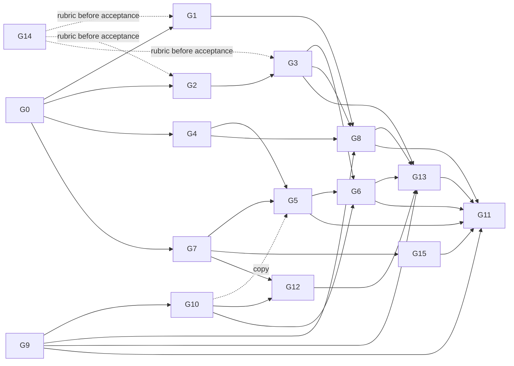
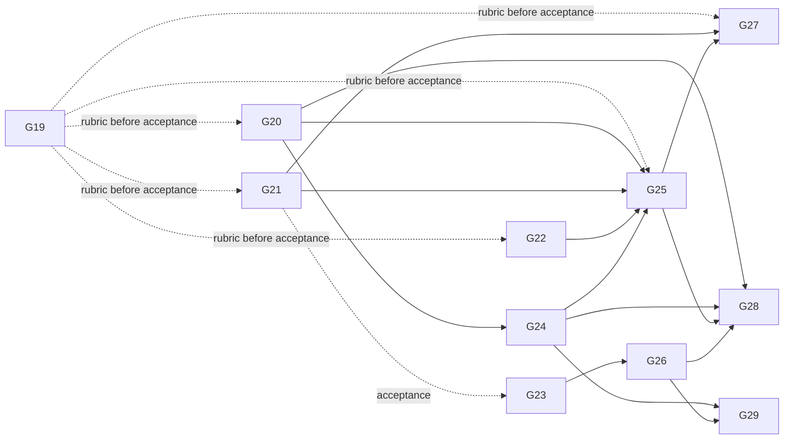

# Fix plan: Sessions (Step 3)

This plan covers all 81 P0/P1 Sessions findings from audit run `20261021T0327Z` (`docs/ux-program/findings.tsv`, survivors in `run-20261021T0327Z.json`). It folds in the 46 P2s that fall inside a group's files and theme. The 9 other P2s wait in the backlog. The plan was written from the code at `ce9b3d0`, and line numbers point there.

Audit run 2 (`20261021T0645Z`) added 10 P1s and 22 P2s (F-SES-138 to F-SES-169). They are folded into the groups that have not started, plus one new group, G15. The groups that merged (G0, G1, G4, G9, G10, G14) and the two in review (G2 #13, G7 #7) are not reopened. Section 9 maps each new finding to its group and lists the ones a merged or in-review PR likely fixes already. Run 2 text was checked against `origin/main` at `91a104e` and the two PR branches.

Each group is one PR, or one PR plus a short follow-up where noted. A group names its data shape before its UI. The bridge and the app share one schema PR (G0), so bridge groups and app groups can run in parallel afterwards.

## 1. Root causes

Most of the 81 findings come from eight root causes:

| # | Root cause | Findings it explains | Groups |
| --- | --- | --- | --- |
| R1 | A step's state and output are read from the first `tool_result`. Claude Code's launch acks for background work, its hand-back wrapper and the later `<task-notification>` are not modeled. Steps carry no times, no command and no cause. | 027 028 029 033 054 056 058 060 061 062 068 075 | G1, G4 |
| R2 | Session status only looks at the foreground turn. `Live.background`, `Live.cli` (wake turns) and the SDK's `task_*` events are ignored by `isWorking()`, `own.status()`, `own.controls()` and the catalog. | 001 030 037 041 045 050 052 055 059 074 | G2, G4, G12 |
| R3 | The end of a run (stop, failure, process death, bridge restart) is not a recorded outcome. Notices and the `failed` mark live in memory. Stop has one scope and no acknowledgement. | 009 010 031 049 051 072 004 040 | G3, G6 |
| R4 | The thread has no single status slot. Run state is only a `Working…` row at the bottom of the list, so nothing is announced and offline state never takes priority. | 005 006 007 065 071 081 | G5 |
| R5 | Overlay items (cards, notices, queued echoes) are appended after transcript items. Rows and threads wait on serial transcript reads. | 032 044 064 066 067 | G8 |
| R6 | The app trusts a socket until a ping fails. There is no path monitor, no probe on return and no pong deadline. The bridge sends no application heartbeat. | 012 015 063 | G2, G9 |
| R7 | Offline screens keep live-looking state and give no cause or action. Requests sent while offline never end. | 011 013 014 036 047 048 070 073 | G10, G11 |
| R8 | Push only covers bot chats and session cards. The phone counts as watching while suspended, and no session alert exists on the device. | 016 017 018 019 020 021 057 | G13 |

The rest are list presentation (G12), card layout (G7) and runner defects (G14).

## 2. Foundation data model (G0)

All new fields are additive under protocol 3. An absent field reads as `null`, `false` or `[]`. Old apps ignore unknown keys, and unknown enum values decode to `.unknown`. New capabilities are gated by new `FEATURES` names, so a new app never offers a control an older bridge would ignore. TypeScript marks the new fields optional (`?:`), so G0 touches only `protocol.ts` on the bridge, and later groups fill the fields without touching it again.

```ts
// bridge/src/protocol.ts

export const FEATURES = [ ...existing, "session_tasks", "session_unqueue", "push_state" ] as const;

/** waiting: an approval card for this call is open, so it has not started. stopped: cut off by the user or by a restart. */
export type StepState = "running" | "waiting" | "ok" | "error" | "denied" | "stopped";

export type ToolStep = {
  id: string; tool: string; label: string; state: StepState;
  diff: { path: string; added: number; removed: number } | null;
  output: string | null;          // real output only: never a launch ack, a hand-back wrapper or a reject boilerplate
  detail?: string | null;         // what actually runs: the Bash command (first 3 lines, masked), or the agent type
  startedAt?: string | null;      // execution start: the tool_use time, or the approval time when it waited on a card
  endedAt?: string | null;        // tool_result time, or the <task-notification> time for background work
  background?: boolean;           // run_in_background Bash or an async Agent: it outlives the turn
  owner?: string | null;          // step id of the Agent step whose subagent started this one (P-BG-5)
  cause?: string | null;          // one line on error, denied or stopped: "Exit code 1: ls: late.txt: No such file", "Stopped by you"
  usage?: { tools: number; ms: number } | null; // a finished Agent's tool count and run time
};

/** Live work Claude Code tracks for the session: subagents (foreground and background) and background commands. */
export type SessionTask = {
  id: string;                     // Claude Code's task_id
  stepId: string | null;          // tool_use id of the step that started it; joins to ToolStep.id
  kind: "agent" | "command" | "other";
  label: string;                  // the task description, masked
  background: boolean;
  startedAt: string;
  owner: string | null;           // step id of the owning subagent (parent_task_id resolved), null for the main thread
  progress: { tools: number; last: string | null; at: string } | null; // tool count, last tool, last activity
  waiting: MessageId | null;      // an open card this task is blocked on
};

export type SessionControls = {
  ...existing;                    // `working` now means: a turn runs, a wake turn is due or running, or tasks is non-empty
  turn?: { startedAt: string; wake: boolean } | null;   // the foreground turn; wake: Claude Code started it on its own
  tasks?: SessionTask[];
  heardAt?: string | null;        // last sign of life from Claude Code for this session; refreshed at least every 25 s while working
};

export type SessionRow = {
  ...existing;
  since?: string | null;          // when the current run started (the turn, or the oldest live task); null at rest
  running?: { agents: number; commands: number } | null;
  activity?: string | null;       // one line while busy: "Run perl -e 'sleep 60'", "Waiting for approval: Bash", "Background: sleep 75"
  outcome?: { kind: "finished" | "failed" | "stopped" | "lost"; text: string; at: string } | null; // until the next send
};

// SessionItem changes
//   permission: + stepId?: string | null; subagent?: string | null   (the asking subagent's label)
//   notice:     + reason?: "stop" | "task" | "restart" | "failure" | "approval" | null
// PermissionMessage.answer: + "stopped" (protocol2.ts closes it for v2 apps)

// Client frames
//   session_stop    + target?: "all" | "turn" | { task: string }   (absent = "all", today's behaviour)
//                   + turnStartedAt?: string | null                 (a stale stop for an older run is refused)
//   session_unqueue { sessionId, clientId }                         (feature session_unqueue)
// Server frames
//   session_tool_output: output: string | null; + error?: string | null
//   error:               + sessionId?: SessionId; about?: "stop" | "send" | "tool" | "create" | null; ref?: string
//   hello:               + push?: PushState
//   push_state           { type: "push_state"; push: PushState }    (feature push_state)
export type PushState = { state: "on" | "off" | "failing"; error: string | null; at: string | null };
```

Two rules hold this together:

- **Steps come from the transcript, and tasks come from the live stream.** A ToolStep is rebuilt from disk, so it survives a reopen or a restart. A SessionTask exists only while a bridge-driven query is live. The app joins them by `stepId`: a running step with a matching task shows its progress and gets a Stop.
- **`working` means that something runs, and `turn` says whether a turn runs.** Stop, the busy row and the S*.stop rubric items follow `working`. Queue-versus-send follows `turn`.

## 3. Groups

Format: findings are the ones the group closes. "(+Gx)" means another group must also land before the finding can be closed in the ledger.

---

### G0. Run-state schema on both sides

- **Findings:** none closed. It is the base for every group below.
- **Root cause:** the wire cannot express background work, step times, outcomes, stop targets or push state (`protocol.ts:371-456`).
- **Fix design:**
  - Data: exactly section 2.
  - Bridge: types only, plus `fixtures/protocol.json` examples for every new field and frame. `protocol2.ts` is not touched here; G3 closes `stopped` for v2.
  - iOS: `Protocol.swift` mirrors the types with `decodeIfPresent` defaults. `ToolStepState` gets `.waiting` and `.stopped`. `SessionTask`, `PushState`, `Feature.sessionTasks/.sessionUnqueue/.pushState` and the new client frames are added. In `ThreadItems.swift`, `StepState` draws the two new states with a word and a non-colour glyph: "Waiting for approval" (hand) and "Stopped" (stop.circle). Nothing else in the UI changes.
  - Docs: the protocol section of `docs/sessions-design.md`.
- **Patterns:** P-STATE-1, P-STATE-6, P-STATE-7, P-BG-1, P-BG-5, P-TIME-1, P-STOP-2, P-ALIVE-2.
- **Files:** `bridge/src/protocol.ts`, `fixtures/protocol.json`, `bridge/test/protocol.test.ts`, `ios/ClaudioBot/Model/Protocol.swift`, `ios/ClaudioBotTests/ProtocolTests.swift`, `ios/ClaudioBot/Views/ThreadItems.swift` (StepState only), `docs/sessions-design.md`.
- **Verify:** `bun test` and the iOS unit tests (the fixture pins both sides). Protocol lane: rerun S1 once and check that the frames still decode and nothing regresses. No simulator.
- **Acceptance:** fixture round-trips on both sides. A frame without the new keys decodes as before. An unknown step state still renders.
- **Risk:** keep every new field optional, or an older bridge breaks a new app. `Feature` gating is the only thing that hides new controls.
- **Depends on:** nothing. **Wave 1.**

---

### G1. Step truth from the transcript (bridge)

- **Findings:** F-SES-027 sessions-async-agent-launch-ack-shown-as-step-output, F-SES-028 sessions-async-agent-step-reads-done-at-launch, F-SES-029 sessions-background-step-marked-ok-while-running, F-SES-033 sessions-finished-subagent-shows-raw-handback, F-SES-054 sessions-subagent-completion-never-reaches-phone, F-SES-058 sessions-wake-turn-prose-wrong-on-arrival-two-of-three, F-SES-061 thread-bg-step-output-shows-launch-boilerplate, F-SES-075 thread-wake-turn-replies-have-no-trigger-and-repeat.
  P2: F-SES-082 a11y-background-control-steps-raw-tool-names, F-SES-098 sessions-denied-step-shows-claude-code-reject-boilerplate, F-SES-113 sessions-subagent-label-masks-ordinary-words-as-secret, F-SES-114 sessions-subagent-labels-cut-at-60-chars-look-identical, F-SES-121 thread-bash-step-label-doubles-run-verb, F-SES-122 thread-bg-command-approval-and-step-never-say-background.
  Enables G4 for 056, 060, 062, 068, 080 and 100.
- **Root cause (R1):**
  - `settle()` (`transcript.ts:748-766`) turns any non-error `tool_result` into `ok` and keeps its last 2 KB as output.
  - `MACHINE` (`:601`) drops `<task-notification>` entries, and `settle()` deletes the tool id from `tail.tools`, so nothing can settle the step later.
  - `stepLabel` (`:536`, `:541`) prefers the model's description and drops the command.
- **Fix design:**
  - Data: fills `ToolStep.detail/startedAt/endedAt/background/cause/usage` and the `stopped` state. Adds `notice` items with `reason: "task"`.
  - Bridge (`transcript.ts`):
    1. **Launch acks.** Detect `Async agent launched successfully` (Agent/Task) and `Command running in background with ID: <id>` (Bash). The step stays `running` with `background: true` and `output: null`. Keep the tool id open in the tail, plus a map from `task-id` to step.
    2. **`<task-notification>` entries.** Parse `<task-id>`, `<tool-use-id>`, `<status>`, `<summary>`, `<result>` and `<usage>`. Settle the step to ok (`completed`), error (`failed`) or stopped (`stopped`/`killed`). Set `endedAt` to the entry time, `usage` from `<usage>`, and `cause` from the summary when it did not succeed. Settling must be idempotent: the note says one task id may notify more than once, so the last one wins. Also emit a `notice` item (id = the entry uuid, `reason: "task"`, text = Claude Code's summary, for example `Background command "sleep 75" completed (exit code 0)` or `Agent "sleeper two" finished`). It lands in time order just before the wake turn's reply, so the reply has a visible trigger (P-BG-4).
    3. **Agent hand-back.** Strip the `[Subagent hand-back]` framing, the `agentId:` lines and the `<usage>` block. `output` keeps the agent's own report, and `usage` gets the numbers.
    4. **Times.** `startedAt` is the tool_use entry time. G2 overrides it with the approval time. `endedAt` is the result time.
    5. **Bash.** `detail` is the command (first 3 lines, masked). The label stays the description but never doubles "Run". A background call reads "Run in background: …" (122). Calls to `BashOutput`/`KillShell`/`TaskOutput` get labels such as "Checked background command" and "Stopped background command" (082).
    6. **Failures.** For an error result, `cause` is the first `Exit code N` line plus the first non-empty error line. `output` keeps the head (512 B) plus the tail (1.5 KB) with a gap marker, so the exit status is never cut (062).
    7. **Stopped versus denied.** A result of `The user doesn't want to proceed with this tool use` that is followed by `[Request interrupted by user…]`, or one that carries the bridge's stop text (`<user> stopped the session. It did not run.`, defined in G3), maps to `stopped` with `cause: "Stopped by you"`. The Claude Code reject boilerplate is dropped from `output` (098).
    8. **Agent labels.** Use up to 120 characters with middle truncation, so the distinguishing words survive (114). `detail` is the subagent type.
  - Bridge (`text.ts`): `maskSecrets` stops masking ordinary words in labels. It masks only assignments and known key shapes (113).
  - iOS: nothing. G0 already renders the states. Times, detail and cause appear in G4.
- **Patterns:** P-STATE-6, P-STATE-2, P-BG-4, P-BG-6 (no stub as output), P-TIME-1, P-TIME-4, A-1, A-7.
- **Files:** `bridge/src/transcript.ts`, `bridge/src/text.ts`, `bridge/test/transcript.test.ts`, `bridge/test/text.test.ts`, `bridge/test/transcripts/jsonl/` (new fixtures copied from the S1b, S2, S4 and S8 run transcripts, with titles scrubbed).
- **Verify:** protocol lane S1, S1b, S2, S4, S5 and S8 (after G14's runner fixes). No simulator.
- **Acceptance:**
  - S1b.4 and S1.4: each Agent step reads ok only within 2 s of its subagent's end.
  - S1b.5, S1.5, S2.3, S5.3 and S6.5 pass on `startedAt`.
  - S2.4 and S3.4: the step flips and a task notice lands within 60 s of bg-done.
  - S4.1 and S4.2: error state plus `cause`.
  - New check (G14): no step `output` matches `/Async agent launched|Command running in background|Subagent hand-back|doesn't want to proceed/`.
  - S2.1 and S5.1 pass on `detail`.
- **Risk:**
  - The ack and notification texts belong to Claude Code (CLI 2.1.305) and can change. Match loosely, pin them with fixtures, and fall back to today's behaviour when nothing matches.
  - The `<task-notification>` for an agent is written only when the agent stops with no live children, so S8's shell gets no notification at all. G2 covers that case from the stream.
- **Depends on:** G0. **Wave 2.**

---

### G2. Live work model: background tasks, wake turns, waiting cards, heartbeat (bridge)

- **Findings:** F-SES-001 (P0) sessions-working-false-while-background-subagents-run, F-SES-015 protocol-silent-gap-no-app-heartbeat-during-long-call (+G9), F-SES-030 sessions-background-task-invisible-row-idle, F-SES-037 sessions-no-stop-affordance-for-background-work (+G6 for the label), F-SES-041 sessions-registry-waiting-shown-idle, F-SES-050 sessions-stopped-subagent-step-reads-ok-and-extra-turn-runs-idle (+G1), F-SES-052 sessions-subagent-background-command-killed-silently, F-SES-059 sessions-wake-turn-shows-idle-and-no-completion-item (+G1), F-SES-074 thread-tool-step-reads-running-while-awaiting-approval.
  P2: F-SES-132 thread-work-item-at-is-tool-request-time-not-run-start.
  Enables G4 (038, 045, 055), G7 (053), G12 (042), G13 (017).
- **Root cause (R2):**
  - `isWorking()` (`session.ts:890-893`) ignores `Live.background` and `Live.cli`, although `busy()` (`:769`) already knows both.
  - `own.status()` and `own.controls()` (`own.ts:424-453`), `sessions.ts:205-235` and `catalog.ts:123` all build on it.
  - `receive()` (`:1209-1234`) ignores `task_started`, `task_updated`, `task_progress`, `tool_progress` and the `parent_task_id` on `background_tasks_changed`.
  - The registry's `waiting` status is dropped (`claudeApps.ts:93`).
  - A card for a tool call never touches its step (`transcript.ts:740`).
- **Fix design:**
  - Data: fills `controls.turn/tasks/heardAt`, the new `working` meaning, `row.since/running/activity`, `task.waiting`, step `waiting`, and the post-approval `startedAt`.
  - Bridge, `session.ts`:
    - Add a task ledger on `Live`, keyed by `task_id`, fed by `task_started` (tool_use_id, task_type, is_backgrounded, parent_task_id, description), `task_updated` (status, end_time), `task_progress` (usage.tool_uses, last_tool_name), `tool_progress` (heartbeat, elapsed) and `task_notification`. `background_tasks_changed` stays the replace-semantics source of truth for which tasks are live.
    - Expose a read-only `activity()` with `{ turn, wake, tasks, heardAt }`.
    - **Do not change `isWorking()`.** The hub and bots depend on it.
    - A task that disappears with status `killed`, or that leaves `background_tasks_changed` without a notification (S8: a subagent's shell killed at hand-back), produces a notice. It names the command and its owner: "`sleep 60` (started by starter) was stopped when starter returned." (052, P-BG-5, A-10).
  - Bridge, `own.ts`:
    - `controls()` sets `working = turn running || wake due or running || tasks.length > 0` and fills `turn`, `tasks` and `heardAt`.
    - `status()` returns `working` on the same rule, below the attention states.
    - A permission card records `toolUseId` and `o.agentID` (`own.ts:227` passes `subagent: null` today). Tasks then get `waiting: cardId`, and the item gets `stepId` and `subagent`.
  - Bridge, `sessions.ts`: `driven()` and `controls()` for agent sessions use the same `activity()`.
  - Bridge, `threads.ts`:
    - The overlay patches transcript steps. A step with an open card reads `waiting`. A step answered "once" gets `startedAt` = the answer time (132). A `background` step whose task is still live stays `running`.
    - A controls-only `session_items` frame (with `heardAt`) goes out at least every 25 s while `working` and the thread is watched, and at most every 10 s on progress (P-ALIVE-2).
  - Bridge, `catalog.ts`: `row.since` = the turn start or the oldest task start. `row.running` = counts by kind. `row.activity` = the open card ("Waiting for approval: Bash"), else the last running step label, else "Background: <label>". For registry-held sessions, `waiting` + `waitingFor: "permission prompt"` maps to `awaiting_approval` (041).
  - Bridge, `claudeApps.ts`: keep `status` and `waitingFor`.
  - iOS: nothing required. The composer already shows Stop when `working`, so the P0 is closed by the bridge alone.
- **Patterns:** P-STATE-1, P-STATE-3, P-STATE-4, P-BG-1, P-BG-2, P-BG-5, P-ALIVE-2, P-STOP-1, A-3, A-6, A-10.
- **Files:** `bridge/src/session.ts`, `bridge/src/own.ts`, `bridge/src/sessions.ts`, `bridge/src/threads.ts`, `bridge/src/catalog.ts`, `bridge/src/claudeApps.ts`, `bridge/test/{session,own,sessions,threads,claudeApps}.test.ts`, `bridge/test/transcripts/*.ndjson` (new raw-SDK fixtures), `bridge/src/hub.ts` (one line: serve `session_tasks`).
- **Verify:** protocol lane S1, S1b, S2, S5, S7 and S8. Also a probe that leaves a card unanswered (the S5 edge, `pend.ts`) and a registry-waiting probe (S7). No simulator.
- **Acceptance:**
  - S1b.3 and S1b.7: the row is working and `controls.working` is true for the whole subagent window, including the wake turns.
  - S2.2a, S2.2b and S2.6.
  - S8.1a, S8.1b, S8.2 (a task or notice names `sleep 60` or `starter`), S8.3 (a killed notice) and S8.5.
  - S5.2, S5.4 (longest gap ≤ 30 s), S5.5, S1.3, S1.7, S7.2 and S7.4.
  - New S5 edge item (G14): a step with an open card reads `waiting`.
  - S1.6 and S1b.6 pass on `controls.tasks[].progress`.
- **Risk:**
  - **Spike first.** Log raw SDK frames in one S1b and one S8 run. Then confirm four things: `local_agent` tasks appear in `task_started` and `background_tasks_changed`; `agentID` equals the agent's `task_id`; a subagent's shell carries `parent_task_id`; and a killed shell reports `killed`. The audit lists all four as unverified.
  - This is the biggest PR. It can land as two commits: the ledger and status in `session.ts`/`own.ts`/`sessions.ts`, then rows and threads in `catalog.ts`/`threads.ts`.
  - `working` now covers background work, so an old app shows "Queue a message" while only a background task runs. G6 fixes that.
- **Depends on:** G0. **Wave 2.**

---

### G3. Run endings: stop targets, recorded outcomes, restart notices (bridge)

- **Findings:** F-SES-009 composer-stop-and-send-kills-background-process-silently, F-SES-010 offline-bridge-restart-leaves-background-promise-unmarked, F-SES-031 sessions-failed-mark-and-error-notice-lost-on-bridge-restart, F-SES-049 sessions-stop-leaves-no-stopped-entry, F-SES-051 sessions-stopped-subagents-labelled-denied (+G1, +G5 for per-task Stop), F-SES-072 thread-step-running-after-process-death.
  P2: F-SES-108 sessions-row-carries-no-outcome-after-failure-or-stop, F-SES-111 sessions-stop-retires-subagent-approval-as-expired, F-SES-117 sessions-unread-dot-says-nothing-about-what-finished (outcome text; the row UI is in G12), F-SES-130 thread-stop-notice-bare-interrupted-and-header-says-ran.
  Run 2, P1: F-SES-143 sessions-stop-in-first-seconds-erases-prompt-permanently (+G6 for the draft), F-SES-140 sessions-model-mode-chip-shows-new-value-when-claude-code-refused (bridge half; the chip is in G6).
  Run 2, P2: F-SES-156 sessions-stop-of-background-work-reports-success-before-it-happens-failure-silent, F-SES-157 sessions-subagent-denied-command-step-reads-ok-while-stop-reads-denied (the Deny half; G1 already fixed the Stop half), F-SES-159 thread-failed-turn-error-notice-shown-twice, F-SES-152 sessions-failed-thread-error-raw-signal-no-next-step (bridge half, +G5), F-SES-150 sessions-approval-always-text-garbles-compound-command (bridge half, +G15).
- **Root cause (R3):**
  - `interrupt()` (`session.ts:1315-1325`) stops every background task on any interrupt, including "Stop and send".
  - `onTurnEnd` (`own.ts:331-340`) has no `stopped` branch.
  - `notices` and `failed` (`own.ts:120-121`) are not persisted.
  - The restart note for background work fires only when a driver is created (`session.ts:1289`). An idle session never gets one.
  - No step is settled when the process dies (`transcript.ts:641-649`).
- **Fix design:**
  - Data: fills `row.outcome`, `notice.reason: "stop" | "restart" | "failure"`, `PermissionMessage.answer: "stopped"` and step `stopped`/`error` with `cause`. Serves `session_stop.target/turnStartedAt`.
  - Bridge, `session.ts`: `interrupt(target)`. `"turn"` stops only the turn. `"all"` stops the turn and every task. `{task}` calls `stopTask(id)` for one task, and that works for foreground subagents too. It returns what it stopped.
  - Bridge, `own.ts`:
    - `stop(rec, target)` records `outcome = { kind: "stopped", text: "Stopped by you: the turn, 2 agents, 1 command" }`. It adds a `notice` (`reason: "stop"`) at the moment of the stop, listing what was stopped (P-STATE-7). It settles open cards with a new reply kind, `stopped`, whose deny message is `<user> stopped the session. It did not run.` and whose answer is `"stopped"` (111).
    - `send(…, interrupt)` passes `"turn"` (009).
    - `onTurnEnd` failed → `outcome failed`. Done → `outcome finished`, with the task summary text when a background task ended (117).
    - Outcome and notices move onto the persisted `rec.own` (`world.ts`) and are cleared on the next send.
    - `restart()` scans records whose `state.background` is not empty. It writes the restart notice and `outcome lost` without starting a driver (010, P-BG-7).
    - Unknown `turnStartedAt` (an older run) is refused with `error{about:"stop"}`.
    - `session_unqueue` drops a pending envelope by `clientId` (the bridge half of 040).
  - Bridge, `threads.ts`: when a session is at rest (no turn, no tasks), the overlay settles every transcript step still `running`. After a failure it becomes `error` with the outcome text as `cause`. After a stop it becomes `stopped` ("Stopped by you"). After a restart it becomes `stopped` ("The bridge restarted"). This covers 072 and the "declined" text in 076.
  - Bridge, `sessions.ts`: routes `target`, `turnStartedAt` and `session_unqueue`. A failed stop returns `error{sessionId, about:"stop"}`.
  - Bridge, `catalog.ts`: `row.outcome` comes from the record. Status is `failed` for failed or lost, and `idle` for stopped or finished.
  - Bridge, `protocol2.ts`: `stopped` closes as `expired` for v2 apps.
  - iOS: none. G6 and G5 consume it.
  - **Run 2 additions:**
    - **A stop must not erase the prompt (143).** Today the phone's user bubble is built only from `session.pending` (`own.ts:416-420`, `sessions.ts:253-257`), and `finish()` (`session.ts:260-266`) removes it when the turn ends `stopped`. If Claude Code had not yet written the user entry, the text is gone for good. On a `stopped` end, `own.ts` keeps the prompt as a persisted overlay user item, with the same id and send time, followed by the stop notice. The item is dropped only once a transcript user entry with that text exists (the same rule G8 uses for live sends). The stop notice then reads "Stopped before Claude started. Your message was not sent to Claude." G6 adds Edit and resend on that bubble.
    - **Model and mode changes report the value that runs (140).** `set()` (`own.ts:389-408` on the G2 branch) writes `drive.model`/`drive.mode` before `setModel`/`setPermissionMode` and does not roll back on a throw. It should apply to the live query first and store only on success. On a refusal it keeps the old value, still calls `changed()` so `controls()` pushes the true value, and returns the refusal as `error` with `about: {kind: "set", sessionId}` (a new additive `ErrorAbout` variant). G6 shows the pending state and the inline error.
    - **Stopping background work is confirmed (156).** G2's branch already has `interrupt(target)` and `stopTask(l, id)`, but `stopTask` is fire-and-forget and `interrupt` returns `true` whatever happens. `interrupt` awaits each `stopTask` with a 5 s cap and returns `{ stopped, failed }`. A failed stop sends `error{about:{kind:"stop"}}` and adds a notice ("Couldn't stop sleeper two"). A successful one settles the task's step `stopped` through the overlay below.
    - **A denied subagent call shows on its Agent step (157).** The overlay in `threads.ts` already knows each card's `stepId` and `subagent` (G2). When a card a subagent raised is answered Deny or Never, its owning Agent step gets `cause: "You denied its Bash: <detail>"`. When the step settles ok, it reads `denied` with that cause, not a bare ok.
    - **One notice per failure (159).** When the turn's transcript already has an API-error notice (`transcript.ts:665-669`) with the same text, `onTurnEnd` (`own.ts:332`) records the outcome but adds no second notice. Dedupe in the overlay by text within the turn, so `transcript.ts` is not touched.
    - **Failure wording and next step (152, bridge half).** The failure notice says what happened in words and keeps the raw error as its second line: "Claude Code stopped unexpectedly. Send a message to start it again." A card whose signal aborts because the process died settles as closed, not `expired` (`own.ts:158-161`), so it does not read "Expired" a minute after it opened.
    - **Always text as a list (150, bridge half).** `alwaysText()` (`own.ts:530-535`) names the tool and separates the rules with " · ", not ", ": "Bash: perl -e 'sleep 45' · echo late …". It drops the trailing ", for this session", because G15's card line states the scope. The `always` field stays a string, so there is no schema change.
- **Patterns:** P-STATE-7, P-STATE-2, P-STOP-2, P-STOP-3, P-STOP-4, P-BG-7, P-CONN-5, A-5, A-9.
- **Files:** `bridge/src/session.ts`, `bridge/src/own.ts`, `bridge/src/sessions.ts`, `bridge/src/threads.ts`, `bridge/src/catalog.ts`, `bridge/src/world.ts`, `bridge/src/protocol2.ts`, `bridge/src/hub.ts` (one line: serve `session_unqueue`), `bridge/test/{session,own,sessions,threads,protocol2}.test.ts`. Run 2: `bridge/src/protocol.ts` and `fixtures/protocol.json` (one additive `ErrorAbout` variant, `{kind: "set"}`, for 140; G6 mirrors it in `Protocol.swift`).
- **Verify:** protocol lane S4 and S2 (with G14's new "Stop and send keeps background" item). Restart and SIGKILL probes come from G14's `bridge restart` and `kill-claude` actions. No simulator.
- **Acceptance:**
  - S4.3, S4.4, S4.5 (a notice with `reason:"stop"`; assistant prose no longer counts after G14) and S4.6 (with process evidence).
  - New S2.9: after "Stop and send" the background command still finishes.
  - New S6.7: after SIGKILL no step reads running, and the row reads failed with a cause.
  - New S6.8: after a bridge restart the row keeps failed or lost, and the thread has the restart notice.
  - Run 2:
    - Early-stop probe (Stop 0.8 s and 1.2 s after `session_create`): the user item is still there after the stop and after a fresh open, with the stop notice under it (143).
    - A `set` that Claude Code refuses leaves `controls.model`/`controls.mode` at the old value and sends `error{about:{kind:"set"}}` (140; unit test with a throwing `setPermissionMode`).
    - A `stopTask` that rejects gives an error frame and a notice. One that resolves settles the step `stopped` within 2 s (156; S4 background variant).
    - Deny probe (S4 with the card answered deny): the Agent step reads `denied` with a cause, not ok (157).
    - A bad-model failure shows one error notice (159). After `kill-claude`, the notice has the worded line, and an open card reads closed, not expired (152).
- **Risk:**
  - Persisting notices grows `world.json`. Keep `NOTICES_KEPT = 10` per session.
  - `stopped` as a card answer touches bot chats' `PermissionMessage`. Check `gate.ts` consumers before shipping.
  - The wake turn that Claude Code starts after a stopped subagent cannot be prevented. G2 makes it read working, and the stop notice above it explains it.
- **Depends on:** G2 (same files, and it reads `activity()` to know nothing is left running). G2's branch already carries `interrupt(target)` and per-task `stopTask`, so G3 builds its stop targets on that code and does not write them again. **Wave 3.**

---

### G4. Thread work run: per-step state, timers, command, cause, counts (iOS)

- **Findings:** F-SES-008 a11y-working-group-header-speaks-no-state, F-SES-038 sessions-no-stuck-signal-for-working-subagents (+G2), F-SES-045 sessions-running-count-missing (+G2, +G12 for the row), F-SES-055 sessions-subagent-inner-activity-dropped (+G2), F-SES-056 sessions-subagent-step-no-start-time (+G1), F-SES-060 thread-bash-step-label-is-model-description-command-not-on-wire (+G1), F-SES-062 thread-failed-command-exit-status-cut-from-output (+G1), F-SES-068 thread-running-tool-step-shows-no-elapsed-time (+G1), F-SES-069 thread-running-work-header-pins-failed-badge-to-running-agent, F-SES-076 thread-work-summary-counts-failed-write-as-edited (+G3), F-SES-080 x-dynamic-type-work-header-truncates-agent-name-shows-one-of-two (+G1).
  P2: F-SES-092 a11y-tool-step-ok-silent-glyph-unhidden, F-SES-100 sessions-finished-subagent-no-duration-or-outcome, F-SES-126 thread-fold-hides-running-and-failed-steps, F-SES-136 x-dynamic-type-workrun-header-icon-clipped.
- **Root cause:** `WorkRunRow` shows only `steps.last { running }` (`ThreadItems.swift:200-250`). `ToolStepRow` has no clock, no command and no cause, and `.ok` draws nothing (`:276-349`). `WorkSummary` counts every edit step, failed ones included (`Threads.swift:121`, `:157-160`).
- **Fix design:**
  - Data: reads the G0 fields and joins `controls.tasks` to steps by `stepId`.
  - iOS, `ThreadItems.swift`:
    - **Header.** One line per state class: "3 agents running · 1 failed: broken helper (unknown agent type) · 2m 05s". The failed step is named with its cause (069). The running count is shown (045). The elapsed time comes from the earliest running `startedAt`, as a `TimelineView` once per second with `.monospacedDigit()` (P-TIME-2, P-A11Y-4).
    - **Spoken header.** "Running: 3 agents, 1 failed, 2 minutes" plus Expanded/Collapsed and a hint (008).
    - **Wrapping.** The header wraps at accessibility sizes. With more than one running agent it lists their distinguishing labels instead of one truncated name (080). The icon sits in a scaled slot (136).
    - **Steps.** Every state has a word and a glyph (done, failed, stopped, waiting) (092). Running shows "1m 12s" from `startedAt` and finished shows the duration (100). `detail` is a second monospace line (060). `cause` comes first on error or stopped, with the output tail under it (062).
    - **Running agents.** Show the task's `progress.last` and tool count (055), and "No activity for 3m" once `progress.at` or `heardAt` is older than 60 s (038, A-2).
    - **Shimmer.** It goes only on the live row (P-ALIVE-1). Under Reduce Motion, the timer alone carries liveness.
    - **Stale mode.** Add an environment key, `\.runStateStale`. When it is set, spinners dim and timers freeze. G5 sets it.
  - iOS, `Threads.swift`: `WorkSummary` counts only `ok` edits and diffs, and keeps failed separate: "Edited 10 files +10, 1 failed" (076). A fold shows the worst state inside it (running or failed counts) (126). The finished header gives the group time: "Ran 3 agents, 43 s" (100).
- **Patterns:** P-TIME-1, P-TIME-2, P-TIME-3, P-TIME-4, P-SUB-1, P-SUB-2, P-ALIVE-1, P-STATE-2, P-A11Y-1, P-A11Y-3, P-A11Y-4, A-2, A-8.
- **Files:** `ios/ClaudioBot/Views/ThreadItems.swift`, `ios/ClaudioBot/Model/Threads.swift`, new `ios/ClaudioBotTests/ThreadWorkTests.swift` (do not grow `SessionsTests.swift`, which G12 also edits), `ios/ClaudioBot/Demo/DemoSessions.swift`.
- **Verify:** **simulator lane** S1, S1b, S2, S4, S5 and S8, with G14's open-thread shots. X-dynamic-type (AX5 via `simctl ui content_size`). X-voiceover by code review plus unit tests on the spoken strings.
- **Acceptance:**
  - S1.8 and S1b.8: three labelled rows, each visibly running, with a count and Stop. S1.9 and S1b.9: three done rows with durations, no spinner.
  - S2.7: running, elapsed time and Stop. S5.7: elapsed differs between the 30 s and 90 s shots.
  - S4.7: the failed and running states look different, and the failed one is named.
  - S8.6: the command and its owner are visible.
  - Header speech includes state, count and failures.
- **Risk:** a 1 Hz `TimelineView` per running row is fine for a few rows. Use one clock per work run, not one per step. Data arrives with G1 and G2. Build against G0 fixtures, merge, then run the acceptance pass once G1 and G2 are in.
- **Depends on:** G0 (`ThreadItems.swift`). Verification needs G1, G2 and G3 (for 076's cause). **Wave 2.**

---

### G5. Thread status slot, background work sheet and announcements (iOS)

- **Findings:** F-SES-005 a11y-thread-header-and-tail-no-run-state-for-voiceover, F-SES-006 a11y-thread-opened-on-waiting-approval-announces-nothing, F-SES-007 a11y-turn-end-and-failure-never-announced, F-SES-065 thread-offline-bar-does-not-say-state-is-stale, F-SES-071 thread-skeleton-forever-when-offline, F-SES-081 x-ipad-sidebar-hidden-in-portrait-running-elsewhere-invisible.
  P2: F-SES-086 a11y-permission-announcement-omits-command-and-session, F-SES-089 a11y-streaming-tail-label-is-whole-growing-reply, F-SES-123 thread-doubled-working-indicators-for-one-running-step, F-SES-125 thread-expired-approval-still-hides-working-and-announces, F-SES-131 thread-top-edge-blur-leaks-transcript-words-beside-title, F-SES-137 x-ipad-thread-header-title-capped-at-260pt.
  Also the per-task Stop UI for F-SES-051.
  Run 2, P2: F-SES-148 a11y-ask-announcement-reads-only-first-question-plan-announcement-unnamed, F-SES-163 voiceover-holder-banner-open-button-merged-and-silent, F-SES-169 x-ipad-selection-not-restored-after-kill-detail-pane-says-no-session-selected (the detail pane half), and the app half of F-SES-152 (the failed outcome's next step).
- **Root cause (R4):**
  - Run state is only `StreamingTail` at the bottom of a lazy list (`ThreadItems.swift:725-749`).
  - The only announcement is a card `.onChange`, which never fires on first render (`SessionThreadView.swift:164-166`).
  - The offline bar exists only in `.ready` (`:169-176`), and the skeleton has no exit (`:50-71`).
- **Fix design:**
  - Data: reads `controls.turn/tasks/heardAt/working`, `row.status`, `store.connection` and `notice.reason`.
  - iOS: one status line above the composer, with strict precedence (P-STATE-5):
    1. Connection: "Can't reach your Mac · last update 40 s ago", with Retry and the cause copy shared with G10's banner.
    2. Stale socket: "No word from your Mac for 50 s" when `heardAt` (or the last frame) is older than 45 s while working.
    3. An open card: "Needs your approval: Bash in sleeper two". It uses the deadline-aware check, so an expired card no longer counts (125).
    4. The turn: "Working 2m 05s · 3 agents".
    5. Background only: "Running in background: sleep 75 · 1m 12s".
    6. At rest: nothing, or the outcome from `row.outcome` for one turn.

    Tapping a background or working line opens a new `BackgroundWorkSheet` that lists `controls.tasks` (kind, label, owner, elapsed, progress) with a Stop per task (`session_stop target {task}`, behind feature `session_tasks`) and "Stop all" (P-BG-3, P-STOP-2, the 051 UI). While the line shows, `StreamingTail` is hidden from sight and from VoiceOver. The live reply is spoken once as "Claude is replying" (089, 123).

    The thread header's `accessibilityValue` is the state word (005). Announcements fire on these transitions: working → rest, failed, stopped, offline, and a card open on first render (006, 007). The card announcement names the command and the subagent (086).

    Offline: the thread view renders even before `.ready`. The skeleton shows for 1 s at most while connected. Otherwise the status line says "This session loads when your Mac is back" (071). It sets `\.runStateStale` from G4, so running marks dim (065).

    iPad: when the split view hides the sidebar, a toolbar chip shows "2 working · 1 needs you" for the other sessions (081). The header title is no longer capped at 260 pt and carries the state word (137). The header band is opaque (131).

    Run 2:
    - The card announcement counts questions ("3 questions. First: …") and the plan announcement names the plan's first heading (148, `SessionThreadView.swift:250-253`).
    - The holder banner (`SessionThreadView.swift:308-346`) keeps its text and its button as separate elements, with the button labelled "Open on claude.ai". A banner that appears or changes (parked, busy elsewhere) is announced, using the same 2 s debounce (163).
    - When Sessions is the sidebar and nothing is selected, the wide-layout detail pane (`MainView.swift:148-159`) shows the live summary instead of "No session selected": "2 running · 1 needs you", with one button per session. Restoring the last open thread after a kill stays out of scope (169).
    - The at-rest outcome line for a failed run (level 6) gives the next step from G3's notice: "Send a message to start it again" (152).
- **Patterns:** P-STATE-5, P-STATE-4, P-BG-3, P-STOP-2, P-ALIVE-3, P-CONN-1, P-CONN-4 (do not flash the stale line for gaps under 400 ms), P-A11Y-1, P-A11Y-2.
- **Files:** `ios/ClaudioBot/Views/SessionThreadView.swift`, `ios/ClaudioBot/Views/ThreadItems.swift` (StreamingTail only), `ios/ClaudioBot/Views/ChatNotices.swift` (OfflineBar folded into the status line), `ios/ClaudioBot/Views/MainView.swift`, new `ios/ClaudioBot/Views/BackgroundWorkSheet.swift`, new `ios/ClaudioBotTests/ThreadStatusTests.swift` (precedence table).
- **Verify:** **simulator lane** S2, S5, S6 (G14's app-side drop) and X-empty-error-offline cases 2-5. X-voiceover by code review plus precedence unit tests. X-ipad is code read (pool has no iPad; keep it as a coverage gap).
- **Acceptance:**
  - S2.7 and S5.7 on the status line.
  - S6.6: running after resume-1, done after resume-2, with no stale spinner and the "last update" line while down.
  - X-empty-error-offline case 5: no skeleton past 1 s offline.
  - One status line, never two working indicators.
  - The precedence unit tests pass for all six levels.
  - Run 2: unit tests on the spoken strings for a 3-question card, a plan, and a banner change (148, 163). On a wide layout with nothing selected, the detail pane lists the running sessions, judged by code read like 081 (169).
- **Risk:** this changes the thread's bottom layout, so check the composer inset and the keyboard. Announcement storms: debounce one announcement per 2 s. Do not announce replays after reconnect (P-NOTIFY-3).
- **Depends on:** G4 (`ThreadItems.swift`, and the stale environment key). G7 (its PR also edits `ThreadItems.swift` and `SessionThreadView.swift`: the card's reveal-step hook and the sending spinners), so G5 rebases after #7 merges. Soft dependency on G10 (shared connection copy and Retry). Verification needs G2 and G3. **Wave 3.**

---

### G6. Composer Stop and queue (iOS)

- **Findings:** F-SES-002 a11y-error-toast-five-seconds-unannounced, F-SES-004 a11y-stop-button-no-target-no-pending-no-ack, F-SES-040 sessions-queued-message-cannot-be-withdrawn-and-survives-stop (+G3).
  P2: F-SES-083 a11y-composer-queued-chip-says-1-messages, F-SES-088 a11y-session-composer-field-unlabelled-queue-mode-only-in-placeholder, F-SES-093 composer-stop-hidden-while-draft-text-present, F-SES-124 thread-error-notice-colour-icon-only, F-SES-134 x-dynamic-type-composer-chips-clipped-stop-squeezes-field.
  Also the Stop label part of 009 and 037.
  Run 2, P1: F-SES-146 voiceover-send-no-spoken-ack-and-focus-lost, the chip half of F-SES-140 (+G3), and the draft half of F-SES-143 (+G3).
  Run 2, P2: F-SES-162 voiceover-composer-field-swaps-to-lock-line-silently, F-SES-168 voiceover-user-bubble-label-is-raw-markdown-source.
- **Root cause:**
  - `showsStop = working && !hasText` with a bare "Stop" label (`SessionComposer.swift:17-22`, `:127-129`).
  - `stop()` only sends the frame (`:242-245`).
  - The queued chip is static (`:180-182`).
  - `ErrorToast` auto-dismisses after 5 s without an announcement (`Components.swift:150-171`).
- **Fix design:**
  - Data: reads `controls.turn/tasks/queued`, `error.sessionId/about` and the stop notice. Sends `session_stop{target, turnStartedAt}` and `session_unqueue`.
  - iOS, Stop:
    - Stop stays visible whenever `working`, even with a draft. A separate Stop sits beside Send when there is text (093). It is sized with the text (134).
    - The label names its target: "Stop: turn, 3 agents, 1 command" (P-A11Y-2).
    - If only the turn runs, Stop acts at once. If background tasks would also die, a confirmation offers "Stop everything", "Stop the turn only" and the count of queued messages that will still run (P-STOP-3, 040).
    - After the tap the control shows "Stopping…" and is announced. It ends when `working` goes false or the stop notice lands, and that is announced too. After 10 s it reads "Couldn't confirm the stop" with Retry (P-STOP-4).
    - "Stop and send" becomes "Stop turn and send" (009).
    - With background work only (`turn == nil`), Send sends at once. The placeholder is "Message Claude", not "Queue a message", and the field's accessibility label carries the mode (088).
  - iOS, queue: the chip reads "1 message queued" (083). Tapping the chip or a queued bubble offers Withdraw or Edit, which sends `session_unqueue` behind feature `session_unqueue` (040).
  - iOS, errors: `ErrorToast` posts an announcement, prefixes "Error:", and stays until dismissed while VoiceOver runs (002). Session errors with `sessionId` show inline under the composer instead of the global toast. The error `NoticeLine` speaks "Error" (124).
  - iOS, run 2:
    - **Send.** The Send/Stop slot is always drawn while the composer shows, so the focused control keeps its place. After Send it reads "Sent" until `working` makes it Stop. Send posts "Sent" or "Queued behind the current turn" (146, `SessionComposer.swift:62-77`, `:212-222`).
    - **Model and mode chips.** A change in flight shows the old value with "Changing to Accept edits…". A refusal (G3's `error{about:{kind:"set"}}`) shows inline under the composer and is announced until dismissed. The chip and its spoken label always come from `controls` (140). `Protocol.swift` mirrors the new `ErrorAbout` variant.
    - **Lock line.** When `canSend` flips to false, the change is announced ("Held by the terminal. Messages wait.") and the lock line takes accessibility focus (162).
    - **Stopped-before-start bubble.** A user item that G3 kept after an early stop offers "Edit and resend", which puts its text back in the composer (143). It uses the same menu as Withdraw and Edit for queued messages.
    - **Bubble speech.** `SessionUserBubble`'s label is built from the rendered text, not the raw markdown. Links read as their labels, and the "You:" and "Queued" parts stay (168, `ThreadItems.swift:106`).
- **Patterns:** P-STOP-1, P-STOP-3, P-STOP-4, P-A11Y-2, P-CONN-6.
- **Files:** `ios/ClaudioBot/Views/SessionComposer.swift`, `ios/ClaudioBot/Views/Components.swift` (ErrorToast), `ios/ClaudioBot/Model/Store.swift` (stop pending state and session-scoped errors), `ios/ClaudioBot/Views/ThreadItems.swift` (SessionUserBubble withdraw, NoticeLine speech), `ios/ClaudioBot/Views/PromptTextView.swift` (field label), new `ios/ClaudioBotTests/ComposerStopTests.swift`. Run 2: `ios/ClaudioBot/Model/Protocol.swift` (the `{kind:"set"}` error variant only), `ios/ClaudioBot/Views/MarkdownText.swift` (a plain-text rendering for the bubble label, if `inline` has none).
- **Verify:** **simulator lane** S4 (S4.8), S1 and S2 at AX5. Protocol lane S4 for the ack timing. X-voiceover by code review.
- **Acceptance:**
  - S4.8: the stopped state shows with no spinner.
  - Stop is visible in every working state, including with a draft (S1.7, S2.6 and S5.5 on screen).
  - The Stop label names its targets, "Stopping…" shows and is spoken, and the end is announced.
  - A withdrawn queued message never runs.
  - The toast is announced.
  - Run 2: unit tests on the composer's spoken strings and on the Send/Stop slot staying present after Send (146, 162, 168). A refused mode change leaves the chip on the old value with an inline error (140, FakeBridge). The early-stop probe from G3 leaves an Edit and resend bubble (143).
- **Risk:** the confirmation step must not slow down the common one-turn stop. With no background tasks, never confirm.
- **Depends on:** G5 (`ThreadItems.swift`), G10 (`Components.swift`), G3 (stop targets, ack notice, unqueue, the `set` refusal and the kept prompt). **Wave 4.**

---

### G7. Approval cards tied to their step and subagent (iOS)

- **Findings:** F-SES-053 sessions-subagent-blocked-on-approval-reads-running (+G2), F-SES-077 x-dynamic-type-answered-permission-cards-keep-full-height-hide-running-agents, F-SES-078 x-dynamic-type-permission-card-fixed-size-text.
  P2: F-SES-085 a11y-decision-sent-spinner-unlabelled-pending-unspoken, F-SES-112 sessions-stopped-subagent-approval-card-keeps-allowed-once.
- **Root cause:**
  - Cards carry no sender for phone sessions.
  - Answered cards keep full height (`ChatItems.swift:402-430`).
  - Card text uses fixed `.ui(size:)` fonts while the outcome scales (`:366-385`, `Theme.swift:24`).
- **Fix design:**
  - Data: reads `permission.subagent/stepId` and `answer: "stopped"`.
  - iOS:
    - The card header names the asker: "sleeper two wants to run Bash". The card scrolls to and highlights its step (053).
    - An answered card collapses to one line, "Allowed once: perl -e 'sleep 30'", which expands on tap (077).
    - All card text uses scaled text styles. Add a scaled variant to `Theme` and leave `.ui(size:)` alone for other screens (078).
    - `"stopped"` reads "Stopped by you. It did not finish.", not a green check (112).
    - The pending decision speaks "Allow once, sending" and announces the result (085).
- **Patterns:** P-STATE-4, P-A11Y-1, P-A11Y-2.
- **Files:** `ios/ClaudioBot/Views/ChatItems.swift`, `ios/ClaudioBot/Model/Display.swift`, `ios/ClaudioBot/Views/Theme.swift` (new scaled style only).
- **Verify:** **simulator lane** S1 with cards left open, then answered, at default size and at AX5 (X-dynamic-type). S4 for the stopped card.
- **Acceptance:**
  - At AX5, three answered cards plus the running work run fit on one screen.
  - The command text scales with the outcome.
  - Each card names its subagent.
  - The stopped card is not green.
- **Risk:** bot chats share `ChatItems`. The collapse must not hide a bot card's answer history, so collapse only in session threads, or keep the bot behaviour behind the item's context.
- **Depends on:** G0. Verification needs G2 (subagent and stepId) and G3 (`stopped`). **Wave 2.**

---

### G8. Thread order and sync latency (bridge, plus app ordering)

- **Findings:** F-SES-032 sessions-failed-subagent-step-not-on-wire-until-later, F-SES-044 sessions-row-working-lags-thread-idle-under-load, F-SES-064 thread-item-order-differs-live-resumed-fresh, F-SES-066 thread-overlay-notice-pinned-below-newer-turns, F-SES-067 thread-prompt-and-tool-step-missing-until-transcript-read.
  P2: F-SES-104 sessions-new-sessions-absent-from-list-while-many-start, F-SES-116 sessions-unread-dot-lights-on-bookkeeping-write-before-reply-exists, F-SES-129 thread-start-phase-14s-silent-and-prompt-timestamp-jumps.
  Also the bridge half of F-SES-034 (lastAt on bookkeeping writes).
  Run 2, P1: F-SES-145 thread-rev-never-checked-lost-frame-not-healed-by-resume, F-SES-144 sessions-title-cut-at-80-code-units-splits-emoji-undecodable-frame.
  Run 2, P2: F-SES-153 sessions-finished-row-lastat-stale-for-whole-turn, F-SES-161 thread-silent-command-output-shows-claude-code-no-output-boilerplate (a one-line `transcript.ts` filter; G8 is the only open group on that file).
- **Root cause (R5):**
  - `merged()` puts overlay-only items after the transcript (`threads.ts:156-165`), and the app appends new ids (`Threads.swift:293-299`).
  - `catalog.flush()` awaits a serial `readDirty()` and `getSessionInfo()` with no dir (`catalog.ts:156-170`, `transcript.ts:356-358`) before it publishes anything.
  - `catchUp` and `poll` wait for a catalog head (`threads.ts:227-231`, `:359-360`).
  - The pending user item disappears at turn end (`own.ts:417-420`).
  - `lastAt` counts any append (`transcript.ts:204`).
- **Fix design:**
  - Data: no new fields. Items are ordered by `(at, insertion)` everywhere.
  - Bridge, `threads.ts`:
    - `merged()` interleaves overlay items by `at`, and an answered card keeps its raise time (064, 066). Replays and snapshots use the same order.
    - Sessions the bridge drives know their transcript path from the query and do not wait for the catalog head (067).
    - A transcript write triggers sync while a card is open (032).
  - Bridge, `catalog.ts`: two-speed flush. Status-only changes from drivers publish within the 500 ms coalesce, without waiting on disk (044, 104). Head refreshes follow when ready.
  - Bridge, `transcript.ts`: `getSessionInfo(id, { dir })`. `lastAt` and `lastRole` move only on user, assistant and tool entries, not on title or metadata writes (034, 116).
  - Bridge, `own.ts`: the pending user item stays until the transcript copy that replaces it exists. It keeps its id and send time (067, 129).
  - iOS, `Threads.swift`: `upsert` inserts by `at` with a stable tiebreak. Snapshot, replay and live paths then give one order.
  - **Run 2: no lost frame passes unseen.**
    - **Rev gaps (145).** Today `apply(.items)` sets `position.rev` to the frame's rev every time (`Threads.swift:397`), and `replay()` (`threads.ts:288-300`) resends only revs above it. Thread frames carry no stream seq. The bridge's `emit()` already makes revs contiguous, so a live `session_items` frame whose rev is not `position.rev + 1` is a gap. The model then drops its position, and the next `watch_session` asks for a snapshot at once. A replay reply is the one exception.
    - **Undecodable thread frames (145, 144).** `BridgeClient.swift` hands an unsequenced frame that fails to decode on a thread channel to that thread as a gap, which triggers the same re-watch. It does not drop the socket.
    - **Well-formed text (144).** `sessions.ts:322` and `:344` cut the draft title with `slice(0, 80)`, which can split a surrogate pair. The cut moves to a code-point boundary and adds an ellipsis. Every frame goes through one `wire()` helper in `serve.ts` and `stream.ts` (`serve.ts:163`, `:307-310`, `stream.ts:33`). It stringifies with a replacer that calls `toWellFormed()` on each string, so no frame can carry a lone surrogate.
    - **Turn end moves `lastAt` (153).** A driven session's turn end (G2's `working` true → false) marks its transcript path dirty and forces a head re-read, skipping the size and mtime cache in `transcript.ts:347-362`. The row frame that announces idle then carries a `lastAt` at or after the last assistant entry.
    - **Placeholder output (161).** `classifyResult` maps Claude Code's `(Bash completed with no output)` (and an empty `toolUseResult.stdout`/`stderr`) to `output: null`. G4's row then shows no output.
- **Patterns:** P-CONN-2, P-STATE-1, P-LIST-1 (stable), P-CONN-4.
- **Files:** `bridge/src/threads.ts`, `bridge/src/catalog.ts`, `bridge/src/transcript.ts`, `bridge/src/own.ts`, `ios/ClaudioBot/Model/Threads.swift`, `bridge/test/{threads,catalog,transcript,own}.test.ts`, new `ios/ClaudioBotTests/ThreadOrderTests.swift`. Run 2: `bridge/src/sessions.ts` (title cut), `bridge/src/serve.ts` and `bridge/src/stream.ts` (one `wire()` serializer), `ios/ClaudioBot/Model/BridgeClient.swift` (an undecodable thread frame is a gap), `bridge/test/{sessions,serve}.test.ts`, `ios/ClaudioBotTests/BridgeClientTests.swift`.
- **Verify:** protocol lane S6 (G14's order-aware compare, resume via epoch/after), S7 (12 sessions) and S4. No simulator.
- **Acceptance:**
  - S6.3: resumed equals fresh, including order.
  - New S7.6: a row leaves Working within 1.5 s of its thread's `working=false`.
  - New S4.9: a failed subagent step is on the wire within 2 s of the transcript write.
  - S7: the user item is never removed before its transcript copy exists.
  - S6.4.
  - Run 2:
    - A FakeBridge test that skips one `session_items` rev ends in a snapshot re-watch, and the thread matches a fresh open (145).
    - A `session_create` whose prompt has an emoji at UTF-16 index 79 gives a decodable row with a whole character and an ellipsis (144). A runner check is proposed for G14's next round.
    - In S1, the idle row's `lastAt` is at or after the final assistant entry (153).
    - In S5, a silent command's step has `output: null` (161).
- **Risk:** sorting by `at` relies on bridge and Claude Code clocks agreeing. Both are on the same Mac, so this holds. A card raised before its tool_use entry is written sorts above the work item, which matches when it was asked.
- **Depends on:** G1 (`transcript.ts`), G3 (`threads.ts`, `catalog.ts`, `own.ts`, `sessions.ts`), G4 (`Threads.swift`), G9 (`BridgeClient.swift`, merged). **Wave 4.**

---

### G9. Connection: detect, probe, reconnect (iOS transport)

- **Findings:** F-SES-012 offline-no-network-monitor-reconnect-waits-backoff-while-foreground, F-SES-063 thread-foreground-return-does-not-probe-live-looking-socket.
  Also the app half of F-SES-015 (pong deadline and frame watchdog) and of F-SES-021 (presence false on background), and the app half of F-SES-057 (unwatch while away).
- **Root cause (R6):**
  - No `NWPathMonitor` exists.
  - `reconnectNow()` → `retry()` acts only on `.unrecognized` (`BridgeClient.swift:212-220`).
  - The ping has no reply deadline (`:349-357`).
  - The iPhone never sends `presence` (`:109-115`).
- **Fix design:**
  - Data: none new. Uses `presence` (an existing feature) and `heardAt` when present.
  - iOS, `BridgeClient.swift`:
    - `retryNow()` skips the backoff in every disconnected state, which gives G10 its Retry.
    - A path monitor triggers an immediate reconnect when the path becomes satisfied (012).
    - A pong deadline of 5 s marks the socket dead and reconnects (015).
    - A frame watchdog: while any watched thread reads `working` and no frame has arrived for 45 s, publish a `stale` connection substate for G5 (P-ALIVE-3).
  - iOS, `ClaudioBotApp.swift`: on `.active`, probe with a ping and a 2 s deadline if away for less than 10 s, else force reconnect and re-watch (063, P-CONN-3). On `.background`, send `presence(false)` (or unwatch session threads when the bridge lacks `presence`). On `.active`, send `presence(true)` (021, 057).
- **Patterns:** P-CONN-3, P-ALIVE-2, P-ALIVE-3, P-CONN-1.
- **Files:** `ios/ClaudioBot/Model/BridgeClient.swift`, `ios/ClaudioBot/App/ClaudioBotApp.swift`, `ios/ClaudioBotTests/BridgeClientTests.swift`, `ios/ClaudioBotTests/FakeBridge.swift`.
- **Verify:** unit tests with FakeBridge (half-open socket, path flap, background and foreground). **Simulator lane:** X-reconnect-stale and S6 with G14's app-side drop. S3 for presence (push no longer held 45 s).
- **Acceptance:**
  - After a path flap the thread shows the true state within 2 s.
  - Returning to the app on a half-open socket shows "Reconnecting" within 2 s and refreshes.
  - The bridge sees `attended=false` within 1 s of backgrounding.
  - S3.7 and S6.6 have no stale spinner.
- **Risk:** reconnect storms on a flapping path. Debounce path events by 500 ms, and keep the backoff for real bridge failures.
- **Depends on:** nothing. **Wave 1.**

---

### G10. Offline presentation in the list (iOS)

- **Findings:** F-SES-011 offline-cold-launch-banner-first-seconds-reasonless, F-SES-013 offline-pull-to-refresh-does-nothing-and-banner-has-no-retry-now, F-SES-047 sessions-stale-banner-no-reason-no-action (+G5 for the thread bar), F-SES-048 sessions-stale-list-keeps-working-indicators-offline.
  P2: F-SES-084 a11y-connection-badge-countdown-ticks-inside-spoken-label.
- **Root cause (R7):**
  - The help text and buttons appear only in the empty-list banner, after 3 failures (`HomeView.swift:366-395`, `BridgeClient.swift:70`).
  - `StaleListBanner` has no cause or action (`SessionsSidebar.swift:592-612`).
  - Rows have no stale input (`SessionRowView.swift:107-117`).
  - Pull-to-refresh never reconnects (`SessionsSidebar.swift:408-415`).
- **Fix design:**
  - Data: none. Uses `store.connection` and G9's `retryNow()`.
  - iOS:
    - One connection banner component shows the address and cause from the first failed attempt, with Retry now, Edit address and Pair again (011, 047). The empty list and the stale list both use it. G5's thread line reuses its copy.
    - Pull-to-refresh while disconnected calls `retryNow()`. It ends with "Mac still not answering" or with fresh data (013).
    - While disconnected, rows show working rings as dimmed "last known" marks, ages freeze at last-updated, and the Working chip count is hidden (048, P-ALIVE-3).
    - The badge speaks a stable "Mac unreachable, reconnecting". The countdown is hidden from VoiceOver and one announcement is posted per state change (084).
- **Patterns:** P-CONN-1, P-ALIVE-3, P-LIST-5, P-STATE-5.
- **Files:** `ios/ClaudioBot/Views/HomeView.swift`, `ios/ClaudioBot/Views/SessionsSidebar.swift`, `ios/ClaudioBot/Views/SessionRowView.swift`, `ios/ClaudioBot/Model/Sessions.swift`, `ios/ClaudioBot/Views/Components.swift` (ConnectionBadge), new `ios/ClaudioBotTests/OfflineListTests.swift`.
- **Verify:** **simulator lane** X-empty-error-offline cases 2-4 (bridge killed, cold launch with bridge down, stale list).
- **Acceptance:**
  - At t = 2 s cold launch, the banner names the address and offers Retry.
  - Pull-to-refresh offline triggers a reconnect attempt and gives a worded result.
  - At 110 s down: no spinning ring, no "Working 2" chip, frozen ages.
- **Risk:** keep the "Retrying in Ns" visual, but never let it be the only text.
- **Depends on:** G9 (`retryNow()` semantics). **Wave 2.**

---

### G11. Session requests that outlive the socket (iOS, plus one bridge reply)

- **Findings:** F-SES-014 offline-session-stop-not-age-guarded-replays-on-reconnect, F-SES-036 sessions-new-session-start-spinner-unlabelled-no-timeout, F-SES-070 thread-session-send-lost-with-socket-never-resent-echo-stays-queued, F-SES-073 thread-tool-output-spinner-never-ends-on-failure.
  P2: F-SES-094 offline-permission-card-stays-live-and-queued-decision-replays, F-SES-127 thread-load-earlier-row-says-loading-when-idle-or-waiting-for-mac, F-SES-128 thread-reopened-kept-thread-shows-stale-running-until-watch-reply.
  Run 2, P1: F-SES-142 sessions-plan-ask-card-spinner-stuck-after-failed-or-refused-send.
  Run 2, P2: F-SES-154 sessions-new-session-start-disabled-offline-no-reason, and the plan-card half of F-SES-166 (+G15).
- **Root cause (R7):**
  - Only bot `.send` is tracked for resend (`Store.swift:213-243`, `BridgeClient.swift:282-285`).
  - Only bot `.stop` is age-guarded (`BridgeClient.swift:243-248`).
  - `session_tool` errors carry no ids (`threads.ts:337-338`).
  - The start sheet waits forever (`SessionComposer.swift:329-372`).
- **Fix design:**
  - Data: `session_tool_output.error`, `error.ref/about`, `session_stop.turnStartedAt`.
  - Bridge, `threads.ts`: a missing output replies `session_tool_output{output:null, error:"…"}`.
  - iOS:
    - `session_send` joins the resend path by `clientId`. The bridge already dedupes (`sessions.ts:383-390`). An echo that is not acknowledged within 10 s after hello reads "Not sent · Retry" (070).
    - `sessionStop` and `sessionDecide` are age-guarded at 60 s and carry `turnStartedAt`. A dropped one leaves a line: "Stop not sent: the connection came back too late" (014, 094).
    - Approval buttons disable while disconnected, with "Your answer can't reach your Mac" (094).
    - The New Session sheet shows a labelled "Starting session…". After 20 s, or after a reconnect, it reads "Couldn't confirm. Check the list or retry." (036).
    - The tool-output sheet ends with a reason and Retry or Close, and says "Waiting for your Mac" while offline (073).
    - The load-earlier row is a button when idle and says "Waiting for your Mac" when offline (127).
    - A thread reopened from cache reads "Catching up…" without Stop until the watch reply arrives (128).
    - **Run 2: plan and question cards (142).** `PlanCard` and `AskCard` keep their own `@State sent`, which is cleared only when the card changes (`ThreadItems.swift`). `transmit` calls `decisionFailed` only for `.decide` and `.sessionDecide`, never `.sessionAnswer` (`BridgeClient.swift:389`), and an `.error` frame clears nothing (`Store.swift:378-380`). The pending state moves into `Store.pendingDecisions`, keyed by card id, for all three card kinds. A failed transmit and a bridge refusal ("Unknown card", "already answered") both clear it, which needs `error.about` to carry the card id (a new additive variant `{kind: "decide", sessionId, cardId}`, emitted by `sessions.ts`). The card then reads "Not sent · Try again", or "Already answered" for that refusal. G7's `.sending` value supplies the spoken "Sending".
    - **Run 2: the plan card's buttons (166, plan half).** Approve and Keep planning carry hints that state their effect ("Leaves plan mode and starts the work"), and the footnote moves before them.
    - **Run 2: New Session offline (154).** While `store.machine == nil`, the sheet shows the shared connection line from G10 with Retry, and Start's label reads "Start (your Mac is unreachable)". The typed prompt is kept when the sheet closes and comes back when it reopens.
- **Patterns:** P-CONN-6, P-STOP-1 (run identity), P-STOP-4, P-CONN-5, P-STATE-2.
- **Files:** `ios/ClaudioBot/Model/BridgeClient.swift`, `ios/ClaudioBot/Model/Store.swift`, `ios/ClaudioBot/Model/Threads.swift`, `ios/ClaudioBot/Views/SessionComposer.swift` (NewSessionSheet), `ios/ClaudioBot/Views/SessionThreadView.swift` (ToolOutputSheet, LoadEarlierRow), `ios/ClaudioBot/Views/ChatItems.swift` (offline-disabled buttons), `bridge/src/threads.ts`, `bridge/test/threads.test.ts`, `ios/ClaudioBotTests/BridgeClientTests.swift`. Run 2: `ios/ClaudioBot/Views/ThreadItems.swift` (PlanCard and AskCard pending state), `bridge/src/sessions.ts` and `bridge/src/protocol.ts` (the `{kind:"decide"}` error variant), `ios/ClaudioBot/Model/Protocol.swift`.
- **Verify:** unit tests with FakeBridge (send during drop, stale stop, lost create, a refused `session_answer`). Protocol lane S6 with G14's send-while-dropping. **Simulator lane** X-empty-error-offline.
- **Acceptance:**
  - A send during a drop runs exactly once after reconnect, or shows "Not sent · Retry".
  - A stop older than 60 s or for another turn is never delivered.
  - Start ends within 20 s with words.
  - The tool sheet never spins forever.
  - Run 2: a plan or question card whose answer fails or is refused is tappable again within 1 s and says why (142). The New Session sheet offline names the cause and offers Retry (154).
- **Risk:** resending relies on the bridge's `taken` list (`SENT_KEPT`). Check that it survives a bridge restart, or accept one duplicate at most and say so.
- **Depends on:** G9 (`BridgeClient.swift`), G13 (`Store.swift`, `sessions.ts`), G8 (`threads.ts`, `Threads.swift`, `BridgeClient.swift`), G6 (`SessionComposer.swift`, `ThreadItems.swift`), G5 (`SessionThreadView.swift`), G15 (`ChatItems.swift`, after G7). **Wave 6.**

---

### G12. Sessions list: order, counts, row line, row speech (iOS)

- **Findings:** F-SES-003 a11y-row-spoken-drops-unread-when-another-mark, F-SES-034 sessions-list-reorders-on-every-transcript-write (+G8), F-SES-035 sessions-mirror-failed-glyph-grey-and-hidden, F-SES-039 sessions-pr-chip-state-colour-only, F-SES-042 sessions-row-has-no-activity-or-cause-line (+G2, +G3), F-SES-043 sessions-row-spoken-working-with-stale-age, F-SES-046 sessions-running-rows-hidden-below-fold, F-SES-079 x-dynamic-type-sessions-project-header-truncated-prefix.
  P2: F-SES-096 sessions-age-label-now-lags-up-to-90s-and-not-refreshed-on-return, F-SES-102 sessions-hidden-row-state-dim-only, F-SES-103 sessions-mirror-pending-glyph-reads-as-working, F-SES-105 sessions-project-header-count-excludes-child-sessions-and-children-spoken-flat, F-SES-106 sessions-project-sections-reorder-under-the-user, F-SES-109 sessions-row-spoken-age-in-seconds-and-future, F-SES-110 sessions-running-rows-sink-below-finished, F-SES-120 sessions-working-row-age-is-last-write, F-SES-133 x-dark-mode-tertiary-text-low-contrast, F-SES-135 x-dynamic-type-sessions-row-fills-screen.
  Also the row half of F-SES-045 and F-SES-117.
  Run 2, P1: F-SES-139 sessions-bots-mode-hides-running-sessions-and-stops-watching, F-SES-147 x-ipad-session-row-tap-leaves-pushed-screen-covering-thread.
  Run 2, P2: F-SES-151 sessions-collapsed-project-header-hides-running-and-needs-you-rows, F-SES-167 voiceover-sessions-filter-and-search-result-never-announced.
- **Root cause:**
  - The list sorts by `lastAt` only, live, with no hysteresis (`Sessions.swift:171-200`), and folds at 5 rows regardless of status (`SessionsSidebar.swift:42`, `:219-236`).
  - One `SessionMark` by precedence hides unread (`Sessions.swift:202-212`).
  - The row has no second line except when parked (`SessionRowView.swift:27-38`).
  - Informative text uses `Theme.tertiary`, at about 3.7:1.
- **Fix design:**
  - Data: reads `row.since/running/activity/outcome` (G0, G2, G3).
  - iOS:
    - **Order.** Within a section: needs you, then working (by `since`), then the rest (by last activity). Order freezes while the list is touched or scrolling, and re-sorts on appear or when a row changes status class (034, 106, 110). Working and needs-you rows are never folded under Show more (046).
    - **Project header.** It wraps at accessibility sizes and reads "12 · 4 working", with child rows counted (079, 105).
    - **Row.** It shows the status mark and the unread dot together (003). A second line shows `activity` while busy and `outcome.text` after a run (042, 117). "Working 2m" counts from `since` (120). It also shows "3 agents".
    - **Speech.** "Working for 2 minutes, 3 agents, unread". Unavailable says "unavailable" (043). Ages use the visible buckets (109).
    - **Glyphs.** The PR state gets a glyph per state (039). A failed mirror gets a word, an attention colour and a label, and the pending mirror glyph is no longer circular arrows (035, 103). Hidden rows get an eye-slash (102).
    - **Text and layout.** Informative text uses `Theme.secondary` (133). The ages clock refreshes on `.active` and ticks at 10 s near boundaries (096). Rows are compact at AX sizes: the title capped at 2 lines and status with age on one line (135).
  - iOS, run 2:
    - **Bots mode (139).** The Bots/Sessions picker (`SessionsSidebar.swift:21-27`) shows "Sessions · 2 working · 1 needs you" as text and in its spoken label. `Router.watchesSessions` (`ClaudioBotApp.swift:91-93`) stays true in Bots mode while the bridge serves sessions, so the counts are live. The list is small, and the bridge already coalesces diffs to 500 ms. When rows come back from a re-watch, cached rows are drawn as last known (G10's dimmed style) until the first fresh `session_rows` frame.
    - **Selection pops the stack (147).** `Router.selection` gets a `didSet` that clears `path` when the selection changes. The sidebar's `List(selection:)` (`SessionsSidebar.swift:64`) and its VoiceOver action (`:284`) then behave like `Router.open(_:)`.
    - **Collapsed projects (151).** A collapsed header reads "my-app · 3 · 2 working · 1 needs you", and says the same aloud. A section that holds a needs-you row opens when that row first needs the user. A later collapse is respected until the next new card.
    - **Filter and search results (167).** A filter or search change posts one announcement after a 500 ms debounce: "2 working sessions" or "No sessions match".
- **Patterns:** P-LIST-1, P-LIST-2, P-LIST-3, P-STATE-1, P-STATE-2, P-TIME-1, P-TIME-2, P-A11Y-1.
- **Files:** `ios/ClaudioBot/Model/Sessions.swift`, `ios/ClaudioBot/Views/SessionRowView.swift`, `ios/ClaudioBot/Views/SessionsSidebar.swift`, `ios/ClaudioBot/Views/Theme.swift` (contrast), `ios/ClaudioBotTests/SessionsTests.swift`. Run 2: `ios/ClaudioBot/App/ClaudioBotApp.swift` (`Router` only: `selection` didSet and `watchesSessions`).
- **Verify:** **simulator lane** S7 (S7.5 mixed), S1 and S2 list shots, X-dark-mode, X-dynamic-type (list) and X-voiceover (spoken strings in unit tests). Protocol lane S7 for order stability once G8 is in.
- **Acceptance:**
  - S7.5: the 4 working rows are on screen without expanding, with a visible count.
  - Order changes at most once per status change in S7's timeline (new S7.7 from G14).
  - Spoken row strings include all true states.
  - Age and count contrast ≥ 4.5:1.
  - Run 2: unit tests for `Router` (a selection change clears `path`; Bots mode still watches) and for the picker, the collapsed-header and the filter announcement strings (139, 147, 151, 167). On iPhone, Bots mode shows the live session count. The iPad half is judged by code read.
- **Risk:** freezing order while touched needs a short timeout (2 s), or a stuck finger leaves the order stale.
- **Depends on:** G10 (same three list files), G7 (`Theme.swift`), G9 (`ClaudioBotApp.swift`, merged). Verification needs G2, G3 and G8. **Wave 3.**

---

### G13. Notify when away: completion push, reminders, withdrawal, push state, unread, local alerts

- **Findings:** F-SES-016 push-delivered-needs-you-never-withdrawn, F-SES-017 push-no-completion-push-for-phone-sessions (+G2), F-SES-018 push-off-or-failed-is-invisible, F-SES-019 push-session-card-no-reminder-single-shot, F-SES-020 push-session-has-no-local-alert-while-socket-live, F-SES-021 push-suppressed-up-to-45s-after-leaving-app (+G9), F-SES-057 sessions-unread-false-after-work-finished-while-away (+G9).
  P2: F-SES-095 push-session-card-payload-anonymous, F-SES-118 sessions-unread-dot-stays-while-thread-open.
  Run 2, P2: F-SES-149 push-parallel-approvals-send-identical-pushes-per-card.
- **Root cause (R8):**
  - `PushReason` covers bots and a single session-card push (`push.ts:26`, `:155-173`).
  - Nothing calls push on a session's completion.
  - A failed send is only logged (`push.ts:131-147`).
  - `live()` drops message pushes instead of deferring them (`:115-121`).
  - The iPhone counts as attended while suspended (`serve.ts:36`, `:159`).
  - `catalog.ts:122` treats any watching socket as reading.
  - `Notifier` knows only bots.
- **Fix design:**
  - Data: `hello.push` and `push_state`. Push keys: `${sessionId}|${runSince}|done` and `${cardId}|reminder`.
  - Bridge, `push.ts`:
    - `notifySession(id, reason)` with reasons `card`, `reminder`, `finished` and `failed`. Text stays content-free but says what happened: "A Claude Code session finished", "… needs your approval", or "2 sessions need you" when coalescing (095). Approvals send with high priority.
    - Pushes held while live are deferred, not dropped, and sent when the phone goes quiet (021).
    - Failed sends are retried with backoff (3 tries). The push state goes to `failing` with the error (018).
    - Session card pushes coalesce per session (149). Today `notifySession` dedupes per card (`push.ts:155-173`), so a three-way fan-out sends three identical pushes within 3 ms. Cards that open within 2 s of each other share one push: "A Claude Code session needs 3 approvals". A later card updates that push in place when ntfy supports it (the same spike as 016). Otherwise the next push is held for the bot throttle window. The key becomes `${sessionId}|${runSince}|cards`.
    - Withdrawal on card settle uses ntfy's message update or delete by sequence id, if the server supports it (spike). Otherwise the click link carries the card id, so the app can say "Already answered" (016).
  - Bridge, `own.ts`: session cards get `remindAt = TTL/2` and a reminder push. Expiry adds a thread notice (`reason:"approval"`) naming what was refused (019).
  - Bridge, `sessions.ts` and `own.ts`: a run's end (G2's `working` true → false), when not caused by a user stop, calls `notifySession(finished|failed)` (017, P-STOP-4: no Done push after a user stop).
  - Bridge, `serve.ts`: a socket with `attended=false` is neither live nor watching. `LIVE_WINDOW_MS` stays as the fallback for apps without presence.
  - Bridge, `catalog.ts`: `watched` counts only attended sockets, so work that finishes while away marks unread (057). A watched thread clears unread within the coalesce window (118).
  - Bridge, `hub.ts`: `hello.push` and the `push_state` frame.
  - iOS:
    - `Notifier` gets session alerts (card, finished, failed) with `threadIdentifier = sessionId` (P-NOTIFY-4), posted when the bridge held the push because this phone is live, except for the session on screen (020, P-NOTIFY-2). Session notifications clear when the thread opens.
    - Settings shows "Alerts when away: on / off / last send failed". The Sessions header shows a one-line note only when push is off or failing (018).
- **Patterns:** P-NOTIFY-1, P-NOTIFY-2, P-NOTIFY-3, P-NOTIFY-4, P-BG-2, P-LIST-2, P-STOP-4, A-6.
- **Files:** `bridge/src/push.ts`, `bridge/src/serve.ts`, `bridge/src/own.ts`, `bridge/src/sessions.ts`, `bridge/src/catalog.ts`, `bridge/src/hub.ts`, `bridge/test/{push,serve,own,sessions}.test.ts`, `ios/ClaudioBot/App/Notifier.swift`, `ios/ClaudioBot/Model/Store.swift`, `ios/ClaudioBot/App/ClaudioBotApp.swift`, `ios/ClaudioBot/Views/SettingsView.swift`.
- **Verify:**
  - Protocol lane S3 (G14 makes S3.1-S3.4 run without a simulator by pointing `CLAUDIOBOT_PUSH_URL` at a local sink that writes `pushes.jsonl`), plus S2.5 and S8.4.
  - **Simulator lane** S3.6. simctl cannot show an ntfy push, so judge the local alert path only, and keep the remote banner as a coverage gap.
- **Acceptance:**
  - S3.1 and S3.2: a push after bg-done with `claudiobot://session/<id>`.
  - S3.3, S2.5 and S8.4: unread after work finishes while away.
  - No push after a user stop.
  - A reminder at TTL/2 in a card probe.
  - Push state reads `off` with no URL and `failing` after a 500 from the sink.
  - Run 2: in S1b with the phone gone, three parallel cards give one push that counts them (149).
- **Risk:**
  - ntfy update/delete support depends on the server version. Spike before promising 016.
  - Presence false on background must be sent before iOS suspends the socket. Use a background task assertion around the send.
- **Depends on:** G8 (`own.ts`, `catalog.ts`, `sessions.ts`, `serve.ts`), G3 (`sessions.ts`), G9 (`ClaudioBotApp.swift`, presence sender), G12 (`ClaudioBotApp.swift`, the `Router` changes), G6 (`Store.swift`). Data from G2. **Wave 5.**

---

### G14. Runner honesty (audit tooling)

- **Findings:** F-SES-022 runner-s1-simulator-shots-capture-list-not-thread, F-SES-023 runner-s1b-ends-on-launch-promise-and-judges-s1b4-wrongly, F-SES-024 runner-s4-late-file-check-passes-when-command-never-ran, F-SES-025 runner-s4-stopped-notice-passes-on-assistant-prose, F-SES-026 runner-s6-reconnect-skips-stream-resume-and-compares-ids-only.
- **Root cause:**
  - The scenarios never open the thread before simulator shots (only S3 does, `scenarios.ts:477`).
  - S1b's all-done regex matches the launch promise (`:303`).
  - S4.5 and S4.6 accept assistant prose and an absent file (`:637`, `:648`).
  - S6 never resumes with epoch/after and compares ids only (`control-claudio.ts:99-106`, `scenarios.ts:813-815`).
  - S3's protocol lane is gated on `--sim`.
- **Fix design** (tooling only; no product code):
  - **Simulator shots.** Add `open-thread` before the running, done and background shots in S1, S1b, S2, S4, S5, S6 and S8.
  - **S1b timing.** Wait for each subagent's `<task-notification>` or its final transcript line. All-done matches an exact final line. Spans end at the subagent's final result.
  - **S4.** S4.6 needs process evidence: a `pgrep` sample of the sleeper's command before Stop, gone after, recorded in the report. S4.5 accepts only `notice` items (`reason:"stop"` once G0 is in).
  - **S6.**
    - Resume with `?epoch&after` like the app and assert `hello.resumed`.
    - Compare resumed against fresh as JSON, in order.
    - Add a half-open drop with no close frame.
    - Add a `send-while-dropping` action.
  - **S3.** Runs on the protocol lane with a local push sink writing `pushes.jsonl`. The simulator stays optional for S3.5-S3.7.
  - **New actions.**
    - `bridge restart` and `kill-claude` (SIGKILL the session's child).
    - Simulator `content-size <size>` and `appearance dark` via `simctl ui`.
  - **Rubric updates.**
    - S2.1 and S5.1 accept `step.detail`.
    - S1.6 and S1b.6 accept `controls.tasks[].progress`.
    - New items: S2.9 (Stop and send keeps background), S4.9 (failed step within 2 s), S5.8 (waiting step while a card is open), S6.7 (no running step after SIGKILL), S6.8 (outcome survives a bridge restart), S7.6 (row leaves Working within 1.5 s), S7.7 (at most one reorder per status change), S8.7 (a killed background command is named with its owner), and a global "no launch-ack or hand-back text in step output".
  - Regenerate `docs/ux-program/scenarios/sessions.md`, and update `runner.md`.
- **Patterns:** P-CONN-2 (S6.3), plus the rubric integrity the program depends on.
- **Files:** `.claude/skills/verify-claudio-bot/bin/scenarios.ts`, `.claude/skills/verify-claudio-bot/bin/scenario.ts`, `.claude/skills/verify-claudio-bot/bin/control-claudio.ts`, `docs/ux-program/runner.md`, `docs/ux-program/scenarios/sessions.md` (generated).
- **Verify:** run S1, S1b, S3, S4 and S6 on today's `main`. The tightened items must **fail** where the audit says the product fails (S1b.4, S4.5, S4.6, S6.3 order), and the new items must fail too. Then run S1 `--sim` and check that `running.png` shows the thread.
- **Acceptance:**
  - No formerly false pass remains.
  - Every simulator shot shows the screen its rubric item names.
  - S3 runs without `--sim`.
- **Risk:** new items fail on `main` until the groups land. That is intended. Mark them in the ledger so the audit does not re-file them as new findings.
- **Depends on:** nothing. **Wave 1.** Every group's acceptance run should wait until G14 is merged.

---

### G15. Approval cards say what each choice does, and speak every change (iOS, added after run 2)

- **Why a new group.** These findings live in `ChatItems.swift` and `Display.swift`. G7 (#7, in review) owns those files and is not reopened. The only open group on `ChatItems.swift` is G11, and G11 is about requests that outlive the socket and sits last in wave 6. The card's copy and speech make one small PR that follows G7.
- **Findings:** P1: F-SES-141 sessions-permission-card-never-and-deny-unexplained, F-SES-138 a11y-approval-card-close-and-expiry-unspoken-focus-dropped (likely fixed in part by G7: see section 9).
  P2: F-SES-166 voiceover-permission-buttons-bare-and-consequence-read-after (permission card; the plan card is in G11), F-SES-150 sessions-approval-always-text-garbles-compound-command (app half, +G3).
- **Root cause:**
  - Only Always allow has a consequence line, "Always allows \(card.always)." (`ChatItems.swift:402-408`). Deny and Never share the danger style and have no line. In a session, Never denies and **stops the turn** (`own.ts:256-257` on the G2 branch). In a bot chat it writes a standing deny rule (`gate.ts:233`, `:572`). The user is told neither.
  - The choice buttons are bare `Text(choice.button)` with no label or hint, and the consequence line comes after them in reading order (`ChatItems.swift:452-500`, `Display.swift:262-269`).
  - G7's `DecisionAnnouncer` speaks the result only when this phone's own decision is confirmed (`pendingDecisions` goes from set to empty). A card that expires on its `TimelineView(.deadline)`, or is closed by Stop or by another device, changes silently, and focus drops when the buttons go.
- **Fix design:**
  - Data: none new. Reads `card.always`, `answer`, `subagent`, and the card's context (session or bot) that G7 already passes.
  - iOS, `Display.swift`: `PermissionChoice.consequence(context:)` gives one line per choice:
    - Allow once: "Runs this call only."
    - Always allow: "Runs these without asking for the rest of this session: <rules>." G3 sends the rules as a " · " list.
    - Deny: "Skips this call. Claude carries on and may ask again."
    - Never: in a session, "Skips this call and stops the turn". In a bot chat, "Never allows this for <bot> again". Check the rule's real scope in `gate.ts` before writing the copy.
  - iOS, `ChatItems.swift`:
    - The open card shows the consequence of each choice under its button. At accessibility sizes it shows one line, which changes with focus. The Always line moves before the buttons (141, 150).
    - Each button gets `accessibilityLabel` "<choice>: <tool> <command head>" and the consequence as `accessibilityHint`. The card is one `.contain` container labelled with the asker and the command (166).
    - `DecisionAnnouncer` becomes a card-state announcer. Any open-to-closed change while the card is on screen posts the outcome with the command ("Expired. Bash did not run."), and a focused button hands focus to the outcome line through `AccessibilityFocusState`. Expiry is announced from the `TimelineView` tick, not from a frame (138).
- **Patterns:** P-A11Y-1, P-A11Y-2, P-STOP-3 (say the blast radius before the tap), P-STATE-4.
- **Files:** `ios/ClaudioBot/Views/ChatItems.swift`, `ios/ClaudioBot/Model/Display.swift`, new `ios/ClaudioBotTests/ApprovalCopyTests.swift`. G7's `ApprovalCardTests.swift` is left alone.
- **Verify:** **simulator lane** S1 and S4 with cards left open, at default size and at AX5. X-voiceover by code review plus unit tests on the labels, hints and announcement strings. Bot chat cards get one regression shot.
- **Acceptance:**
  - Each of the four choices has a visible consequence line, and Never's line differs between a session card and a bot card.
  - Every button's spoken label names its tool and command.
  - Expiry, Stop and a decision from another device each post one announcement with the outcome and the command.
  - The S4 compound command reads as two separate rules.
- **Risk:** four consequence lines make the card taller, which works against G7's AX5 goal. At accessibility sizes show only the focused or pressed choice's line. Bot chats share the card, so check that their copy still reads true.
- **Depends on:** G7 (#7, same files). Data from G3 for the Always list (the line still reads correctly on today's string). **Wave 3.** G11 follows it on `ChatItems.swift`.

## 4. Sequencing

### File overlap (only the shared files)

| File | Groups, in merge order |
| --- | --- |
| `bridge/src/protocol.ts`, `fixtures/protocol.json` | G0 → G3 → G11 (run 2: one additive `ErrorAbout` variant each) |
| `Model/Protocol.swift` | G0 → G6 → G11 (run 2: the same two variants) |
| `bridge/src/transcript.ts` | G1 → G8 |
| `bridge/src/session.ts` | G2 → G3 |
| `bridge/src/own.ts` | G2 → G3 → G8 → G13 |
| `bridge/src/sessions.ts` | G2 → G3 → G8 → G13 → G11 |
| `bridge/src/threads.ts` | G2 → G3 → G8 → G11 |
| `bridge/src/catalog.ts` | G2 → G3 → G8 → G13 |
| `bridge/src/serve.ts` | G8 → G13 |
| `Views/ThreadItems.swift` | G0 → G4 → G7 → G5 → G6 → G11 |
| `Model/Threads.swift` | G4 → G8 → G11 |
| `Views/SessionThreadView.swift` | G7 → G5 → G11 |
| `Views/SessionComposer.swift` | G6 → G11 |
| `Views/Components.swift` | G10 → G6 |
| `Model/Store.swift` | G6 → G13 → G11 |
| `Model/BridgeClient.swift` | G9 → G8 → G11 |
| `App/ClaudioBotApp.swift` | G9 → G12 → G13 |
| `Views/ChatItems.swift` | G7 → G15 → G11 |
| `Model/Display.swift` | G7 → G15 |
| `Views/Theme.swift` | G7 → G12 |
| `Views/SessionsSidebar.swift`, `SessionRowView.swift`, `Model/Sessions.swift` | G10 → G12 |

Not counted as overlap: a one-line addition to the served features list in `hub.ts` (G2, G3). It merges trivially. G13 owns the rest of `hub.ts`. Each iOS group adds its own test file, so tests do not overlap.

### Waves

| Wave | Can start when | Groups (parallel within the wave) |
| --- | --- | --- |
| 1 | now | **G0** schema, **G9** connection transport, **G14** runner |
| 2 | G0 merged (G10: G9 merged) | **G1** step truth, **G2** live work model (P0), **G4** thread work UI, **G7** cards, **G10** offline list |
| 3 | G2 (G3); G4 + G7 (G5); G10 + G7 (G12); G7 (G15) | **G3** run endings, **G5** status slot, **G12** list, **G15** card copy and speech |
| 4 | G3 + G5 + G10 (G6); G1 + G3 + G4 (G8) | **G6** composer Stop, **G8** order and latency |
| 5 | G8 + G3 + G9 + G6 + G12 | **G13** notify when away |
| 6 | G8 + G13 + G9 + G6 + G5 + G15 | **G11** requests outlive the socket |



Why this order:

- **G0 first.** It is the only PR that touches the protocol files. After it, bridge groups and iOS groups no longer conflict on schema.
- **G2 before G3.** It is the foundation for every status rule, it closes the P0, and G3 needs `activity()` to know when a session is at rest.
- **G1 parallel to G2.** It owns only `transcript.ts` and `text.ts`.
- **G4 and G7 in wave 2.** They build against G0's fixtures while G1 and G2 land. They merge when green and take their simulator acceptance run after G1, G2 and G3.
- **G8 after G3.** It edits the same `threads.ts`, `catalog.ts` and `own.ts` paths, and ordering notices depends on G3's persisted notices.
- **G13 and G11 last.** They sit at the end of several file chains. G13 goes first because its findings (S3) are a full scenario at 0 passes and its bridge half is larger.
- **Critical path:** G0 → G2 → G3 → G8 → G13 → G11, which is six PRs in a row. The iOS groups fill the waves alongside it. Run 2 does not lengthen it: G15 and G12's new `Router` work land in wave 3, ahead of G13 and G11.
- **G15 after G7.** It edits the same card files. It is a new group because G7 is in review and G11 is a different theme.

## 5. P2 backlog (not folded into a group)

| Finding | Why it waits |
| --- | --- |
| F-SES-087 a11y-row-selected-state-not-spoken | Sidebar selection behaviour, outside G12's order and row-content theme. Cheap follow-up to G12. |
| F-SES-090 a11y-thinking-row-glyphs-read-aloud-no-hint | Thinking row, not the work run. Cheap follow-up to G4. |
| F-SES-091 a11y-todo-progress-count-has-no-noun | To-do card. Cheap follow-up to G4. |
| F-SES-097 sessions-cloud-session-always-idle | Needs a claude.ai state source that the bridge does not have. |
| F-SES-099 sessions-empty-project-invisible-and-filter-copy | Needs projects without sessions in the catalog (a bridge change outside G8). |
| F-SES-101 sessions-header-percent-ring-unlabelled-beside-working-arcs | Plan usage header, not the Sessions run state. |
| F-SES-107 sessions-pull-to-refresh-online-is-no-rescan-spinner-ends-on-any-frame | Needs a bridge rescan request on `sessions.ts` and `catalog.ts`, which are busy through wave 5. Do it after G13. |
| F-SES-115 sessions-titles-rewritten-and-generic | Title generation belongs to Claude Code. A disambiguator needs a product call (see Decisions). |
| F-SES-119 sessions-wide-open-thread-row-vanishes-from-sidebar | Wide-layout pinning of the selected row. Pairs with 087. |
| F-SES-155 sessions-no-projects-new-session-disabled-no-way-forward | Run 2. Needs the bridge to report its project roots, or to list projects with no sessions. That is the same catalog change as 099, so the two go together. |
| F-SES-158 sessions-subagent-step-label-no-background-flag-model-or-task | Run 2. Likely fixed in part by G1: see section 9. What remains (a "background" mark on Agent steps, the model, the prompt on expand) needs new `ToolStep` fields and a row change in `ThreadItems.swift`. Cheap follow-up after G6. |
| F-SES-160 thread-running-bash-step-hides-its-timeout-deadline | Run 2. A feature request (a skeptic found no pattern that asks for it). It needs a new `ToolStep` field (`limitMs`) and a running-row change. Follow-up to G4 once G6 is in. |
| F-SES-164 voiceover-markdown-list-marker-separate-element | Run 2. `MarkdownText.swift` is shared with bot chats and is outside every group's theme. A one-modifier follow-up after G6, which touches the same file for 168. |
| F-SES-165 voiceover-no-heading-traits-sessions-list-or-thread | Run 2. It spans `SessionsSidebar.swift` (G12), `ThreadItems.swift` (G6) and `ChatItems.swift` (G15). Do it once all three have merged, so it does not add a file to three groups. G7's PR already marks its sheet title as a header. |

## 6. Suggested merges and severity changes (findings.tsv is unchanged)

- **Merge F-SES-030 and F-SES-037 into F-SES-001 and treat them as P0.** All three have one root cause (R2) and one fix (G2). A background command making the row idle and Stop unreachable is the same honesty failure as background subagents. 030 and 037 each had one P0 vote.
- **Merge F-SES-061 into F-SES-027** (launch ack as output, Bash versus Agent) and **F-SES-029 into F-SES-028** (done at launch, Bash versus Agent). Each pair is the same `settle()` branch.
- **Merge F-SES-058 into F-SES-054.** Prose that is wrong on arrival is a consequence of dropped completion notifications. F-SES-075 stays separate, since it is about the missing trigger item.
- **Merge F-SES-066 into F-SES-064.** Both come from `merged()` putting overlay items last.
- **Merge F-SES-011 into F-SES-047.** Same banner, same missing cause and action, at a different moment.
- **Lower to P2:** F-SES-039 (PR chip; VoiceOver already speaks the state), F-SES-035 (mirror glyph; a secondary feature), F-SES-079 (header truncation at AX5 only), and F-SES-081 (iPad, code-read only, no device to observe it). Each had a P2 vote, and none blocks knowing what runs.
- **Consider raising F-SES-017 to P0.** Together with F-SES-001 it is the "leave the app and trust it" path. With no completion push, a phone-first remote never tells the user a run ended.
- Tag F-SES-022 to F-SES-026 as tooling, so Step 4's product re-audit does not count them against the app.

## 7. Decisions (product calls, each with its default and why)

1. **Schema-first PR (G0) with optional fields, protocol stays 3.** Feature flags gate new controls. Why: bridge and app groups can then run in parallel, and old apps keep working.
2. **`controls.working` means anything runs (turn, wake turn, live task). `controls.turn` says whether a foreground turn runs.** Why: the rubric (S1b.7, S2.6, S8.5) and P-STOP-1 tie Stop to `working`. Queue-versus-send needs the turn alone.
3. **Steps come from the transcript and tasks come from the live SDK stream, joined by `stepId`.** Why: steps must survive reopen and restart, while progress and per-task stop exist only while a query is live.
4. **Two new step states: `waiting` and `stopped`.** Process death is `error` with a cause. A restart is `stopped` with the cause "The bridge restarted". Why: P-STATE-6 and A-9 want user stop told apart from failure, and a death is a failure.
5. **A finished background task appears as a `notice` item (`reason:"task"`) with Claude Code's own summary text.** Why: older apps render it, it explains the wake turn below it, and it does not depend on the model's prose. Trade-off: the text is Claude Code's wording, not ours.
6. **Stop defaults to everything. "Stop and send" stops only the turn.** Confirm only when background work would be killed (P-STOP-3). Per-task Stop lives in the background work sheet. Why: a runaway needs one tap. Redirecting a conversation should not kill an unrelated job (009).
7. **Queued messages survive Stop**, which is today's protocol meaning. They become withdrawable, and the Stop confirmation says how many will still run. Why: the user typed them, and dropping them silently is worse than running them.
8. **The heartbeat is a controls-only `session_items` frame at least every 25 s while working.** It is not a new frame type. The app treats 45 s without any frame as stale. Why: S5.4 asks for ≤ 30 s, older apps already decode it, and replay ring cost is negligible.
9. **"No activity for N" shows after 60 s without task progress.** The bridge's 30-minute stall note stays. Why: A-2 asks for stuck to be distinguishable well before 30 min, and a UI label costs nothing.
10. **Subagent inner activity comes only from SDK `task_progress` and `tool_progress` for bridge-driven sessions.** There are no child threads yet (P-SUB-3 is backlog), and sidechain transcripts are not read. Why: the live stream already carries the current tool and the tool count. Child threads are a separate surface.
11. **Row outcome:** stopped → `idle` with the line "Stopped by you". Failed or lost → `failed` with the cause. Finished background work → the task summary. Every outcome clears on the next send. Why: a stop is not an alarm, and a failure must stay visible after a restart (031).
12. **List order:** needs you, then working (by start), then the rest (by activity), within each project. Order freezes while the user touches the list. Why: P-LIST-1, without rows jumping under a finger (034).
13. **`lastAt` and unread move only on user, assistant and tool entries**, not on title or metadata writes. Why: bookkeeping writes reorder rows and light the dot early (034, 116).
14. **Push stays content-free.** It says the kind and a count, but no titles or project names. A completion push goes out only when no attended socket watches the session and the run did not end in a user stop. A reminder goes out at TTL/2. Why: privacy is the stated rule in `push.ts`, and P-STOP-4 rules out a Done push after a user stop.
15. **The iPhone sends `presence(false)` on background.** A watching socket counts as reading only when attended. Why: this fixes the 45 s push hold (021) and the missing unread (057) with one existing feature.
16. **Thread items are ordered by `at`, with a stable tiebreak, on bridge and app alike.** An answered card stays where it was raised. Why: live, resumed and fresh views must match (P-CONN-2).
17. **Commands:** the label stays the model's description, and `detail` carries the real command (first 3 lines, masked). Why: the description reads well, the command is the truth (060), and showing both avoids a wall of shell text.
18. **Offline outbox stays in memory.** Session sends join the clientId resend path. Unacknowledged echoes read "Not sent · Retry". Stops and decisions expire at 60 s and are tied to `turnStartedAt`. Why: persisting the outbox across app kills is a larger change with little gain. Stale stops must never hit a newer run (P-STOP-1).
19. **Answered approval cards collapse to one line in session threads only.** Why: bot chats keep their current card history.
20. **iPad stays a code-read coverage gap.** G5 ships the indicator, but verification is by code review until an iPad pool device is allowed (decisions.tsv, 2026-10-21T03:14:54Z).

## 8. Concerns

- **The bridge critical path is six PRs in a row** (G0 → G2 → G3 → G8 → G13 → G11), because `own.ts`, `threads.ts` and `catalog.ts` are the session core. G2 is the largest PR in the plan. Land it as two commits, and run its SDK spike before writing code.
- **Unverified SDK facts sit under G2 and G3:**
  - whether `local_agent` tasks appear in `task_started` and `background_tasks_changed`
  - whether `agentID` equals the agent's `task_id`
  - whether a subagent's shell carries `parent_task_id` and ends `killed`
  - which result text a Stop leaves on a foreground Agent step.

  Spike all four with raw-frame logging in S1b, S4 and S8 first.
- **ntfy withdrawal (016) may not be possible** on the user's ntfy server version. The fallback ("Already answered" on tap) only partly closes the finding.
- **Run 2 of the audit has finished** (32 survivors, section 9). Its findings went into the open groups that own their files. The exception is G15, because the card files belong to G7 (in review) and to G11 (a different theme, last wave). Several groups grew: G3 gained 7 findings, G6 5, G8 4 and G12 4. Watch G3's size, and split the run-2 bridge items into a second commit if review is slow.
- **Acceptance depends on G14.** Until it merges, S1b.4, S4.5, S4.6 and S6.3 pass on `main` for the wrong reasons.
- **VoiceOver and remote push banners cannot be observed** in the simulator lane. Those acceptance items are judged by code review plus unit tests on spoken strings and on the local-notification path. Keep them as coverage gaps.

## 9. Run 2 additions (audit run `20261021T0645Z`)

Code checked at `origin/main` `91a104e` (G0, G1, G4, G9, G10, G14 and R1 merged), `origin/ux/sessions-g2-live-work` (#13) and `origin/ux/sessions-g7-approval-cards` (#7, `acc9e0d`).

| Finding | Sev | Group | Note |
| --- | --- | --- | --- |
| F-SES-138 a11y-approval-card-close-and-expiry-unspoken-focus-dropped | P1 | G15 | **Likely fixed in part by G7, confirm in Step 4.** G7's `DecisionAnnouncer` speaks the outcome once this phone's own decision is confirmed. Expiry, Stop, a decision from another device and the focus move are still open. |
| F-SES-139 sessions-bots-mode-hides-running-sessions-and-stops-watching | P1 | G12 | Adds `ClaudioBotApp.swift` (`Router`) to G12. |
| F-SES-140 sessions-model-mode-chip-shows-new-value-when-claude-code-refused | P1 | G3 (bridge) + G6 (chip) | Not fixed on G2's branch: `set()` still stores before it awaits. |
| F-SES-141 sessions-permission-card-never-and-deny-unexplained | P1 | G15 | Not fixed by G7: no Deny or Never line. |
| F-SES-142 sessions-plan-ask-card-spinner-stuck-after-failed-or-refused-send | P1 | G11 | G7 only labels the spinner ("Sending"). The stuck state is still open. |
| F-SES-143 sessions-stop-in-first-seconds-erases-prompt-permanently | P1 | G3 (+G6 for Edit and resend) | |
| F-SES-144 sessions-title-cut-at-80-code-units-splits-emoji-undecodable-frame | P1 | G8 | `slice(0, 80)` is still on main and on G2. Adds `sessions.ts`, `serve.ts`, `stream.ts` and `BridgeClient.swift` to G8. |
| F-SES-145 thread-rev-never-checked-lost-frame-not-healed-by-resume | P1 | G8 | |
| F-SES-146 voiceover-send-no-spoken-ack-and-focus-lost | P1 | G6 | |
| F-SES-147 x-ipad-session-row-tap-leaves-pushed-screen-covering-thread | P1 | G12 | `Router.selection` has no didSet on main. |
| F-SES-148 a11y-ask-announcement-reads-only-first-question-plan-announcement-unnamed | P2 | G5 | |
| F-SES-149 push-parallel-approvals-send-identical-pushes-per-card | P2 | G13 | |
| F-SES-150 sessions-approval-always-text-garbles-compound-command | P2 | G3 (bridge) + G15 (card) | |
| F-SES-151 sessions-collapsed-project-header-hides-running-and-needs-you-rows | P2 | G12 | |
| F-SES-152 sessions-failed-thread-error-raw-signal-no-next-step | P2 | G3 (bridge) + G5 (outcome line) | |
| F-SES-153 sessions-finished-row-lastat-stale-for-whole-turn | P2 | G8 | |
| F-SES-154 sessions-new-session-start-disabled-offline-no-reason | P2 | G11 | |
| F-SES-155 sessions-no-projects-new-session-disabled-no-way-forward | P2 | backlog | With 099. |
| F-SES-156 sessions-stop-of-background-work-reports-success-before-it-happens-failure-silent | P2 | G3 | G2's branch adds per-task `stopTask`, but it is still fire-and-forget. |
| F-SES-157 sessions-subagent-denied-command-step-reads-ok-while-stop-reads-denied | P2 | G3 | **The Stop half is likely fixed by G1, confirm in Step 4.** `classifyResult` maps the bridge's stop text to `stopped`, "Stopped by you". The Deny half is still open. |
| F-SES-158 sessions-subagent-step-label-no-background-flag-model-or-task | P2 | backlog | **Likely fixed in part by G1 (+G4), confirm in Step 4.** The launch ack is no longer the output, `background: true` and `detail` (the subagent type) are on the wire, and G4 draws `detail`. The background mark, model and prompt are not shown. |
| F-SES-159 thread-failed-turn-error-notice-shown-twice | P2 | G3 | |
| F-SES-160 thread-running-bash-step-hides-its-timeout-deadline | P2 | backlog | |
| F-SES-161 thread-silent-command-output-shows-claude-code-no-output-boilerplate | P2 | G8 | Not fixed by G1: there is no placeholder filter in `transcript.ts`. |
| F-SES-162 voiceover-composer-field-swaps-to-lock-line-silently | P2 | G6 | |
| F-SES-163 voiceover-holder-banner-open-button-merged-and-silent | P2 | G5 | |
| F-SES-164 voiceover-markdown-list-marker-separate-element | P2 | backlog | |
| F-SES-165 voiceover-no-heading-traits-sessions-list-or-thread | P2 | backlog | |
| F-SES-166 voiceover-permission-buttons-bare-and-consequence-read-after | P2 | G15 (permission card) + G11 (plan card) | Not fixed by G7: its new hints are only on the fold and on "Show the step". |
| F-SES-167 voiceover-sessions-filter-and-search-result-never-announced | P2 | G12 | |
| F-SES-168 voiceover-user-bubble-label-is-raw-markdown-source | P2 | G6 | |
| F-SES-169 x-ipad-selection-not-restored-after-kill-detail-pane-says-no-session-selected | P2 | G5 | The detail pane summary only. Restoring the selection is out of scope. |

Totals: 10 P1s, all assigned (G3 2, G6 1, G8 2, G11 1, G12 2, G15 2, where 140 and 143 also need G6). 22 P2s: 17 folded in and 5 to the backlog.

## Schema note (after G0 merged, PR #4)

Section 2's sketch is superseded. The wire contract is `bridge/src/protocol.ts` and `docs/sessions-design.md` §3.1. Differences: new fields are `?: T` (absent, never null); `PushState` and `ErrorAbout` are discriminated unions; `session_tool_output.output` stays a string and a failed fetch is an `error` with `about: {kind: "tool"}`. G2, G3 and G13 add `session_tasks`, `session_unqueue` and `push_state` to the hub's `SERVED` list when they serve them.

### G17. Stop and restart honesty in the bridge (added during Step 3)

- **Findings:** F-SES-173 (P1) after a bridge restart the thread says background work stopped while the command is still alive. F-SES-174 (P1) "Stopped by you before Claude replied." is posted, then Claude Code takes the prompt and replies.
  P2 (from backlog, found by G6 owner and verifiers): the bridge posts "Stopped by you: the turn …" before the turn has actually ended when Claude Code is paused; two stops of the same task produce "command X and command X"; a background-task stop landing during an answered turn makes the status read "Stopped by you"; with no Claude Code process a model change stores any model id unchecked and the next send fails.
- **Rule:** the bridge never claims an outcome it has not observed. A stop notice is posted only once Claude Code (or the OS, for a process) confirms it; until then the state is "stopping". After a restart, background work is reported from what is actually alive (process check), not assumed dead.
- **Files (expected):** `bridge/src/own.ts`, `bridge/src/session.ts`, `bridge/src/tasks.ts`, bridge tests. Bridge-only; no iOS files (G6 owns the composer). Runs before G13 on `own.ts`.
- **Verify:** protocol lane S4 and S6 (restart variant), plus probes with SIGSTOP/SIGCONT on the run's own Claude Code.

### G18. Foreground work that outlives a restart or crash (added during Step 3)

- **Findings:** F-SES-176 (P1). Also from G17 verifiers (P2): commands macOS ps rewrites (non-ASCII, tabs, newlines) or with their own `<` can never be paired, so their end is never reported; header "Ran N commands" while one may still run; ~0.5 s "error" on a live background step after a crash during a turn.
- **Rule:** the same as G17: report foreground work after a restart or crash from the process table, adopt it as stoppable, never claim stopped or failed while it runs.
- **Files (expected):** `bridge/src/own.ts`, `bridge/src/session.ts`, `bridge/src/outlived.ts`, `bridge/src/procs.ts`. Runs after G17 merges, before or alongside G13 depending on file overlap.
- **Added after G13:** a bridge restart mid-run must tell the away user: push "stopped with an error" (or honest restart wording) once per run the restart lost, with a recorded key so it never repeats; endings held for a live phone must survive a restart (G13 verifier P2-4). Also the ~15 s "stopped (The bridge restarted)" label shown while lsof hangs (G17 final verifier).

## Run 3 (Step 4 rerun audit, 2026-10-31)

The Step 4 rerun on main `b0925fc` filed 135 survivors as F-SES-177 to F-SES-311: 52 P1 and 83 P2, with no P0. The full evidence and the three skeptic votes per finding are in `.claude/ux-evidence/sessions-s4-audit.json` (git-ignored, never copied here). This section triages every P1, groups the real ones as G19 to G29, folds in 56 P2s and sends the other 27 to `backlog.md`.

**Code checked.** Main is `f2e9772`. Its product tree equals the audit base: `git diff --quiet b0925fc origin/main -- bridge ios .claude` is empty, because #28 changed only `docs/ux-program/`. Every `file:line` a skeptic confirmed at `b0925fc` therefore holds on main, and the line numbers below point at main.

### R3.1 P1 triage

Totals: 40 real, 0 duplicates, 1 already fixed on main, 11 in conflict with a recorded call. The 11 conflicts are real defects too. Each gets a new product call (R3.4) and a group. No rubric was loosened to close one.

No pair of P1s is the same defect. The near pairs were checked and kept apart because each needs its own change: 198 and 213 (a command step versus an agent step, two branches of `WorkRun.quiet`), 220 and 223 (a card-held line versus an offline or quiet line), 196 and 211 (the row while orphaned work runs versus the row after the user stops it), 222 and 226 (what is owed versus what is said).

| Finding | Verdict | Group | Note |
| --- | --- | --- | --- |
| F-SES-177 | real | G26 | `BackgroundWorkSheet.swift:157` has no retries branch in the label. |
| F-SES-178 | real | G26 | Only permission cards use `.announcesClose` (`ChatItems.swift:361`, `:413`). |
| F-SES-179 | real | G28 | `SessionComposer.swift:473` speaks "Sent." before any frame. |
| F-SES-180 | real | G26 | `ThreadAnnouncement.of` has no quiet case. |
| F-SES-181 | real | G26 | `WorkRun.spoken(now:)` (`Threads.swift:268`) takes no stale flag. |
| F-SES-182 | real | G28 | `Store.decisionNote` (`Store.swift:382-384`) returns nothing for `.unsure`. |
| F-SES-183 | real | G28 | `BridgeClient.stillWanted` (`:357-362`) never ages out `.sessionSet`. |
| F-SES-184 | real | G20 (bridge), G28 (app) | `sessions.ts:502` and `own.ts:964` interrupt any turn. |
| F-SES-185 | real | G28 | `transmit` (`BridgeClient.swift:406-421`) drops a failed `.sessionStop` silently. |
| F-SES-186 | real | G22 | `push.ts:327` records the card key before the send, and `deliver` gives up after 3 tries. |
| F-SES-187 | conflict | G25 | decisions.tsv:132 (an ending needs 5 s at rest). Adopted commands keep the run from resting, so a crash never alerts. |
| F-SES-188 | real | G22 | `setReach` (`push.ts:231-235`) runs only inside `deliver`, and the state is not persisted. |
| F-SES-189 | conflict | G25 | decisions.tsv:132 with :111 (unsure work is not working). Together they send "finished" while the command runs. |
| F-SES-190 | conflict | G25 | decisions.tsv:139 fixes the text "interrupted by a bridge restart", which is false when commands survive. |
| F-SES-191 | real (runner) | G19 | `scenarios.ts:621-627` accepts only `working`. |
| F-SES-192 | real (runner) | G19 | `scenario.ts:802-807`: `show-list` does nothing on the protocol lane. |
| F-SES-193 | real | G24 | `SessionsSidebar.swift:220-260` ignores hidden rows in the empty state. |
| F-SES-194 | real | G21 | `transcript.ts:753-772` never reads `output-file`. |
| F-SES-195 | real | G21 (notice), G23 (run) | `ThreadItems.swift:402` draws only live steps when collapsed. |
| F-SES-196 | conflict | G25 (bridge), G24 (row), G26 (status) | decisions.tsv:138 labels outlived foreground work as background. `RowDetail` (`Sessions.swift:451-460`) and `ThreadStatus.of` (`:145-149`) hide the held failed outcome. |
| F-SES-197 | conflict | G24 | decisions.tsv:74 keeps only needs-you and working rows out of the fold. |
| F-SES-198 | conflict | G23 | decisions.tsv:37 ("a background command is quiet only when the whole session is quiet") is the rule that mislabels a healthy command. |
| F-SES-199 | real | G20 | `own.ts:372-378`: the same text for a confirmed stop and a forced kill. |
| F-SES-200 | real | G21 (text), G23 (weight) | `tasks.ts:217` returns before the owner branch at `:218`. |
| F-SES-201 | real | G24 | `Store.swift:243-244` marks the list stale on every deliberate reconnect. This breaks decisions.tsv:48 ("from the first failed try"), so it is not a conflict. |
| F-SES-202 | real | G24 | `SessionsSidebar.swift:113-123`: the skeleton has no clock. |
| F-SES-203 | real | G21 (labels), G23 (expand) | `tasks.ts:51-53` cuts the end at 80. `ThreadItems.swift:545-550` caps at 3 lines with no expand. |
| F-SES-204 | real | G27 | `own.ts:476-477` says "no longer shows it" while the step is shown. |
| F-SES-205 | real | G24 | `HomeView.swift:375-386` gives `.unrecognized` the "bridge not running" cause. |
| F-SES-206 | real | G28 | Hide, rename, open-on-Mac and the mirror preference replay late or revert silently (`stillWanted` default `true`). |
| F-SES-207 | real | G21 | `tasks.ts:60-70`, `:124-137`: an ended agent task drops from the count, and a re-registration resets `startedAt`. |
| F-SES-208 | real | G26 | `BackgroundWorkSheet.swift:144`: `what` reaches only the spoken label. |
| F-SES-209 | real | G24 | `projects.ts:120` names a project by its basename or repo name only. |
| F-SES-210 | real | G20 | `session.ts:517` drops the stopped prompt, and the notice takes the kill time. |
| F-SES-211 | conflict | G25 | decisions.tsv:94 (a stop of everything makes the outcome stopped) overwrites the crash. |
| F-SES-212 | conflict | G20 (wire), G28 (app) | decisions.tsv:92 (said only after the 15 s kill) against the app's 10 s Stop patience (`ComposerState.swift:94`). The wire cannot say "stopping". |
| F-SES-213 | real | G23 | `Threads.swift:285-291`: `progress.at` wins over a live owned command. |
| F-SES-214 | real | G27 | `own.ts:416-434`: unpaired unsure work is never polled. |
| F-SES-215 | real | G24 | `UnrecognizedBanner` (`HomeView.swift:445-468`) has no freshness line. |
| F-SES-216 | conflict | G27 | decisions.tsv:111 and :126 chose the 30 s to 10 min backoff, accepting late "ended". |
| F-SES-217 | real | G21 | `tasks.ts:152-155` flips `background` and posts nothing. |
| F-SES-218 | real | G25 | `threads.ts:333` clears `s.live` only on an upsert, so a crash leaves it. |
| F-SES-219 | real | G21 | `transcript.ts:960-977` builds items from `<synthetic>` assistant messages. |
| F-SES-220 | real | G26 | `ThreadStatus.swift:144` returns `.needsYou` with no tasks, and its tap only scrolls. |
| F-SES-221 | real | G26 | `OpenCard.newest` (`ThreadStatus.swift:17-24`) names one card and no count. |
| F-SES-222 | conflict | G28 | decisions.tsv:145 (auto-resend up to 3 copies) keeps a "Not sent" message owed with no age and no discard. |
| F-SES-223 | real | G26 | `ThreadStatus.swift:162-167` drops tasks for offline, catching up and quiet. |
| F-SES-224 | real | G21 (bridge), G23 (guard) | `tasks.ts:320-326`: `unclaimed()` keeps `output` when it turns an error step back to running. |
| F-SES-225 | fixed on main | none | Code-read finding whose premise is false. The bridge beats every 25 s (`threads.ts:549-559` `beat()`, driven each second from `sessions.ts:764-768`, `BEAT_MS` at `threads.ts:76`). `emit` sends a controls-only `session_items` frame (`threads.ts:316-335`), and any frame resets the app's `heardAt` (`BridgeClient.swift:546`). `own.ts:1060` keeps `controls.working` true while a card waits, so a card-held watched thread is never 45 s silent on a healthy Mac. G19 adds S5.10 to observe this. |
| F-SES-226 | conflict | G28 | decisions.tsv:145 chose the words "Not sent · Retry". A skeptic shows that the Mac may have run the message (S6g). |
| F-SES-227 | real | G29 | `SessionsAtWork` (`ThreadStatus.swift:373-390`) has no freshness input. |
| F-SES-228 | real | G29 | `SessionsAtWork` has no failed bucket, and `MainView.swift:200-205` ignores `row.since`. |

### R3.2 Groups

Each group is one PR. "(+Gx)" means another group must also land before the finding closes in the ledger. Groups G20 to G29 take their acceptance runs only after G19 has merged, as with G14.

---

### G19. Runner and rubric truth (audit tooling)

- **Findings:** F-SES-191 runner-s1-3-fails-on-honest-awaiting-approval-row, F-SES-192 runner-s3b-protocol-lane-keeps-thread-watched-not-elsewhere.
  P2: F-SES-257 runner-s1-10-ack-pattern-misses-tools-used-wrapper (runner half), F-SES-258 runner-s4c-freezes-3s-never-reaches-15s-kill-path, F-SES-259 runner-s6f-judges-push-only-and-its-command-survives-the-restart.
- **Root cause:**
  - S1.3 (`scenarios.ts:621-627`) compares every row with `working`. An `awaiting_approval` row while a subagent's card is open is the honest needs-you state (P-STATE-1, attention first), and the check calls it a failure.
  - On the protocol lane `show-list` returns at once (`scenario.ts:802-807`), and `open-thread` re-watches (`:796-801`). S3b therefore judges "finished while elsewhere" with the thread watched.
  - S1.10's pattern lacks `<tools-used-before-summary>`. S4c freezes Claude Code for 3 s, under the 15 s Stop deadline (`session.ts:50`). S6f judges only the push.
- **Fix design** (tooling only, no product code). Every change makes a check able to fail on a broken product:
  - **S1.3.** A row passes while subagents run if it reads `working`, or `awaiting_approval` while the timeline shows an open card raised in that window. Any other status fails, and "about N s" sums only the failing states. An `awaiting_approval` row with no open card still fails.
  - **S3b protocol lane.** `show-list` unwatches every thread the protocol phone watches (`p.watch(sid, false)`) and records it. New item S3b.4 says the `finished` alert arrived with no watch open. It fails when the phone was watching.
  - **S1.10** also matches `<tools-used-before-summary>`. It fails on main until G21 lands.
  - **S4c long freeze.** A variant holds the freeze 24 s. New items: S4c.4, controls carry `stopping` within 1 s of Stop (G20). S4c.5, the kill notice says Claude Code did not answer and was ended (G20). S4c.6, the stop notice sorts before a follow-up sent 3 s after Stop (G20). S4c.7, the stopped prompt stays in the thread (G20).
  - **S6f.** S6f.3, after each restart `row.outcome` keeps kind and `at`, with no second copy of the restart notice. S6f.4, the foreground command that survives keeps its foreground label on the row (G25).
  - **New items for the run-3 groups.** Each fails on main and passes when its group lands:
    - S1.12 (G21, 289): row and status counts do not count a subagent's own commands twice.
    - S1b.12 (G21, 195): each "Agent … finished" notice carries the agent's run time.
    - S2.13 (G21, 194): a finished background command's step has non-null output that holds the command's echo.
    - S5t (new variant, G21, 217): Bash timeout 8 s with a 60 s sleep. S5t.1: a notice says it moved to the background within 3 s of the flip.
    - S5.10: S5 with `holdCardsS: 60`. The longest gap between frames on the watched thread while the card waits is at most 30 s. It must **pass** on main, which is the observed proof for F-SES-225.
    - S6.11 (G21, 224): after the kill and a send, no running step carries output.
    - S6.12 (G21, 219): no assistant item reads "No response requested." after the crash and a send.
    - S6k (new variant, G25, 218): kill Claude Code mid-reply in a no-tool turn. S6k.1: a fresh watch has `live: null`, and the partial text is an item followed by a notice.
    - S6e.5 to S6e.8 (G25): a `failed` alert within 10 s of the kill that carries running counts (187). After Stop of the orphans, `row.outcome.kind` stays `failed` (211). The row's status changes at most once per real change, with no failed, working, failed flicker (196, 273). The `lost` alert carries `running` (190).
    - S6d.4 (G25, 189): no `finished` alert while any step is unsure.
    - S6d.5 to S6d.7 (G27): "ended" within 10 s of the process going (216). A twin variant where both steps reach ended (214). No notice says "no longer shows it" (204).
    - S6g.10 (G20, 184): a protocol-phone `session_send` with `interrupt` and a stale `turnStartedAt` does not interrupt the newer turn.
    - S8.11 and S8.12 (G21): `running.agents` stays at least 1 and `since` stays constant while starter waits on its own command (207). The killed-command notice names the cause and the run time (200).
    - S9.7 and S9.8 (G22): with the sink down 12 s at card open, the card push arrives after recovery and before the reminder (186). `push_state` returns to `on` within 30 s of recovery with no new event (188).
  - Regenerate `scenarios/sessions.md`, and update `runner.md` for the variants and the protocol-lane `show-list`.
- **Patterns:** P-STATE-1, P-ALIVE-2, P-NOTIFY-2, plus decisions.tsv:78 (a rubric item must be able to fail on a broken product).
- **Files:** `.claude/skills/verify-claudio-bot/bin/scenarios.ts`, `.claude/skills/verify-claudio-bot/bin/scenario.ts`, new `.claude/skills/verify-claudio-bot/bin/scenarios.test.ts`, `docs/ux-program/runner.md`, `docs/ux-program/scenarios/sessions.md` (generated).
- **Verify:**
  - `bun test .claude/skills/verify-claudio-bot/bin/scenarios.test.ts` with literal event fixtures. S1.3 passes `awaiting_approval` with an open card, and fails `idle` and `awaiting_approval` with no card. On main's check the first case fails.
  - Run S1 `--away`, S3b, S4c, S5, S6, S6d, S6e, S6f, S8 and S9 on main. Every new item listed above must **fail** on main, except S5.10, which must pass.
- **Acceptance:**
  - S1.3 passes on the S1 `--away` run where it failed falsely, and still fails on a fixture with an idle row.
  - S3b's report shows the thread unwatched before the alert.
  - Every new item fails on main for the reason its finding names.
- **Risk:** the new items fail on main until their groups land. That is intended. Record them in the ledger so Step 4 does not re-file them.
- **Depends on:** nothing. **Wave 1.**

---

### G20. Stop of a frozen Claude Code, and Stop and send aimed at one turn (bridge)

- **Findings:** F-SES-199 sessions-hung-claude-code-force-killed-after-15s-stop-says-only-stopped-by-you, F-SES-210 sessions-stop-notice-orphaned-under-followup-stopped-prompt-gone, F-SES-212 sessions-stop-pending-not-on-wire-app-gives-up-before-bridge-deadline (wire half, +G28), F-SES-184 offline-stop-and-send-replays-unguarded-and-kills-newer-turn (bridge half, +G28).
  P2: F-SES-282 sessions-single-task-stop-records-outcome-finished, F-SES-283 sessions-stop-notice-lists-every-task-by-name-uncapped, F-SES-287 sessions-stopped-outcome-text-says-the-turn-not-what-happened, F-SES-288 sessions-stopped-step-wire-flips-cause-unseen-end-then-stopped-by-you.
- **Root cause:**
  - The bridge holds `lifecycle: stopping` for up to `STOP_DEADLINE_MS = 15_000` (`session.ts:50`, `:517`), but `sessions.ts:257`, `:294` map stopping to the same busy and turn as working. Controls cannot say a stop is pending, so a second phone shows a live Stop.
  - At the deadline `session.ts:546-548` kills Claude Code. `sayTurnStop` (`own.ts:372-378`) uses `killed` only to sort commands, so the text is the same as a confirmed stop.
  - `dropOnStop(life.turn.pending)` (`session.ts:517`) removes the stopped prompt. The early-stop notice takes the kill time, so it sorts after a later follow-up.
  - An interrupting `session_send` runs `stopRun(rec, "turn")` with no turn check (`sessions.ts:502`, `own.ts:964`). Only `stop()` compares `turnStartedAt` (about `sessions.ts:525`).
  - `own.ts` P2s: a single-task stop records `finished` (282). The stop notice names every task (283). The outcome reads "the turn" (287). A stopped step goes out once with "It ended without a result" before "Stopped by you" (288).
- **Fix design:**
  - Data (additive, `protocol.ts` and `fixtures/protocol.json`):
    - `SessionControls.stopping?: { at: string; deadline: string }` while the bridge waits for Claude Code to confirm a stop.
    - `session_send.turnStartedAt?: string`, accepted by `parse.ts` like `session_stop`'s.
    - `Protocol.swift` decodes and encodes both. The app's use is G28.
  - Bridge, `session.ts` and `sessions.ts`: expose `stopping` from the lifecycle, and send controls at once when it starts and when it ends.
  - Bridge, `own.ts`:
    - A forced end posts "Claude Code didn't answer Stop, so the bridge ended it. Your next message starts it again." (R3.4 call 12). A confirmed stop keeps today's text.
    - The early-stop notice is timed at the Stop and names the prompt: "Stopped by you before Claude replied to "<first 60 chars, masked>"." The stopped prompt stays in the overlay as a user item marked stopped (R3.4 call 13).
    - An interrupting send with a `turnStartedAt` that differs from the running turn does not interrupt. The message is queued, and the bridge answers `error{about:{kind:"stop"}}` "That turn had already ended. Your message is queued." (R3.4 call 3).
    - P2s: a stop that ends the only task records `stopped`, never `finished` (282). The notice names at most 3 tasks, then "and N more", using `fewOf` (283). The outcome text says what stopped ("Stopped by you before Claude replied", or "Stopped by you: 2 commands") (287). A step stopped by the user is sent once, with `cause: "Stopped by you"` (288).
- **Patterns:** P-STOP-1, P-STOP-4, P-STATE-7, P-STATE-2, P-CONN-5.
- **Files:** `bridge/src/session.ts`, `bridge/src/own.ts`, `bridge/src/sessions.ts`, `bridge/src/parse.ts`, `bridge/src/protocol.ts`, `fixtures/protocol.json`, `bridge/test/{session,own,sessions,protocol}.test.ts`, `ios/ClaudioBot/Model/Protocol.swift`, `ios/ClaudioBotTests/ProtocolTests.swift`.
- **Verify:**
  - `bun test`. New tests fail on main: controls carry `stopping` during the window. The kill notice text. The early-stop notice sorts at the Stop's time and names the prompt. An interrupt with a stale `turnStartedAt` leaves the running turn alone.
  - Protocol lane S4c (with G19's long freeze) and S6g.10.
- **Acceptance:** S4c.4 to S4c.7 and S6g.10 pass. A second phone opened during the window sees `stopping`. No user stop records `finished`.
- **Risk:**
  - `stopping` is a new reason for the app to show something. Old apps ignore it, so they keep today's behaviour.
  - Keeping the stopped prompt as an overlay item must not make G8's ordering re-key it. Test against G8's tie rules.
- **Depends on:** nothing. **Wave 1.** G25 follows on `own.ts`, `session.ts` and `protocol.ts`, and G28 on `sessions.ts`.

---

### G21. Task truth in the bridge: background commands, agents and row counts

- **Findings:** F-SES-194 sessions-background-command-output-never-read-ok-and-failed-steps-show-nothing, F-SES-195 (notice half, +G23), F-SES-200 (text half, +G23), F-SES-203 (label half, +G23), F-SES-207 sessions-row-drops-waiting-subagent-count-then-readds-with-reset-clock, F-SES-217 thread-bash-timeout-silently-moves-command-to-background, F-SES-219 thread-crash-then-send-shows-phantom-no-response-requested-reply, F-SES-224 (bridge half, +G23).
  P2: F-SES-257 (product half), F-SES-260, F-SES-269, F-SES-270, F-SES-277, F-SES-278, F-SES-279, F-SES-280, F-SES-284, F-SES-289 (bridge half, +G26), F-SES-290, F-SES-298, F-SES-300, F-SES-303, F-SES-306 (bridge half, +G23).
- **Root cause:**
  - `parseNotes` (`transcript.ts:753-772`) ignores `<output-file>`. `noteOutcome` (`:782-798`) uses `note.result`, which is null for a command, so a finished or failed command has no output.
  - `lostNotice` (`tasks.ts:214-220`) returns the `killed` text before the owner branch, with no run time or consequence.
  - `LABEL_MAX = 80` (`tasks.ts:51-53`) cuts the end of a command. `middleCut` (`transcript.ts:566-569`) is used only for agents.
  - `rowRun` (`tasks.ts:259-281`) counts only live tasks, counts owned commands again, and names the last call. `end()` (`:60-70`) drops an agent that waits on its own work. A later `task_started` resets `startedAt` (`:124-137`).
  - `task_updated.is_backgrounded` (`tasks.ts:152-155`) flips `background` silently.
  - `unclaimed()` (`tasks.ts:320-326`) keeps the synthetic "Tool call interrupted" output when it turns an error step back to running.
  - Item building (`transcript.ts:960-977`) does not skip `model: "<synthetic>"` messages. The same file already knows the marker (`:172`).
  - The agent finished notice is Claude Code's summary verbatim (`transcript.ts:1105`), though `usage` is in hand.
- **Fix design:**
  - **Commands.**
    - Read the last 2 KB of `<output-file>` when a command's notification settles it, with the same head and tail rule and masking as a foreground step (194). A missing or unreadable file leaves `output: null` and adds `cause` "Its output file was gone".
    - `lostNotice` puts the owner branch first and adds the run time and the consequence: "…was stopped by Claude Code when starter returned, after 1 s. It did not finish." (200).
    - A task label is the full masked command up to 200 characters with `middleCut`. Step `detail` keeps every line up to 2 KB with `middleCut`, so the app can expand it (203, 284).
    - `is_backgrounded` flipping to true emits a `Lost`-shaped note of a new kind, `moved`, that `lostNotice` words: "Passed its time limit and kept running in the background." The step keeps `startedAt` (217). `session.ts:1521` already posts whatever `observe` returns, so `session.ts` is not touched.
    - `unclaimed()` clears `output` whenever it sets `running` (224).
    - A stopped command step carries `endedAt` (306).
  - **Agents.**
    - An agent task whose Agent step still runs stays in the counts, with its first `startedAt`. A re-registration keeps the earlier start (207, 280, 290).
    - The finished notice adds the time and the tool count from `usage`: "Agent "sleeper two" finished · 35s · 1 tool" (195).
    - Strip `<tools-used-before-summary>` from agent output (257). A running agent step gets no output until it settles (303).
    - A failed agent's cause is the first line of its result, not the agent-type roster (300).
  - **Row line (rowRun).**
    - Commands owned by a live agent are not counted again (R3.4 call 16, 289).
    - The activity is the open card's asker ("Waiting for approval: Bash in sleeper two (3 waiting)") (279), or "Waiting for your answer" and "Waiting for plan approval" for ask and plan (278). Otherwise "3 agents running" when several agents run (277).
    - A foreground command counts from its tool_use, so the row and the step agree from the first second (269, 270).
  - **Transcript.** Skip assistant items whose message model is `<synthetic>` (219). The waiting-on-own-work notice names the command and when it started (298). A step's `endedAt` for an agent comes from `task_updated.end_time` when present (260).
- **Patterns:** P-BG-4, P-BG-5, P-BG-6, P-BG-7, P-TIME-4, P-SUB-1, P-LIST-3, A-1, A-7, A-8.
- **Files:** `bridge/src/tasks.ts`, `bridge/src/transcript.ts`, `bridge/src/procs.ts` (output file path from the note), `bridge/test/{tasks,transcript}.test.ts`, `bridge/test/transcripts/jsonl/` (new scrubbed fixtures: a command notification with an output file, a `<synthetic>` message, a `<tools-used-before-summary>` hand-back).
- **Verify:** `bun test` with literal expected items. These fail on main: output from the file, `lostNotice` text, middle-cut label, `moved` notice, cleared output, synthetic skip, counts. Protocol lane S1, S1b, S2, S5t, S6 and S8 with G19's items.
- **Acceptance:** S1.10, S1.12, S1b.12, S2.13, S5t.1, S6.11, S6.12, S8.11 and S8.12 pass. No step output matches the G19 ack pattern.
- **Risk:**
  - The output file belongs to Claude Code and can be deleted by the time the bridge reads it. Read it when the notification lands, and fall back to "output gone".
  - This is the largest group. Land it as two commits, commands then agents and rows.
- **Depends on:** nothing. **Wave 1.** G25 follows on `tasks.ts` and `transcript.ts`.

---

### G22. Push delivery: owed pushes and an honest push state (bridge)

- **Findings:** F-SES-186 push-card-push-lost-after-three-failed-tries-never-resent, F-SES-188 push-failing-state-stays-until-next-push-no-probe-reset-on-restart.
  P2: F-SES-243 push-finished-alert-resent-on-every-reconnect-until-phone-speaks, F-SES-250 push-off-finished-alert-lost-if-no-socket-open-never-redelivered, F-SES-255 push-send-timeout-retries-a-push-the-server-may-have-accepted-duplicate-card-pushes.
- **Root cause:**
  - `pushCards` records `${cardId}|card` before the send (`push.ts:327`), so `heldCards()` (`:229`) never sees it again. `deliver` gives up after 3 tries, about 10 s (`:253-268`).
  - `setReach` (`:231-235`) runs only inside `deliver`. `reach` starts as `on` and is not persisted (`:214`).
  - A send timeout counts as a failure, though the server may have taken it (255). Owed alerts are kept per socket, not per newer event (243), and are dropped when no socket is open (250).
- **Fix design:**
  - A card push that failed all tries stays owed. It is keyed `${cardId}|card-owed` in `world.push`, and the sweep resends it with backoff (30 s, 1 min, 2 min, capped at 5 min) until it goes or the card closes (186).
  - While `failing`, the sweep probes with the oldest owed push, or, when nothing is owed, a HEAD request to the push URL every 60 s. A success sets `on`. `reach` is saved in `world.push` and restored at start, and a restored `failing` is probed at once (188).
  - A send that timed out is not retried at once, since the server may have taken it. It is retried only after a refused connection or an HTTP error, or by the owed-push sweep once the card is still open 30 s later (255). If the user's ntfy version accepts an idempotency key, resend with the same key instead. That is unchecked.
  - An owed finished or failed alert is withdrawn once the session has a newer user send (243). With push off, alerts owed while no socket was open go to the next socket that says hello (250, the same path as decisions.tsv:149).
- **Patterns:** P-NOTIFY-1, P-NOTIFY-3, P-STATE-2.
- **Files:** `bridge/src/push.ts`, `bridge/src/store.ts` (`PushState.reach` and `owed`, schema), `bridge/test/push.test.ts`.
- **Verify:** `bun test` with a fake sender that fails N times and a fake clock. These fail on main: a resend after recovery, `on` after recovery with nothing new, a restart with `failing` restored. Protocol lane S9 with S9.7 and S9.8.
- **Acceptance:** S9.7 and S9.8 pass. One card never rings more than once in the test with a slow sink.
- **Risk:** probing a push server costs requests. Probe only while `failing`, at most every 60 s.
- **Depends on:** nothing. **Wave 2.** G25 follows on `push.ts`.

---

### G23. Work run in the thread: quiet, finished agents, full command (iOS)

- **Findings:** F-SES-198 sessions-healthy-background-command-step-reads-no-activity-after-60s, F-SES-213 sessions-subagent-quiet-label-ignores-its-own-running-command, F-SES-195 (run half, +G21), F-SES-203 (expand half, +G21), F-SES-224 (guard half, +G21), F-SES-200 (weight half, +G21).
  P2: F-SES-233, F-SES-239, F-SES-240, F-SES-302 (age half, +G27), F-SES-304, F-SES-306 (app half, +G21).
- **Root cause:**
  - `WorkRun.quiet` (`Threads.swift:285-291`) uses `heardAt` for a command step. `heardAt` is Claude Code's last stream message, which a healthy background command never refreshes. That follows decisions.tsv:37, which this group replaces (R3.4 call 4).
  - For an agent, `progress.at` is used even when a command the agent owns is still live.
  - A collapsed run draws only live steps (`ThreadItems.swift:376`, `:402`), and the headline counts settled steps only when nothing runs (`Threads.swift:244-253`).
  - Detail has `lineLimit(3)` and no expand (`ThreadItems.swift:545-550`), and the sheet shows `task.label` only (`BackgroundWorkSheet.swift:93-96`).
  - `ToolStepRow` draws any output on a running step (`ThreadItems.swift:508`).
  - `NoticeLine` draws every non-error notice as a tertiary footnote (`ThreadItems.swift:975-988`).
- **Fix design:**
  - `quiet`: a command step whose task is live is never quiet. An agent step is quiet only when its progress, every live task it owns (`task.owner == step.id`) and `heardAt` are all older than 60 s (198, 213).
  - Collapsed run: while any agent in the run is live, finished sibling agents stay drawn, one line each with outcome and time. The headline reads "2 of 3 agents running · 1 done" (195, R3.4 call 15). Two or more failed steps name the first and add "and 1 more failed" (304).
  - The step's detail expands on tap to the full masked command. The Running now sheet shows the step's `detail` under the label, middle-cut, with the same expand. Stop's spoken label uses the step title (203).
  - A running step draws no output (224, defence beside G21).
  - A `reason: task` notice uses body size and secondary colour (200).
  - An unsure step shows its age from `startedAt` ("May still run on your Mac · started 4m ago") (302). A stopped command shows its run time (306).
  - Spoken text: "1 line added" (233). "Full output of <step title>" (239). The output tail sits in one element labelled "Output" (240).
- **Patterns:** P-ALIVE-3, P-SUB-1, P-SUB-2, P-TIME-3, P-TIME-4, P-A11Y-1, P-A11Y-2, A-2.
- **Files:** `ios/ClaudioBot/Model/Threads.swift`, `ios/ClaudioBot/Views/ThreadItems.swift` (work run, step row, NoticeLine), `ios/ClaudioBot/Views/BackgroundWorkSheet.swift` (task row detail only), `ios/ClaudioBotTests/WorkRunTests.swift` (new).
- **Verify:**
  - Unit tests with literal strings, failing on main: `quiet` of a live command step with `heardAt` 120 s old is `nil`. An agent step with a live owned command is not quiet. The headline reads "2 of 3 agents running · 1 done". A running step with output shows none.
  - **Simulator lane** S1, S1b and S2 shots of the open thread, plus one AX5 shot of the expanded detail.
- **Acceptance:** no "no activity" on a healthy command or on an agent waiting on its own command. A finished agent stays visible while its siblings run. A long command can be read in full.
- **Risk:** expanding detail at AX5 makes a tall row. Open it in a sheet at accessibility sizes, like G7's folded cards.
- **Depends on:** nothing on its files. Take its simulator acceptance after G21 merges. **Wave 2.** G26 follows on `Threads.swift`, `ThreadItems.swift` and `BackgroundWorkSheet.swift`.

---

### G24. Sessions list: hidden, broken, stale and loading say so (iOS, plus projects.ts)

- **Findings:** F-SES-193 sessions-all-hidden-empty-state-claims-no-sessions, F-SES-197 sessions-failed-unavailable-parked-rows-fold-under-show-more, F-SES-201 sessions-list-flashes-mac-not-answering-on-every-foreground-reconnect, F-SES-202 sessions-list-skeleton-forever-when-connected-but-list-never-arrives, F-SES-205 sessions-new-session-sheet-unrecognized-says-bridge-not-running-no-pair-again, F-SES-209 sessions-same-name-projects-indistinguishable, F-SES-215 sessions-unrecognized-banner-says-nothing-about-stale-rows, F-SES-196 (row half, +G25, +G26).
  P2: F-SES-236 a11y-row-working-for-since-date-ungrammatical, F-SES-307 voiceover-filter-count-announcement-ignores-stale-list.
- **Root cause:**
  - The empty state ignores hidden rows (`SessionsSidebar.swift:220-260`, `Sessions.swift:32`, `:287`).
  - `Rank` has only needsYou, working and rest (`Sessions.swift:130-135`). The fold keeps only active ranks (`SessionsSidebar.swift:294`), and the tally counts two states (`Sessions.swift:85`).
  - A deliberate reconnect (`BridgeClient.swift:294`) sets `.connecting`. `setConnection` marks the list stale at once (`Store.swift:243-244`), and the banner shows with no 400 ms gate (`SessionsSidebar.swift:196-199`), unlike the thread (`SessionThreadView.swift:48-49`).
  - The skeleton has no clock (`SessionsSidebar.swift:113-123`).
  - `.unrecognized` falls into the "bridge not running" cause (`HomeView.swift:375-386`), and Start says "unreachable" (`SessionComposer.swift:591`, `:695`). `UnrecognizedBanner` has no freshness line (`HomeView.swift:445-468`).
  - `projects.ts:120` names a project by its basename or repo only.
  - `RowDetail` (`Sessions.swift:451-460`) shows the activity first, so a failed outcome is hidden while orphaned work runs.
- **Fix design:**
  - Empty state: when rows exist but all are hidden, "N hidden sessions" with a Show hidden button. "No sessions yet" only when `rows.isEmpty` (193).
  - Fold: failed, unavailable and parked rows are exempt from Show more. The project header counts them ("1 failed"). Within the rest, a failed row sorts by `outcome.at` (197, R3.4 call 14).
  - Reconnect: `setConnection(.connecting)` after a connected state does not mark the list stale or show the banner for 400 ms. Until the first failed try it shows "Reconnecting…" with no cause text and no buttons (201, P-CONN-4, decisions.tsv:48).
  - Skeleton: after 5 s with a socket and no list, "Your Mac is connected but hasn't sent the session list yet" with Refresh, which re-sends `watch_sessions` (202).
  - Not recognized: the New Session sheet reuses `UnrecognizedBanner` with Pair again and Retry, and Start's reason reads "your Mac doesn't recognize this iPhone" (205). `UnrecognizedBanner` takes `staleSince` and shows the same freshness line (215).
  - Same-name projects: `projects.ts` adds `label` when names collide, owner/repo for GitHub remotes and otherwise the parent folder. The header, the picker and the spoken label use it (209).
  - Row: while working with a held failed or lost outcome, the second line reads "<outcome text> · 1 command still running" (196).
  - "working for 7 days" (236). The filter count announcement says "as of <time>" when stale (307).
- **Patterns:** P-LIST-1, P-LIST-3, P-LIST-5, P-CONN-1, P-CONN-4, P-ALIVE-3, P-STATE-2.
- **Files:** `ios/ClaudioBot/Views/SessionsSidebar.swift`, `ios/ClaudioBot/Model/Sessions.swift`, `ios/ClaudioBot/Views/HomeView.swift`, `ios/ClaudioBot/Views/Components.swift` (Reach `.reconnecting`), `ios/ClaudioBot/Model/Store.swift` (`setConnection` only), `ios/ClaudioBot/Views/SessionComposer.swift` (NewSessionSheet only), `bridge/src/projects.ts`, `bridge/src/protocol.ts` (`Project.label?`), `fixtures/protocol.json`, `ios/ClaudioBot/Model/Protocol.swift`, `ios/ClaudioBotTests/SessionsListTests.swift` (new), `bridge/test/projects.test.ts`.
- **Verify:**
  - Unit tests failing on main: the all-hidden empty-state text. `isActive` for a failed row. `RowDetail` for working plus a failed outcome. No stale mark within 400 ms of a deliberate reconnect. Two roots named `app` get distinct labels.
  - **Simulator lane** X-empty-error-offline cases 1 to 3 and S7 with 12 rows plus a failed one.
- **Acceptance:** each finding's case shows words that match what the phone knows. A failed row is visible without Show more.
- **Risk:** `Protocol.swift` and `protocol.ts` are also edited by G20 and G25. The change is one optional field. Rebase after G20.
- **Depends on:** G20 (`protocol.ts`, `Protocol.swift`). **Wave 2.** G28 follows on `Store.swift` and `SessionComposer.swift`, and G29 on `Sessions.swift`.

---

### G25. Claude Code death and bridge restart: row, outcome, alerts and the cut-off reply (bridge, plus Notifier)

- **Findings:** F-SES-187 push-claude-crash-with-surviving-command-raises-no-failed-alert, F-SES-189 push-finished-alert-while-command-still-runs-after-restart, F-SES-190 push-lost-restart-alert-says-interrupted-while-commands-still-run, F-SES-211 sessions-stop-of-orphan-commands-overwrites-crash-outcome-on-row, F-SES-218 thread-crash-mid-reply-leaves-partial-text-as-live-reply, F-SES-196 (bridge half, +G24, +G26).
  P2: F-SES-248, F-SES-263, F-SES-267, F-SES-268, F-SES-272, F-SES-273, F-SES-274, F-SES-281.
- **Root cause:**
  - `ending.set` (`own.ts:310-311`) runs only when `working(rec)` is false. `working()` (`own.ts:273`) counts followed outlived commands, so a crash with survivors never ends (187).
  - Conversely, unsure work leaves `working`, so the run rests and `finished` goes out 5 s later (`own.ts:297-312`, `:1177-1185`) while the command runs (189).
  - The lost text is fixed (`push.ts:83`, `Notifier.swift:102`), and `SessionAlert` has no running field (190).
  - `end(rec, {kind:"stopped"…})` (`own.ts:394`) overwrites a failed outcome (211).
  - `s.live` is cleared only by an upsert (`threads.ts:333`), and snapshots re-send it (`:449`, `:472`) (218).
  - Adopted work gets `background: true` (`outlived.ts:24`), and `rowRun` names it "Background:" (`tasks.ts:274`) (196, 274).
  - The first list frame after a restart is built before the outlived lookup (273).
- **Fix design:**
  - **Endings.** Claude Code's death is an ending event of its own. It fires the `failed` alert once per death, keyed by the death time, whatever outlived work does (187, R3.4 call 8). A run with any unsure step is not at rest, and its ending waits for the step to end (189, R3.4 call 9).
  - **Alert text.** `SessionAlert.running?: {agents, commands}` (additive). With survivors: "A Claude Code session stopped with an error. 2 commands still run on your Mac." and "A bridge restart interrupted a Claude Code session. 2 commands still run on your Mac." (187, 190, R3.4 call 10). The lost push's 60 s grace starts at the first restart and is not reset by later ones (248).
  - **Outcome.** A stop never replaces a failed or lost outcome. It appends: "Claude Code stopped unexpectedly · you stopped its 2 commands" (211, R3.4 call 11). A finished outcome is the turn's last reply line, never a subagent's summary or a task label (267, 268, 281).
  - **Labels.** Adopted work keeps its original `background` value and carries `outlived: true`. `rowRun` says "Still running after Claude Code stopped: <label>" (196, 274). The task clock is the step's `startedAt` (274).
  - **No flicker.** Until the boot lookup of outlived work has run, a session's row is sent with its last saved status, not `failed` or idle (273). One notice per death says what happened and one ordered next step: "Claude Code stopped unexpectedly. 2 commands still run: Stop ends them. Send a message to start Claude Code again; the commands keep running until you stop them." (272).
  - **Cut-off reply.** When the live query dies with `s.live` set, the bridge commits the partial text as an assistant item and emits a notice "Claude Code stopped while writing this reply." right after it. It clears `s.live` and sends `live: null` in snapshots (218).
  - **Notices.** Bridge notices are capped by age (24 h), not by count (10). A crash or stop notice is never dropped while its run's outcome holds (263).
  - App: `Notifier.swift` reads `running` for the alert text. `Protocol.swift` decodes `running` and `outlived`.
- **Patterns:** P-STATE-1, P-STATE-2, P-BG-2, P-BG-7, P-NOTIFY-1, P-CONN-2, A-9.
- **Files:** `bridge/src/own.ts`, `bridge/src/push.ts`, `bridge/src/outlived.ts`, `bridge/src/threads.ts`, `bridge/src/tasks.ts` (`rowRun` label only), `bridge/src/protocol.ts`, `fixtures/protocol.json`, `bridge/test/{own,push,threads,outlived}.test.ts`, `ios/ClaudioBot/App/Notifier.swift`, `ios/ClaudioBot/Model/Protocol.swift`, `ios/ClaudioBotTests/NotifierTests.swift`.
- **Verify:** `bun test`, failing on main: one `failed` alert after a death with survivors. No `finished` while a step is unsure. A stop keeps a failed outcome. A snapshot after a death has `live: null`. Protocol lane S6, S6d, S6e, S6f and S6k with G19's items.
- **Acceptance:** S6e.5 to S6e.8, S6d.4, S6f.3, S6f.4 and S6k.1 pass. The row never reads plain working while Claude Code is dead.
- **Risk:**
  - Holding the ending while work is unsure can hold it for a long time. G27 makes unsure work end within 10 s of its process going, so land G27 soon after.
  - Committing a partial reply adds an item that Claude Code's transcript never has. Mark it overlay-only, so a fresh read after Claude Code restarts does not duplicate it.
- **Depends on:** G20 (`own.ts`, `protocol.ts`, `Protocol.swift`, and its stopping state), G21 (`tasks.ts`), G22 (`push.ts`), G24 (`protocol.ts`, `Protocol.swift`). **Wave 3.**

---

### G26. Thread status line and spoken state (iOS)

- **Findings:** F-SES-177 a11y-bg-sheet-stop-all-retry-label-drops-not-stopped, F-SES-178 a11y-plan-ask-card-close-silent-and-stop-outcome-suppressed, F-SES-180 a11y-thread-quiet-status-never-announced, F-SES-181 a11y-work-run-and-step-speak-running-with-frozen-clock-when-stale, F-SES-208 sessions-running-now-sheet-stop-all-hides-that-it-also-stops-the-turn-and-has-no-count, F-SES-220 thread-needs-you-status-line-hides-running-list-and-stop-per-task, F-SES-221 thread-needs-you-status-line-names-newest-of-several-approvals-no-count, F-SES-223 thread-offline-or-quiet-status-line-cannot-open-running-list, F-SES-196 (status half, +G24, +G25).
  P2: F-SES-230, F-SES-231, F-SES-232, F-SES-237, F-SES-238, F-SES-247, F-SES-289 (nouns half, +G21), F-SES-297.
- **Root cause:**
  - `ThreadStatus.of` returns `.needsYou(card)` with no tasks (`ThreadStatus.swift:144`). Offline, catching up and quiet carry none either (`:162-167`). Only `.working` and `.background` open the sheet (`SessionThreadView.swift:329-339`).
  - `OpenCard.newest` (`ThreadStatus.swift:17-24`) names one card.
  - `ThreadAnnouncement.of` (`:279-287`) has no quiet case. It mutes the stopped outcome from `.needsYou` on the belief that the card spoke, which holds only for permission cards.
  - `WorkRun.spoken` and the step summary take no stale flag (`Threads.swift:268`, `:294`, `ThreadItems.swift:381-388`, `:410`, `:~506`).
  - The sheet's Stop all shows `what` only to VoiceOver and has no retry label (`BackgroundWorkSheet.swift:144-160`).
  - `.working` and `.background` outrank `.ended(outcome)` (`ThreadStatus.swift:145-149`), so a held failure reads "Running in background" (196).
- **Fix design:**
  - Every status level keeps the last-known tasks. The line adds the count: "Needs your approval: 3 requests (sleeper one, two, three) · 2 still running" (220, 221). "Offline. 3 agents were running when your Mac last answered 40s ago" (223). A tap on any level with tasks opens Running now, which already has a stale mode. A needs-you line with no tasks keeps scrolling to the card.
  - New level `.orphaned(outcome, tasks)` above `.working` when a failed or lost outcome is held and tasks run: "Claude Code stopped unexpectedly · 1 command still running · Stop ends it" (196).
  - Announcements: quiet, once, "No word from your Mac for about a minute. The thread may be out of date." (180). Plan and ask cards get `CloseAnnouncer` like permission cards. The stopped-outcome mute applies only when a card's own announcer spoke (178).
  - Stale speech: `WorkRun.spoken(now:stale:)` says "Running when last updated, 2 minutes 5 seconds", and the step summary says the same (181). The streaming tail reads "Reply in progress when last updated" when stale (237).
  - Running now: the title has the count ("6 running"). The visible button says its blast radius ("Stop all 6 and the current turn"). The retry state is spoken: "Not stopped yet. Stop all again." (177, 208).
  - Nouns: commands owned by a live agent are spoken under it ("3 agents, each running a command") (289). A needs-you line adds the wait time ("· 2m") (297). A link to a closed card says "That request was answered" even when another card waits (247).
  - Cards: each question's options and fields are prefixed with the question (230). Send answers says which question is missing (231). Glyphs beside a word are hidden from VoiceOver (238). Background work ended is announced with its outcome and the step title, not the raw command (232).
- **Patterns:** P-STATE-5, P-ALIVE-3, P-STOP-2, P-STOP-3, P-A11Y-1, P-A11Y-2, P-SUB-1.
- **Files:** `ios/ClaudioBot/Model/ThreadStatus.swift`, `ios/ClaudioBot/Views/SessionThreadView.swift`, `ios/ClaudioBot/Views/BackgroundWorkSheet.swift`, `ios/ClaudioBot/Model/Threads.swift` (`WorkRun.spoken` only), `ios/ClaudioBot/Views/ThreadItems.swift` (PlanCard, AskCard, run header speech, StreamingTail, to-do glyphs), `ios/ClaudioBot/Views/ChatItems.swift` (`CloseAnnouncer`, option glyphs), `ios/ClaudioBotTests/ThreadStatusTests.swift`.
- **Verify:**
  - Unit tests with literal strings, failing on main: `.needsYou` carries tasks and its line has the count. The offline line keeps the count and `tap` returns the sheet. The quiet announcement. The stale spoken run. `.orphaned` outranks `.background`. Plan and ask close announcements. The Stop all label and its retry label.
  - Update `ThreadStatusTests.eachLevelHidesTheOnesBelowIt` for `.orphaned`. Its quiet-over-needs-you case stays, since G26 does not change that order (F-SES-225 is fixed on main).
  - **Simulator lane** S1 with three cards open, S6 offline, and X-voiceover by code review plus the label tests.
- **Acceptance:** the user can always reach Running now while anything runs or last ran. Every status change that matters is spoken once.
- **Risk:** a longer status line at AX5. Use G6's measured-height steps (decisions.tsv:108) and drop the clock first.
- **Depends on:** G23 (`Threads.swift`, `ThreadItems.swift`, `BackgroundWorkSheet.swift`). **Wave 3.** G28 follows on `ThreadItems.swift`, `Threads.swift` and `ChatItems.swift`, and G29 on `ThreadStatus.swift` and `SessionThreadView.swift`.

---

### G27. Unsure work after a restart: recheck, end, one wording (bridge)

- **Findings:** F-SES-204 sessions-lost-command-notice-contradicts-itself-and-earlier-stop-promise, F-SES-214 sessions-unpaired-bg-command-reads-may-still-run-forever, F-SES-216 sessions-unsure-command-end-said-up-to-10-min-late.
  P2: F-SES-276, F-SES-291, F-SES-294, F-SES-295, F-SES-302 (end-time half, +G23).
- **Root cause:**
  - `UNSURE_LOOK_MS = 30s` doubling to `UNSURE_LOOK_MAX_MS = 10min` (`own.ts:126-127`, `unsureDue` at about `:481-491`) gates even the cheap liveness check (216).
  - `pairLoose` leaves twins unpaired (`session.ts:1391-1409`). `lost()` sends them only to `markUnsure` (`own.ts:416-434`). `lookOutlived` polls only `allOutlived` (`:499-512`). `drive.unsure` keys are never removed (`:434`, `:1095`) (214).
  - `unsureText` says "so it no longer shows it" (`own.ts:476-477`) under an earlier "Stop ends it" notice (`:455-458`) (204).
- **Fix design:**
  - **Two speeds.** For paired unsure work, `kill -0` on the saved group or pid runs every 5 s. Only the shell lookup by `lsof` keeps the 30 s to 10 min backoff (216, R3.4 call 5).
  - **Unpaired work** is watched by an exact count of live processes whose command line matches. Observe only, never signalled (decisions.tsv:116). When the count reaches 0, every unpaired step for that command reads ended, and its key leaves `drive.unsure`. While some remain, the step stays unsure (214, R3.4 call 6).
  - **Wording.**
    - A downgrade says what changed and supersedes the earlier claim: "The bridge can no longer confirm command <step title> is the one it followed. It is now shown as may still run, and Stop can't end it. The earlier note that Stop ends it no longer holds." (204).
    - Every notice names a command by its step title, with the command as detail (276).
    - The "can't stop" refusal gives a next step: "Check it on your Mac (Activity Monitor, or `ps`)." (295).
  - **The end of unsure work** sets the row's unread and a line "Command ended" (294). The ended step's `endedAt` is the first look that found it gone, at most 5 s late (302).
  - At the end of a fan-out, a background agent whose `task_updated` said completed is never cut as "ended without a result" while its result is on the way. This extends decisions.tsv:117 to the at-rest cut (291).
- **Patterns:** P-BG-7, P-ALIVE-3, P-TIME-4, P-STATE-2.
- **Files:** `bridge/src/own.ts`, `bridge/src/session.ts` (`pairLoose` count), `bridge/src/outlived.ts`, `bridge/src/procs.ts`, `bridge/test/{own,outlived,procs}.test.ts`. No wire change.
- **Verify:** `bun test` with a fake process table and clock, failing on main: ended within 5 s of the group going. Twins both reach ended. No "no longer shows it" text. Protocol lane S6c and S6d with S6d.5 to S6d.7.
- **Acceptance:** S6d.5 to S6d.7 pass. No step reads "may still run" more than 10 s after its process is gone.
- **Risk:** a command-line count can match a user's own process with the same command. That is an observe-only false "still runs", which is the safe direction.
- **Depends on:** G25 (`own.ts`, `outlived.ts`), G20 (`session.ts`), G21 (`procs.ts`). **Wave 4.**

---

### G28. Requests that outlive the socket, honestly (iOS, plus one bridge reply)

- **Findings:** F-SES-179 a11y-sent-announced-before-ack-and-not-sent-lapse-silent, F-SES-182 offline-decision-lost-with-socket-card-rearms-silently, F-SES-183 offline-mode-model-change-replays-after-user-told-not-taken, F-SES-185 offline-stop-send-failure-reads-stopping-for-10s-never-replayed, F-SES-206 sessions-row-actions-and-mirror-pref-vanish-or-revert-with-the-socket, F-SES-222 thread-not-sent-send-still-auto-resent-no-discard-no-age-limit, F-SES-226 thread-unechoed-send-caption-says-not-sent-though-mac-may-have-run-it, F-SES-184 (app half, +G20), F-SES-212 (app half, +G20).
  P2: F-SES-229 a11y-approval-decision-spinner-has-no-ack-deadline, F-SES-235 a11y-queued-menu-edit-withdraw-identical-per-message.
- **Root cause:**
  - `stillWanted` (`BridgeClient.swift:357-362`) ages out only stops and decisions, so `.sessionSet`, hide, rename, open-on-Mac, prefs and interrupting sends replay at any age.
  - `requestDropped` (`Store.swift:387-402`) has no case for them.
  - `transmit` reports a failed send only for decisions (`:406-421`). `transmitCounted` tracks only sends (`:395-399`).
  - `lapseSends` flips the caption to `.notSent(nil)` on time alone (`Threads.swift:557-567`), while `resendsAfterHello` keeps resending with no age (`Store.swift:299-308`). The words claim a failure, and the behaviour still owes the send. Both follow decisions.tsv:145, replaced here (R3.4 call 1).
  - `.unsure` decisions draw nothing (`Store.swift:382-384`, `ChatItems.swift:822-845`).
  - "Sent." is spoken at the tap (`SessionComposer.swift:473`, `ComposerState.swift:284-288`).
- **Fix design:**
  - **One table** `OutboxRule` in `BridgeClient.swift` gives every request kind its age limit (60 s) and the words when it is dropped (R3.4 call 2). It covers `.sessionSet` (mode, model, hidden, title), `.sessionOpenDesktop`, `.sessionPrefs` and interrupting `.sessionSend`. `stillWanted` and `requestDropped` read it. A dropped request leaves its line: "Mode change not sent: your Mac was unreachable" in the composer, and a toast for row actions. The mirror picker reverts with the same note (183, 206).
  - **Stop.** A `.sessionStop` whose socket send fails reads "Stop not sent" at once. It is kept and replayed on the next hello if it is under 60 s old and for the same turn, else dropped with words (185). The app's Stop patience is the bridge's `stopping.deadline` plus 5 s when controls carry `stopping`, with "Waiting for Claude Code to stop…" (212, R3.4 call 12).
  - **Stop and send** carries `turnStartedAt`. Past 60 s its interrupt is dropped and the message goes as a plain send, with "Stop not sent: that turn had ended. Your message was queued." (184, R3.4 call 3).
  - **Sends** (R3.4 call 1):
    - A frame no socket took reads "Not sent · Retry · Discard".
    - A frame a socket took, with no echo after 10 s, reads "No word from your Mac yet. It may have gone through." with Retry (labelled safe, same clientId) and Discard.
    - Automatic resend after hello happens only within 60 s of the tap. After that nothing resends without a tap, and Discard removes it from `unechoedSends` (222, 226).
  - **Speech.** The tap says "Sending.". The echo says "Sent.". The lapse says "No word from your Mac yet. Your message may not have arrived." (179).
  - **Decisions.** `.unsure` after a reconnect reads "Your answer may not have reached your Mac · Tap again" and is spoken (182, R3.4 call 18). A decision with no ack after 10 s on a live socket moves to `.unsure` (229).
  - Queued menu items name their message ("Edit "fix the tests…"") (235).
  - Bridge, `sessions.ts`: `session_prefs` and `session_open_desktop` failures carry `about` with a new `{kind:"prefs"}` and `{kind:"open"}` (additive), so the app can say which request failed (206).
- **Patterns:** P-CONN-5, P-CONN-6, P-STOP-1, P-STOP-4, P-A11Y-1.
- **Files:** `ios/ClaudioBot/Model/BridgeClient.swift`, `ios/ClaudioBot/Model/Store.swift`, `ios/ClaudioBot/Model/ComposerState.swift`, `ios/ClaudioBot/Views/SessionComposer.swift`, `ios/ClaudioBot/Model/Threads.swift` (pending sends), `ios/ClaudioBot/Views/ThreadItems.swift` (user bubble caption and Discard), `ios/ClaudioBot/Views/ChatItems.swift` (DecisionStatusLine), `ios/ClaudioBot/Views/SettingsView.swift` (mirror note), `ios/ClaudioBot/Model/Protocol.swift`, `bridge/src/sessions.ts`, `bridge/src/protocol.ts`, `fixtures/protocol.json`, `ios/ClaudioBotTests/BridgeClientTests.swift`, `bridge/test/sessions.test.ts`.
- **Verify:**
  - FakeBridge unit tests with literal strings, failing on main: `stillWanted(.sessionSet, 61 s)` is false. An interrupting send at 61 s goes without its interrupt. A failed Stop send reads "Stop not sent". `resendsAfterHello` skips a 61 s old send. The caption depends on `transmitted`. Discard empties the owed list. Speech order "Sending." then "Sent.".
  - Protocol lane S6g. **Simulator lane** S6g and X-empty-error-offline with a real tap (decisions.tsv:54).
- **Acceptance:** nothing the user tapped offline happens later without a word on screen. "Not sent" appears only when it is true.
- **Risk:** "may have gone through" is longer than "Not sent". At AX5 the caption wraps to two lines. Accept it.
- **Depends on:** G20 (`turnStartedAt`, `stopping`), G26 (`ThreadItems.swift`, `Threads.swift`, `ChatItems.swift`), G24 (`Store.swift`, `SessionComposer.swift`), G25 (`protocol.ts`, `Protocol.swift`). **Wave 4.**

---

### G29. Wide layout at-work surfaces (iOS)

- **Findings:** F-SES-227 x-ipad-at-work-counts-ignore-stale-list, F-SES-228 x-ipad-at-work-surfaces-omit-failed-and-no-run-time.
  P2: F-SES-308, F-SES-309, F-SES-310, F-SES-311.
- **Root cause:**
  - `SessionsAtWork` (`ThreadStatus.swift:373-390`) has no freshness input and only needsYou and working buckets.
  - The chip (`SessionThreadView.swift:354-368`) and the pane (`MainView.swift:150-152`, `:192-209`) draw live rings and ignore `row.since`, hidden rows and the needs-you reason.
- **Fix design:**
  - `SessionsAtWork(rows:freshness:)` drops the working count and the rings when the list is not live, and says "as of <time>" or "Mac unreachable", like the list header (227).
  - It adds failed and stopped buckets ("1 failed"). It shows a run clock from `row.since` on working rows (228) and the needs-you reason (309). It counts agents and commands (310). It counts hidden rows that run or need you (308). The empty detail pane says "Waiting for your Mac" before the first list or while unreachable (311).
- **Patterns:** P-STATE-1, P-ALIVE-3, P-TIME-1, P-LIST-1.
- **Files:** `ios/ClaudioBot/Model/ThreadStatus.swift` (`SessionsAtWork` only), `ios/ClaudioBot/Views/MainView.swift`, `ios/ClaudioBot/Views/SessionThreadView.swift` (chip only), `ios/ClaudioBot/Model/Sessions.swift` (freshness accessor), `ios/ClaudioBotTests/SessionsAtWorkTests.swift` (new).
- **Verify:** unit tests failing on main: stale freshness gives no working count. The failed bucket. A since clock string. X-ipad stays a code-read coverage gap (decisions.tsv:16), plus iPhone landscape shots.
- **Acceptance:** the wide layout never claims work runs when the list is stale, and it names failed sessions.
- **Risk:** low.
- **Depends on:** G26 (`ThreadStatus.swift`, `SessionThreadView.swift`), G24 (`Sessions.swift`). **Wave 4.**

### R3.3 Sequencing

**File overlap** (shared files only):

| File | Groups, in merge order |
| --- | --- |
| `bridge/src/own.ts` | G20 → G25 → G27 |
| `bridge/src/session.ts` | G20 → G27 |
| `bridge/src/protocol.ts`, `fixtures/protocol.json`, `Model/Protocol.swift` | G20 → G24 → G25 → G28 |
| `bridge/src/sessions.ts` | G20 → G28 |
| `bridge/src/tasks.ts` | G21 → G25 |
| `bridge/src/procs.ts` | G21 → G27 |
| `bridge/src/outlived.ts` | G25 → G27 |
| `bridge/src/push.ts` | G22 → G25 |
| `Model/Threads.swift`, `Views/ThreadItems.swift` | G23 → G26 → G28 |
| `Views/BackgroundWorkSheet.swift` | G23 → G26 |
| `Model/ThreadStatus.swift`, `Views/SessionThreadView.swift` | G26 → G29 |
| `Views/ChatItems.swift` | G26 → G28 |
| `Model/Sessions.swift` | G24 → G29 |
| `Model/Store.swift`, `Views/SessionComposer.swift` | G24 → G28 |
| `.claude/skills/verify-claudio-bot/bin/*` | G19 only |

`transcript.ts` (G21), `projects.ts` (G24), `threads.ts` and `Notifier.swift` (G25), `ComposerState.swift`, `BridgeClient.swift` and `SettingsView.swift` (G28), and `MainView.swift` (G29) each have one owner.

**Waves** (at most 3 groups at once, since 3 pool simulators are shared):

| Wave | Can start when | Groups (parallel within the wave) |
| --- | --- | --- |
| 1 | now | **G19** runner, **G20** frozen stop, **G21** task truth |
| 2 | a wave 1 slot frees; G24 also needs G20 | **G22** push delivery, **G23** work run (iOS), **G24** list (iOS) |
| 3 | G20 + G21 + G22 + G24 (G25); G23 (G26) | **G25** crash and restart, **G26** status line (iOS) |
| 4 | G25 + G21 (G27); G20 + G24 + G25 + G26 (G28); G24 + G26 (G29) | **G27** unsure work, **G28** outbox (iOS), **G29** wide layout (iOS) |



Why this order:

- **G19 first.** Every new acceptance item lives in its files. Groups may build against main before it merges, but they take acceptance runs only after it.
- **G20 and G21 in wave 1.** They are the two bridge groups with no shared file, and both sit at the head of a chain.
- **G25 in wave 3.** It meets four chains (`own.ts`, `tasks.ts`, `push.ts`, `protocol.ts`). It needs G20's `stopping` handling and G21's labels.
- **Critical path:** G20 → G25 → G27 for the bridge, and G23 → G26 → G28 for the app. Each is three PRs. Wave 3 has two groups, because nothing else is free of a wave 2 file.

### R3.4 New product calls

Recorded in `decisions.tsv` with the prefix "Run3:". Each says what it replaces.

1. **Unechoed send** (222, 226). Replaces decisions.tsv:145. "Not sent" only when no socket took the frame or the bridge refused it. A frame a socket took, with no echo after 10 s, reads "No word from your Mac yet. It may have gone through." with a safe Retry and a Discard. Automatic resend only within 60 s of the tap.
2. **Every queued request has an age limit** (183, 185, 206). Extends plan §7 #18. A 60 s limit, and words on screen when it is dropped.
3. **Stop and send is aimed at one turn** (184). It carries `turnStartedAt`. When that turn has ended, the message goes without the interrupt, and the app says so.
4. **Quiet** (198, 213). Replaces the second clause of decisions.tsv:37. A live command is never quiet from Claude Code's silence. An agent is quiet only when its progress, its live owned tasks and `heardAt` are all older than 60 s.
5. **Unsure liveness every 5 s** (216). Replaces the liveness half of decisions.tsv:111 and :126. Only the `lsof` lookup keeps the backoff.
6. **Unpaired unsure work** (214). It is watched by an exact command-line count, never signalled, and ends when no such process remains.
7. **Outlived work keeps its word** (196, 274). Replaces the labelling in decisions.tsv:138. Foreground stays foreground. The row and the header say Claude Code stopped and N commands still run.
8. **A death is an ending** (187). Amends decisions.tsv:132. One "stopped with an error" alert per Claude Code death, even while adopted work runs.
9. **No finish while unsure** (189). Amends decisions.tsv:132 and :111. The ending waits until unsure work has ended.
10. **The restart alert names survivors** (190). Amends decisions.tsv:139. A new additive field, `SessionAlert.running`.
11. **A stop never hides a failure** (211). Amends decisions.tsv:94. The stop is appended to a failed or lost outcome.
12. **Stopping is on the wire** (212, 199). Amends decisions.tsv:92 and G6's 10 s Stop patience. The app waits for the bridge's deadline plus 5 s. A forced end has its own words.
13. **The early-stop notice** (210). Amends decisions.tsv:65. It names the prompt, sorts at the Stop, and the stopped prompt stays in the thread.
14. **Failed rows never fold** (197). Amends decisions.tsv:74. Failed, unavailable and parked rows are exempt from Show more and counted in the header. A failed row sorts by its outcome time.
15. **Finished agents stay visible** (195). Extends decisions.tsv:38. Shown while any sibling runs, with the header "2 of 3 agents running · 1 done".
16. **Counts are top-level work** (289). A subagent's own commands are named under it, not counted again.
17. **Spoken send** (179). Replaces G6's "Sent." at the tap. "Sending." at the tap, "Sent." on the echo, and the lapse is spoken.
18. **Unsure decisions say so** (182). "Your answer may not have reached your Mac · Tap again."
19. **F-SES-225 closed as fixed on main** on code evidence (the bridge beat). G19's S5.10 observes it.
20. **S1.3 accepts awaiting_approval only while a card is open.** It is still able to fail on an idle row.

### R3.5 Open questions for the user

- **Call 1 replaces a recorded call** (decisions.tsv:145). The default is in. Discard is a new control on a user bubble.
- **Call 14 changes the list order.** Failed rows rise above newer finished rows. A user who prefers strict recency would lose that.
- **Call 16 changes counts** the user already sees on rows and in the status line.
- **Backlog P2s that need a product call before anyone can fix them:** F-SES-242 (finished alert right after watching the end), F-SES-244 (group finished pushes), F-SES-245 (mute alerts for hidden sessions), F-SES-246 (app icon badge), F-SES-266 (re-asking an expired card).
- **F-SES-225** is closed on a code read. S5.10 must pass on main to confirm it. If it fails, reopen 225 into G26.
